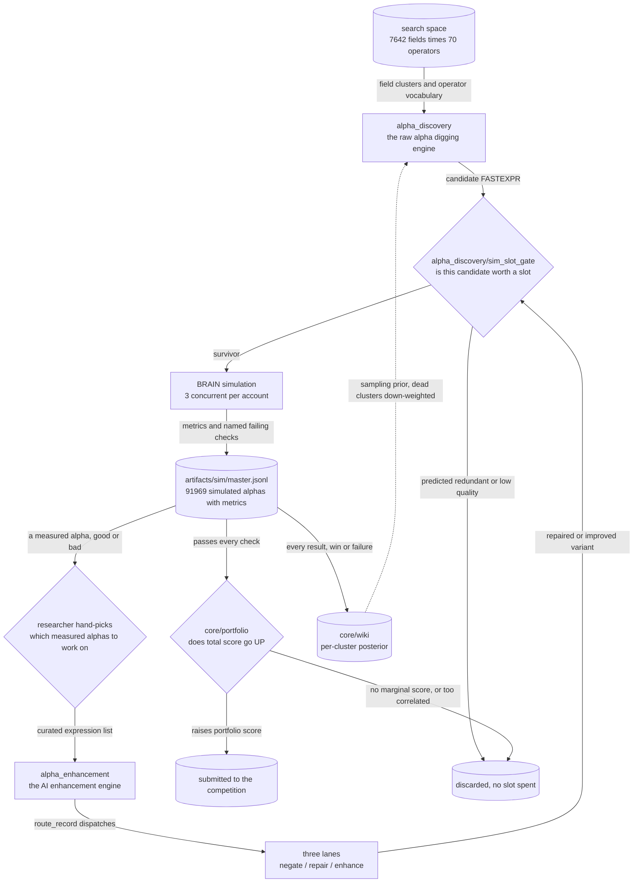

# Alpha Research Pipeline

A systematic search for cross-sectional equity alphas on the WorldQuant BRAIN platform.

## The competition

BRAIN runs a quant competition (this work targets `IQC2026S1`). You submit **formulaic
alphas** — single expressions in BRAIN's `FASTEXPR` language, for example:

```
group_rank(ts_mean(ts_zscore(returns, 20), 10), subindustry)
```

Each submission is backtested by the platform and earns points from two scores: an
**in-sample score** on the historical window you can see, and an **out-of-sample score** on
the window you cannot. Points accrue to your **portfolio**, not to the alpha. That last
detail drives everything downstream: an alpha that is excellent but merely repaints something
you already submitted adds nothing. What counts is the *marginal* score of adding it.

An alpha only becomes submittable if it passes **every** platform check, not just the headline
ones — in-sample Sharpe, fitness and turnover, but also concentrated weight, sub-universe
Sharpe, units, and self-correlation against your existing portfolio.

## The foundational problem: navigating a vast search space

The expression space is effectively unbounded:

| | |
|---|---|
| Data fields | **7,642** (`all_fields.csv`) — price/volume, fundamentals, analyst, news, sentiment, options, models |
| Operators | **70** (`core/expr/operators.py`) — time-series, cross-sectional, group, arithmetic, transformational |
| Composition | Arbitrary depth, so the reachable set grows super-exponentially |

And the thing that stops you is not imagination — it is **measurement cost**. A candidate
expression tells you nothing until it is simulated, there is no cheap partial-sim probe, and
the platform allows only **3 concurrent simulations per account**. Simulation is the scarce
resource, and every candidate you simulate is one you cannot spend elsewhere.

So the real question is never "what expression should I write?" It is:

> **Which candidate is worth a simulation slot?**

## The approach: two engines

The discovery process is split in two, which is also how this repository is organised.



**1. `alpha_discovery/` — the raw alpha digging engine.** Generates candidates and, crucially,
decides which ones to *refuse* to simulate. One subpackage per method, each with its own
README laying out how it frames the problem:

| Method | Frames the search as | README |
|---|---|---|
| `grammar_method/` | sample a context-free grammar over FASTEXPR under a depth budget | [README](alpha_discovery/grammar_method/README.md) |
| `probe_method/` | map where signal lives first, with one cheap probe per field cluster | [README](alpha_discovery/probe_method/README.md) |
| `theory_method/` | pre-register an economic mechanism, then enumerate a designed family | [README](alpha_discovery/theory_method/README.md) |
| `template_sweep_method/` | fix the functional forms, search only the bindings | [README](alpha_discovery/template_sweep_method/README.md) |
| `sim_slot_gate/` | **don't generate — predict.** Is this candidate worth a slot? | [README](alpha_discovery/sim_slot_gate/README.md) |
| `legacy/` | three retired methods, archived with their reasoning | [README](alpha_discovery/legacy/README.md) |

**2. `alpha_enhancement/` — the AI enhancement engine.** Takes an alpha that **already has a
measured backtest and a named failing check** and improves it with LLM agents, routing each
record to one of three lanes — **negate**, **repair**, **enhance**. Selection into this engine
is **hand-picked by the researcher**, not automatic.
See [`alpha_enhancement/README.md`](alpha_enhancement/README.md).

**Supporting layers.** [`core/`](core/README.md) is the shared platform — BRAIN API, the
FASTEXPR operator registry and expression models, the Q-table, self-correlation, the
submittable predicate, the portfolio score-add gate, the wiki posterior. `tools/` holds the
operational CLIs.

## What the search actually found

The headline result is negative, and it reproduced four times: **an LLM asked to generate
alphas loses to random grammar sampling.** It becomes useful only once it is handed a measured
backtest and a named failing check to repair. That finding is why the repository is shaped the
way it is — intelligence in *selection* and *repair*, not in generation.

| Approach | Where | Result | Submittable |
|---|---|---|---|
| LLM writes the expression itself | `alpha_discovery/legacy/economic_search_method/` | 1 of 1,611 completed sims passed every check | **0.06%** |
| LLM steers the grammar's distribution | `alpha_discovery/legacy/llm_grammar_control_method/` | 19 of 3,066 completed sims clean on every check | **0.62%** |
| Operator skeleton fixed first | `alpha_discovery/legacy/operator_skeleton_method/` | no promoted alpha ever reached the ledger | **0** |
| LLM pre-registers a mechanism card | `alpha_discovery/theory_method/` | 49 of 327 families validated, 88 queued, 12 raised score | **15% of families** |
| Random CFG + stacked prune datastores | `alpha_discovery/grammar_method/` | 281 of 16,188 completed sims clear every gate | **1.74%** |
| LLM repairs a *measured* alpha | `alpha_enhancement/` | 211 of 587 sims submittable | **36%** |

Two further results shaped the design:

- **Redundancy, not quality, is the binding constraint.** Of 72 candidates that were *all*
  already submittable, robust and locally de-correlated, only **12 raised the portfolio score**
  (16.7%). A separate batch of 50 was rejected 50/50 for high global correlation.
- **Novelty and signal are close to independent.** The retired economic-search lane certified
  every candidate as novel through a SQLite novelty index and still returned one passer in
  1,611 simulations. A novelty index cannot substitute for a quality predictor.

## The finding this project is built around

The sim-slot gate's champion/challenger harness falsified the mechanism it was built to
replace. The grammar lane's two-level Q-table pruner — the component that was supposed to be
learning — was measured on the real production artifact and found **inert**: 9 of 8,987
level-1 buckets and 19 of 22,640 level-2 buckets prune, 0.089%. It was saving ~0% of
simulation slots while appearing to work.

The replacement beats it decisively out-of-time (McNemar χ²=1816), but it **has not been cut
over**. Three cutover conditions were pre-declared *before* the results came in; two pass, and
the third — live shadow confirmation — remains underpowered. So the gate runs in
`mode: reliable`, where only the redundancy and turnover branches are authoritative and the
quality surrogate stays in shadow.

The same harness also caught an error in its own earlier result. An initial run reported a
0.91 quality-zone recall at β=2.0, but that came from a **random** train/test split — which
leaks across time in an append-only simulation log. On an honest time split, β=2.0 actually
holds only 0.76 quality-zone recall, so the operating point was moved to **β=2.5**, which after
feature pruning gives **46% of slots saved at 0.91 quality-zone recall**. The superseded figure
is kept in [`CALIBRATION_REPORT.md`](CALIBRATION_REPORT.md) beside the corrected one rather than
quietly replaced.

Note what the gate is actually saving *today*: in `mode: reliable` only the redundancy and
turnover hard-kills fire, and that floor is **5% of slots saved at 79% recall**. The 46% figure
is the shadow-mode projection for the configuration that has not been cut over.

## Repository layout

```
core/                  shared platform, depends on nothing above it
  brain/                 BRAIN REST API: auth, submit, poll, metric and PnL fetches
  expr/                  FASTEXPR vocabulary: operator registry, expression/field models
  qtable.py              the shared Q-table (written by several lanes)
  selfcorr.py            self-correlation, portfolio PnL, sim-record construction
  clusters.py            field-cluster catalog construction and caching
  quality.py             the submittable predicate and the quality ordering
  robustness.py          year-consistency score, the repo-wide selection criterion
  portfolio/             score-add admission gate         -> README
  wiki/                  per-cluster posterior, exported back as a prior -> README
  prompts/               every LLM prompt template, kept as data
alpha_discovery/       the raw alpha digging engine        -> README per method
alpha_enhancement/     the AI enhancement engine           -> README
  workshop/              lane routing, repair orchestration, robustness cards
  agents/                the LLM agents
  semantic_templates/    typed reuse of promoted families
tools/                 operational CLIs over all three layers
  harnesses/             manual diagnostics (not pytest-collectable)
samples/               truncated real output from each lane, as evidence of a run
docs/lanes/            earlier per-lane write-ups
```

The layering is enforced and verified: `core` imports nothing from `alpha_discovery` or
`alpha_enhancement`, and `alpha_enhancement -> alpha_discovery` edges are **zero**. One
deliberate exception is annotated in place — `core/brain/submit.py`'s opt-in `--auto-workshop`
CLI path lazily imports the workshop.

## Documents worth reading first

| Doc | What it is |
|---|---|
| [`CALIBRATION_REPORT.md`](CALIBRATION_REPORT.md) | The gate's validation: time-split frontier, champion/challenger, the inert-Q-table finding, the three cutover conditions, and the retracted figure |
| [`ASSUMPTIONS.md`](ASSUMPTIONS.md) | 29 falsifiable assumptions with resolved statuses — 12 PASS, 11 PARTIAL, 6 FAIL, 1 UNTESTED — plus dated amendments where a result overturned an earlier belief |
| [`dedup.md`](dedup.md) | Measures the failure mode before proposing a fix: 90.5% of simulation budget went into regions history had already proved dead |
| [`PIPELINE.md`](PIPELINE.md) | Stage-by-stage map of the code space |
| [`alpha_discovery/sim_slot_gate/metric.md`](alpha_discovery/sim_slot_gate/metric.md) | Design doc for the two gate objects |

## Running it

See [`SETUP.md`](SETUP.md): `pip install -r requirements.txt`, then supply credentials by
copying the `.example` files at the repository root.

Every discovery lane submits to a metered external API, so an end-to-end run needs live
credentials and a simulation budget. What is inspectable **offline**:

```bash
# the gate's unit tests — no account, no network
python -m alpha_discovery.sim_slot_gate.tests.test_parse       # 13/13
python -m alpha_discovery.sim_slot_gate.tests.test_channels    #   9/9
python -m alpha_discovery.sim_slot_gate.tests.test_corr_model  # 11/11
python -m alpha_discovery.sim_slot_gate.tests.test_surrogate   # acceptance checks
```

Also offline: grammar derivation and its prune datastores (pure functions over
`all_fields.csv`), the gate's calibrated parameters in
`alpha_discovery/sim_slot_gate/metric_params.json`, the PnL-only scoring path in
`core/portfolio/local_admission.py`, and the truncated run output in `samples/`.

## Known rough edges

Stated here rather than left to be discovered:

- `alpha_discovery/grammar_method/run_pipeline.py` is still ~1,190 lines and mixes argparse,
  BRAIN submission and record construction. Its platform-level helpers were lifted into
  `core/selfcorr.py` and `core/clusters.py` to break a dependency cycle, but the module itself
  wants splitting further.
- The quality surrogate is **not** cut over; only two of the gate's four branches are
  authoritative. Condition 3 is unmet, not ignored.
- `alpha_enhancement/semantic_templates/` is wired and default-on but has produced no
  surviving output. Built, not yet evidenced.
- Promotion into the competition pool requires interactive biometric auth on the submission
  account, so that stage cannot run headless.
- `core/brain/api.py` assumes WSL with a Windows browser on the host.
- `alpha_discovery/legacy/` is archived and not imported by active code. Two archived one-off
  scripts had import-time side effects and are now guarded inert.
