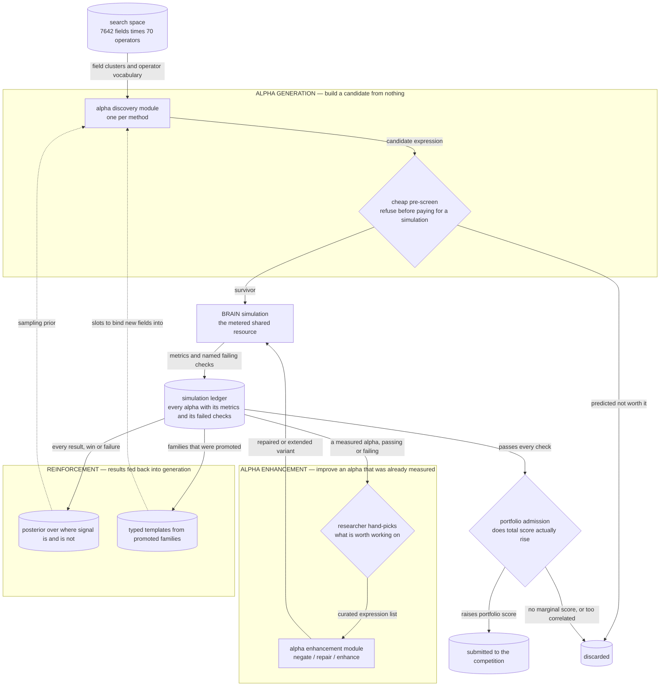

# Alpha Research Pipeline

A systematic search for cross-sectional equity alphas on the WorldQuant BRAIN platform.

## The competition

You submit **formulaic alphas** — single expressions in BRAIN's `FASTEXPR` language:

```
group_rank(ts_mean(ts_zscore(returns, 20), 10), subindustry)
```

The platform backtests each one and awards points from an **in-sample score** and an
**out-of-sample score**. Points accrue to your **portfolio**, not to the individual alpha, so a
good alpha that merely repaints something you already submitted is worth nothing. What counts
is the *marginal* contribution of adding it.

The search space is effectively unbounded — **7,642 data fields** × **70 operators**
(`core/expr/operators.py`), composable to arbitrary depth. And the thing that limits you is not
imagination but **measurement cost**: an expression tells you nothing until it is simulated,
there is no cheap partial-sim probe, and the platform allows only **3 concurrent simulations
per account**.

## The baseline: random grammar search

Everything here starts from one published idea.

> **Alpha Discovery via Grammar-Guided Learning and Search** — Han Yang, Dong Hao, Zhuohan
> Wang, Qi Shi, Xingtong Li. The *AlphaCFG* framework.
> (The paper itself is not redistributed in this repository.)

Its first move is the one worth stealing: stop treating an alpha as a *string* to be mutated
and treat it as a **derivation tree from a context-free grammar**. The grammar is written so
that every tree it can produce is a syntactically valid and financially interpretable
expression, which removes the entire class of wasted work spent generating and then rejecting
malformed candidates.

The second move bounds the space. The paper's `α-Sem-k` variant assigns each production rule a
cost `Δk` and caps the total at a maximum length `K`, enforcing the bound *during* derivation
so every expansion step stays inside the feasible region. The grammar in
`alpha_discovery/grammar_method/grammar.py` implements this directly, with `Δk` costs taken
from the paper's rule table and `K=10`.

**So the baseline is: sample that bounded grammar uniformly at random, simulate the draws, keep
what passes.** That is the reference point every other method in this repository is measured
against, and it is a far stronger baseline than it sounds — a valid-by-construction sampler over
a size-controlled space is already much better than unstructured search.

### Where this project deliberately departs from the paper

AlphaCFG's own contribution *on top of* the grammar is a learned search policy: it casts
discovery as a tree-structured Markov decision process and solves it with grammar-aware Monte
Carlo Tree Search, encoding partial trees with a Tree-LSTM that feeds shared value and policy
networks.

That is the right design when rollouts are cheap. Here they are not. A "rollout" is a metered
BRAIN simulation — minutes long, 3 at a time, and rate-limited — so the thousands of rollouts
MCTS needs to become useful are simply unaffordable. The learned policy would spend the entire
budget learning to search instead of searching.

So this project keeps the grammar and the size budget and **replaces the learned search policy
with cheap persistent pruning**: a Q-table over field–operator combinations, a structural
fingerprint registry, and a cross-run posterior, all of which only ever *remove* candidates and
all of which persist to disk so the next session starts from accumulated evidence. The paper's
UCB-guided search side was attempted and archived —
`alpha_discovery/legacy/archived_shims/alpha_grammar/ucb_legacy.py` — because a bandit cannot
work when pulling an arm costs the scarce resource you are trying to conserve.

## Two halves

Everything splits cleanly in two, and so does the repository.



The dividing line is **whether the alpha already has a backtest**. Generation works from the
field catalog and produces candidates nobody has measured. Enhancement only ever works on a
record that has been simulated, so it always has metrics and a named failure to aim at. The two
halves share one simulation bus and one ledger.

Note the one manual step: **selection from the ledger into enhancement is hand-picked.** The
researcher reads the ledger and decides what deserves budget; nothing promotes itself.

## The discovery designs

Each attacks the same space under a different assumption. Specifics, code and results are in
each method's own README.

| Method | The design |
|---|---|
| [**grammar_method**](alpha_discovery/grammar_method/README.md) | The baseline above: sample the bounded CFG, canonicalize commutative operands so equivalent trees collapse, and stack persistent prune datastores in front of the simulator. The productive generator. |
| [**probe_method**](alpha_discovery/probe_method/README.md) | Don't mine blind. Spend one cheap simulation per *field cluster* on a fixed operator pack, so cost scales with clusters rather than fields × operators, and use the result as a prior over where to sample. |
| [**theory_method**](alpha_discovery/theory_method/README.md) | Have an LLM pre-register a falsifiable economic mechanism as a structured card, then let a *deterministic* enumerator render the expression family from it. The LLM never writes FASTEXPR; verdicts are issued per family, not per alpha. |
| [**template_sweep_method**](alpha_discovery/template_sweep_method/README.md) | The inverse bet: assume the useful functional forms are already known and search only the field and window bindings. Small enough to sweep exhaustively. |
| [**sim_slot_gate**](alpha_discovery/sim_slot_gate/README.md) | The pre-screen itself — predict from an expression's structure whether it is redundant or likely weak, and decline to simulate it. |
| [**legacy/**](alpha_discovery/legacy/README.md) | Three retired designs: LLM writes the expression; LLM steers the grammar's distribution; operator skeleton fixed first. Archived with the reasoning that killed each. |

## The enhancement engine

[`alpha_enhancement/`](alpha_enhancement/README.md) exists because of a negative result that
reproduced three times: an LLM asked to *generate* alphas loses to random grammar sampling.
The diagnosis was that the model was being asked to predict profitability from expression text
alone, with no feedback.

Change that one condition — hand it an alpha with a measured backtest and a **specific named
failing check** — and it becomes a constrained repair task with a stated objective, which is
something an LLM is good at. `route_record()` dispatches each hand-picked record to one of
three lanes:

- **negate** — right structure, wrong sign. Flip and re-simulate; no LLM needed.
- **repair** — fix a named failing check. Either *settings repair* (change neutralization,
  decay, truncation; expression untouched) or *semantic repair* (LLM rewrite, with the failing
  check and metrics in the prompt, under a hard round cap).
- **enhance** — the alpha already passes; make it stronger without making it fragile.

## Reinforcement, on the side

Two components are neither generators nor repairers. They turn accumulated results back into
better generation, which is why they sit to the side of the main flow:

- [`core/wiki/`](core/wiki/README.md) aggregates every simulation — win *or* failure — into a
  per-cluster posterior, exported back as the grammar lane's sampling prior. A region
  repeatedly proven dead gets down-weighted in future derivation, so the search compounds
  instead of re-paying for the same dead ends.
- [`alpha_enhancement/semantic_templates/`](alpha_enhancement/README.md) abstracts families
  that were *already promoted* into typed-slot templates and binds new fields into them —
  exploiting what worked, rather than repairing what failed.

## Repository layout

```
core/                  shared platform, depends on nothing above it
  brain/                 BRAIN REST API: auth, submit, poll, metric and PnL fetches
  expr/                  FASTEXPR vocabulary: operator registry, expression/field models
  qtable.py              the shared Q-table
  selfcorr.py            self-correlation, portfolio PnL, sim-record construction
  quality.py             the submittable predicate and the quality ordering
  portfolio/             score-add admission gate         -> README
  wiki/                  per-cluster posterior            -> README
  prompts/               every LLM prompt template, kept as data
alpha_discovery/       alpha generation, one subpackage per method   -> README per method
alpha_enhancement/     the AI enhancement engine                    -> README
tools/                 operational CLIs over all three layers
samples/               truncated real output from each lane
```

Layering is enforced and verified: `core` imports nothing from either pillar, and
`alpha_enhancement → alpha_discovery` edges are **zero**. One deliberate exception is annotated
in place — `core/brain/submit.py`'s opt-in `--auto-workshop` CLI path lazily imports the
workshop.

## Running it

See [`SETUP.md`](SETUP.md). Credentials are read from plaintext files at the repository root;
copy the `.example` files and fill them in. An end-to-end run needs a live account and
simulation budget, but the grammar derivation, the gate's calibrated parameters, the PnL-only
scoring path and the unit tests all run offline.

## Reference docs

| Doc | What it is |
|---|---|
| [`CALIBRATION_REPORT.md`](CALIBRATION_REPORT.md) | Validation of the pre-screen, including a result it retracted after finding temporal leakage in its own backtest |
| [`ASSUMPTIONS.md`](ASSUMPTIONS.md) | 29 falsifiable assumptions with resolved statuses, plus dated amendments where a result overturned an earlier belief |
| [`dedup.md`](dedup.md) | Measures the failure mode before proposing a fix: most simulation budget was going into regions already proved dead |
| [`PIPELINE.md`](PIPELINE.md) | Stage-by-stage map of the code space |

## What the search found

Read in order, the discovery designs tell one story, and it is worth stating plainly because it
is the reason the repository is shaped the way it is.

Three successive attempts to put an LLM in the **generator** seat all lost to random sampling
from the bounded grammar — first writing expressions directly, then steering the grammar's
distribution instead, then constraining operator skeletons by economic role. Each failure ruled
out the previous explanation, and what survived was not "the model was too weak" but something
structural: **an LLM given no feedback cannot tell which expressions will make money**, and no
amount of scaffolding around the generation step changes that.

Two things did work. Giving the model **feedback** — a measured backtest and a named failing
check — turns generation into repair, and the enhancement engine's success rate on hand-picked
input is an order of magnitude above any generation lane. And spending effort on **what not to
simulate** paid off, because the binding constraint turned out to be redundancy rather than
quality: of a batch of candidates that were *all* already submittable, robust and locally
de-correlated, only about one in six actually raised the portfolio score.

Hence the final shape — a strong random baseline, cheap pruning in front of it, results fed
back as a prior, and the AI applied to repair rather than invention. Per-method numbers are at
the end of each method README.
