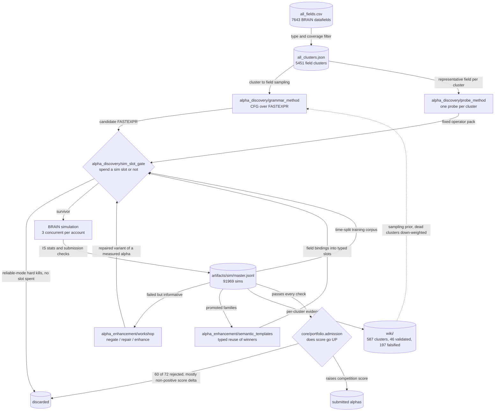

# Alpha Research Pipeline

A systematic search for cross-sectional equity alphas on the WorldQuant BRAIN platform.
Eleven discovery lanes were built, measured against live simulations, and kept or killed on
the evidence. Every one is documented below, including the four that failed.

## The constraint that shapes everything

Three concurrent simulations per account. No cheap partial-sim probe exists — a candidate
either gets a full backtest or no information at all. Every design decision here follows from
one question: **which candidate is worth a slot?**

## What the search actually found

The headline result is negative, and it reproduced four times: **an LLM asked to generate
alphas loses to random grammar sampling.** It only becomes useful once it is handed a measured
backtest and a named failing check to repair.

| Approach | Lane | Result | Submittable |
|---|---|---|---|
| LLM writes the expression itself | `legacy/alpha_discovery/legacy.economic_search_method` | 1 of 1611 completed sims passed every check | **0.06%** |
| LLM steers the grammar's distribution | `legacy/alpha_discovery/legacy.llm_grammar_control_method` | 19 of 3066 completed sims clean on every check | **0.62%** |
| Operator skeleton fixed first | `legacy/alpha_discovery/legacy.operator_skeleton_method` | no promoted alpha ever reached the ledger | **0** |
| LLM pre-registers a mechanism card | `alpha_discovery/theory_method` | 49 of 327 families validated and 88 queued; 12 survived the portfolio gate | **15% of families** |
| Random CFG + stacked prune datastores | `alpha_discovery/grammar_method` | 281 of 16188 completed sims clear every gate | **1.74%** |
| LLM repairs a *measured* alpha | `alpha_enhancement/workshop` | 211 of 587 sims submittable in the 2026-06-17/19 slice | **36%** |

Novelty and signal turned out to be close to independent. The retired economic-search lane
certified every candidate as novel through a SQLite novelty index and still returned one passer
in 1611 simulations. That is why the intelligence in this system sits in **selection**, not
generation — and why the gate, not the generator, is the centrepiece.

## Architecture



## The lanes

### Selection

The gate that decides whether a candidate is worth a simulation slot.

| Lane | What it does | Result |
|---|---|---|
| [Sim-slot gate: predict before spending a backtest](docs/lanes/sim-slot-gate.md) | Sim-free pre-screen that decides simulate-or-skip per candidate, validated out-of-time against the incumbent pruner before any cutover. | 45% of slots saved at 85% in-zone recall on the honest time split; not cut over |

### Generation

The lanes that produce candidates.

| Lane | What it does | Result |
|---|---|---|
| [Grammar Search: CFG-Generated FASTEXPR Discovery](docs/lanes/grammar-search.md) | A context-free grammar over FASTEXPR with a Δk depth budget, semantic constraints enforced at derivation time, and three stacked prune datastores guarding every simulation slot. | 281 of 16188 sims clear every gate (1.74%) — the best generator |
| [Probe -> Seed -> A-Derived Enhance](docs/lanes/probe-seed-enhance.md) | One fixed operator pack per field cluster - map where signal lives before spending grammar or LLM mining budget. | 332 cluster priors, consumed by the grammar sampler |
| [Workshop: Negate, Repair, Enhance a Measured Alpha](docs/lanes/workshop-negate-repair-enhance.md) | The LLM never invents from scratch here. It repairs an alpha that already has a measured backtest and a named failing check. | 211 of 587 sims submittable (36%) — the lane that works |
| [Semantic Templates - typed reuse of promoted alphas](docs/lanes/semantic-templates.md) | Abstract alphas that already passed into typed-slot templates, then let an architect/selector/router trio bind new fields into the slots. | wired and default-on, but no surviving output |

### Promotion and compounding

What happens to an alpha that passes, and how the result feeds back.

| Lane | What it does | Result |
|---|---|---|
| [Portfolio Admission: Does Adding This Alpha Add Score?](docs/lanes/portfolio-admission-score-add-gate.md) | Passing a simulation is not the bar. The bar is whether the competition score goes UP once this alpha joins what is already submitted. | only 12 of 72 already-submittable alphas raised the score |
| [Wiki Posterior and the Compounding Grammar Prior](docs/lanes/wiki-posterior-compounding-prior.md) | Every simulation, win or failure, folds into a per-cluster posterior that is exported back as the grammar lane's sampling prior. | 197 falsified vs 46 validated mechanisms; exports the grammar prior |

### Retired

Built out properly, measured, killed. Archived with the reasoning.

| Lane | What it does | Result |
|---|---|---|
| [Theory-First Lane: Pre-Registered Mechanism Cards](docs/lanes/theory-first-discovery.md) | An LLM pre-registers a mechanism card, a deterministic enumerator renders the designed family, a Beta posterior issues the verdict. Rigorous — and it lost. | 49 of 327 families validated; 12 of 88 survived the portfolio gate |
| [Theory-First Economic Search (retired)](docs/lanes/theory-first-economic-search.md) | LLM proposes a falsifiable economic mechanism and writes the FASTEXPR itself; a SQLite novelty index rations sim slots. 2531 sims, 1 passer. | 2531 sims, 1 passer (0.06%) |
| [LLM-as-Grammar-Controller (retired)](docs/lanes/llm-as-grammar-controller.md) | The LLM never writes an expression - it emits a GrammarConfig patch, so the grammar guarantees validity and the LLM only steers the search distribution. | 19 of 3066 sims clean (0.62%) |
| [Operator-First Template Search and Its Tombstones](docs/lanes/operator-first-template-search.md) | Fix the operator skeleton first and search fields into it - the inverse of grammar search - plus three deliberately disabled successors. | no promoted alpha ever reached the ledger |

## The finding this project is built around

The gate's champion/challenger harness falsified the mechanism it was built to replace. The
grammar lane's two-level Q-table pruner — the component that was supposed to be learning — was
measured on the real production artifact and found **inert**: 9 of 8,987 level-1 buckets and
19 of 22,640 level-2 buckets prune — 0.089%. It was saving ~0% of simulation slots while
appearing to work.

The replacement beats it decisively out-of-time (McNemar χ²=1816), but it **has not been cut
over**. Three cutover conditions were pre-declared before the results came in; two pass, and
the third — live shadow confirmation — remains underpowered at 1 of ~197 needed in-zone
observations. So the gate runs in `mode: reliable`, where only the redundancy and turnover
branches are authoritative and the quality surrogate stays in shadow.

The same harness also caught an error in its own earlier result. An initial “71% of slots
saved at 91% recall” came from a random train/test split, which leaks across time in an
append-only simulation log. Re-run on an honest time split it fell to **45% saved at 85%
recall**, and the kill threshold was raised from β=2.0 to β=2.5 in response. The retracted
figure is kept in [`CALIBRATION_REPORT.md`](CALIBRATION_REPORT.md) alongside the corrected
one rather than quietly replaced.

Full write-up in [`CALIBRATION_REPORT.md`](CALIBRATION_REPORT.md).

## Repository layout

```
alpha_discovery/sim_slot_gate/      sim-slot gate: redundancy + quantile surrogate, calibration, cutover
alpha_discovery/grammar_method/     CFG generator over FASTEXPR, Q-table pruner, structural dedup
alpha_discovery/probe_method/       one cheap probe per field cluster -> sampling priors
wq_alpha/          shared library
  brain/             BRAIN REST API: auth, submit, poll, paged metric and PnL fetches
  workshop/          negate / repair / enhance routing over measured alphas
  theory/            pre-registered mechanism cards -> designed expression families
  semantic_templates/  typed reuse of promoted alpha families
  portfolio/         score-add admission gate and self-correlation
  wiki/              per-cluster posterior, exported back as a grammar prior
  prompts/           every LLM prompt template, kept as data
tools/             operational CLIs over the above
  harnesses/         manual diagnostic scripts (not pytest-collectable)
legacy/            four retired lanes, archived with their reasoning
docs/lanes/        one pipeline graph per lane
samples/           truncated real output from each lane, as evidence of a run
```

## Documents worth reading first

| Doc | What it is |
|---|---|
| [`CALIBRATION_REPORT.md`](CALIBRATION_REPORT.md) | The gate's validation: time-split frontier, champion/challenger, the inert-Q-table finding, the three cutover conditions |
| [`ASSUMPTIONS.md`](ASSUMPTIONS.md) | 29 falsifiable assumptions with resolved statuses — 12 PASS, 11 PARTIAL, 6 FAIL, 1 UNTESTED — plus dated amendments where a result overturned an earlier belief |
| [`dedup.md`](dedup.md) | Measures the failure mode before proposing a fix: 90% of simulations landed in regions already known to be dead |
| [`PIPELINE.md`](PIPELINE.md) | Stage-by-stage map of the code space |
| [`alpha_discovery/sim_slot_gate/metric.md`](alpha_discovery/sim_slot_gate/metric.md) | Design doc for the two gate objects |

## Running it

See [`SETUP.md`](SETUP.md): `pip install -r requirements.txt`, then supply credentials by
copying the `.example` files at the repo root.

Every discovery lane submits to a metered external API, so an end-to-end run needs live
credentials and a simulation budget. Inspectable offline: the grammar derivation and its prune
datastores (pure functions over `all_fields.csv`), the gate's calibrated parameters in
`alpha_discovery/sim_slot_gate/metric_params.json`, the PnL-only local scoring path in
`core/portfolio/admission.py`, the unit tests in `alpha_discovery/sim_slot_gate/tests/` (33 assertions, all passing), and the truncated
run output in `samples/`.

## Known rough edges

Stated here rather than left to be discovered:

- `alpha_discovery/grammar_method/run_pipeline.py` is a 1489-line module mixing argparse, BRAIN submission,
  self-correlation math and record construction. Other packages import BRAIN helpers out of
  it, inverting the dependency direction this repo's own docs specify.
- The quality surrogate is **not** cut over; only two of the gate's four branches are
  authoritative. Condition 3 is unmet, not ignored.
- `alpha_enhancement/semantic_templates/` is wired and default-on but has produced no surviving output.
  Built, not yet evidenced.
- BRAIN's submission account requires interactive biometric auth, so promotion and the
  official score-add stage cannot run headless.
- `core/brain/api.py` assumes WSL with a Windows browser on the host.

