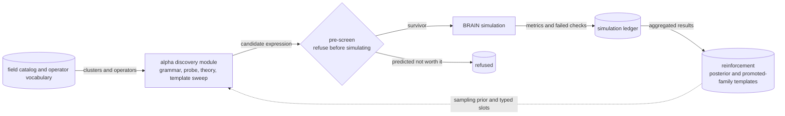

# `alpha_discovery/` — alpha generation

The generation half of the pipeline: build candidate expressions from the field catalog and
decide which ones are worth simulating. The other half,
[`../alpha_enhancement/`](../alpha_enhancement/README.md), never generates — it only improves
alphas that already have a backtest. See the [root README](../README.md) for the competition
format and the overall problem.

## The baseline everything is measured against

`grammar_method/` is the reference implementation, built on the *AlphaCFG* idea of Yang, Hao,
Wang, Shi and Li (*Alpha Discovery via Grammar-Guided Learning and Search*): treat an alpha as
a derivation tree from a context-free grammar that can only produce valid expressions, and
bound the space with a per-rule `Δk` cost against a maximum length `K`.

Sampled **uniformly at random**, that bounded grammar is the baseline. It is a strong one —
valid-by-construction sampling over a size-controlled space beats unstructured search outright
— and every other method here has to earn its keep against it. Mostly they have not.

The paper's own next step, a learned MCTS policy over the grammar, is deliberately **not**
implemented: a rollout here is a metered simulation, so the project substitutes cheap persistent
pruning for learned search. Details and the archived bandit attempt are in
[`grammar_method/README.md`](grammar_method/README.md).

## The designs

| Method | The assumption it makes |
|---|---|
| [`grammar_method/`](grammar_method/README.md) | The useful expression *shapes* are unknown — derive them from the grammar and spend the effort on refusing bad draws. **The baseline, and the productive generator.** |
| [`probe_method/`](probe_method/README.md) | Signal is cluster-structured. Spend one cheap simulation per field cluster on a fixed operator pack and use the result as a prior over where to sample. |
| [`theory_method/`](theory_method/README.md) | A pre-registered economic mechanism can point at the right subspace — provided a deterministic enumerator, not the LLM, renders the expressions. |
| [`template_sweep_method/`](template_sweep_method/README.md) | The inverse bet: the useful forms are already known, so search only the bindings. |
| [`sim_slot_gate/`](sim_slot_gate/README.md) | A pre-screen. Predict from structure whether a candidate is redundant or likely weak, and decline to simulate it. |
| [`legacy/`](legacy/README.md) | Three retired designs, archived with the reasoning that killed each. |

## How they compose

The structural claim is **several generators behind one screen**. Adding a generator is cheap,
and individually none of them matters very much; what matters is that the simulation budget all
flows through one place where it can be conserved, and that results come back as a prior rather
than being thrown away.

## Shared machinery

These methods deliberately do not own what they have in common. The FASTEXPR operator registry,
the expression and field models, the Q-table, self-correlation, the cluster catalog and the
submittable predicate all live in [`../core/`](../core/README.md), so no method imports from
another. That layering is verified: `alpha_enhancement → alpha_discovery` import edges are zero,
and `core` imports nothing from either pillar.
