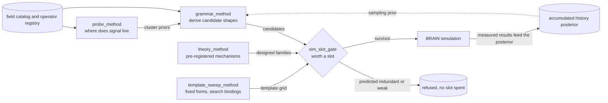

# `alpha_discovery/` — the raw alpha digging engine

The first of the project's two pillars. Its job is to produce candidate alphas **and**, more
importantly, to decide which candidates to refuse to simulate — because simulation, not
imagination, is the scarce resource. See the [root README](../README.md) for the competition
format and the overall problem statement.

Every method here is one answer to the same question: *how do you navigate 7,642 fields × 70
operators without wasting a hard-capped simulation budget?* They differ in what they assume.

| Method | Core assumption | Status |
|---|---|---|
| [`grammar_method/`](grammar_method/README.md) | The useful expression *shapes* are unknown, so derive them from a grammar under a depth budget and spend the effort on refusing bad draws. | **Active** — the productive generator |
| [`sim_slot_gate/`](sim_slot_gate/README.md) | Don't generate better — *predict*. Given a candidate, is it worth a slot at all? | **Active** — partially live, not cut over |
| [`probe_method/`](probe_method/README.md) | Signal is cluster-structured, so map where it lives with one cheap probe per cluster before mining deeply. | Active; its prior is now back-filled from accumulated history |
| [`theory_method/`](theory_method/README.md) | An economic mechanism, pre-registered and then enumerated deterministically, can point at the right subspace. | Built and measured; lost to grammar search |
| [`template_sweep_method/`](template_sweep_method/README.md) | The useful shapes are already known; only the field and window bindings need searching. | Retained narrowly, for its pre-declared regime-check device |
| [`legacy/`](legacy/README.md) | Three retired methods, archived with their reasoning. | Archived, not imported |

## How they fit together

The arrangement is the project's main structural claim: **four generators, one gate.** Adding a
generator is cheap and none of them individually matters very much. The gate is what the
simulation budget actually flows through, which is why it gets the most engineering attention
despite producing no alphas itself.

## Shared machinery

These methods deliberately do **not** own the things they have in common. The FASTEXPR operator
registry, the expression and field models, the Q-table, self-correlation, the cluster catalog and
the submittable predicate all live in [`../core/`](../core/README.md), so that no method has to
import from another. That layering is verified: `alpha_enhancement → alpha_discovery` import
edges are zero, and `core` imports nothing from either pillar.
