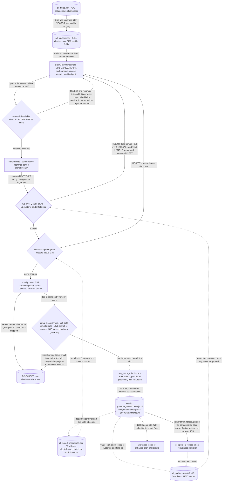

# Grammar Method — sample a context-free grammar over FASTEXPR

## The problem

The space of FASTEXPR expressions is unbounded under composition: 7,642 fields, 70 operators,
and no limit on nesting depth. Enumerating it is hopeless and hand-writing expressions explores
a vanishing fraction of it.

This method's bet is that alpha discovery is a **search** problem, not an **authoring** problem.
Instead of guessing good expressions, define a **context-free grammar** whose productions each
cost `Δk` against a total budget `K`. That does three useful things at once: it bounds depth, it
makes the reachable set explicit rather than implicit in someone's taste, and it turns the task
from "invent an alpha" into "sample the grammar cheaply, then refuse to simulate the bad draws".

Since the binding constraint is the simulation slot and not candidate supply, the generator is
deliberately over-productive and the engineering effort goes into the **refusal** stack that
sits between it and the simulator.

## How it discovers alpha

A derivation walks the grammar, debiting `Δk` per production until the budget is spent. Two
properties matter more than the sampler itself:

**Semantic constraints are enforced at derivation time, not post-filtered.** A division whose
right-hand side is not a size proxy, a paired operator given two identical fields, or an
exhausted inner-normalizer depth are rejected *while the tree is being built*, so the sampler
never wastes draws producing expressions it would only discard later.

**Commutative operands are canonicalized.** Sorting the arguments of commutative operators
means `add(a, b)` and `add(b, a)` collapse to one expression, which roughly halves the paired
operator space and makes structural dedup meaningful.

Downstream of that sit three persistent prune datastores — the Q-table, a tested-fingerprint
registry, and skeleton counts — plus a novelty oversample-and-trim, and finally the sim-slot
gate. Each one only ever *removes* candidates, and each writes its evidence to disk so the next
round starts from the accumulated history rather than from scratch.



## The code

| File | LOC | What it does |
|---|---|---|
| `alpha_discovery/grammar_method/grammar.py` | 1240 | Context-free grammar for syntactically and semantically valid Brain alpha expressions |
| `alpha_discovery/grammar_method/run_pipeline.py` **(CLI)** | 1193 | Unified alpha_discovery/grammar_method pipeline runner |
| `alpha_discovery/grammar_method/planner.py` | 335 | GrammarPlanner: generates alpha candidate batches via grammar sampling |
| `alpha_discovery/grammar_method/probe_prior.py` | 309 | Probe-prior grammar sampling helpers |
| `alpha_discovery/grammar_method/novelty.py` | 213 | Cluster-scoped structural novelty for generated grammar expressions |
| `alpha_discovery/grammar_method/__init__.py` | 38 | alpha_discovery/grammar_method — Grammar-guided alpha discovery with Q-table pruning |
| `alpha_discovery/grammar_method/diversity.py` | 38 | Expression tree fingerprint utilities |

The grammar's vocabulary and its Q-table live in the shared layer, because other lanes read them: `core/expr/operators.py` (the 70-operator registry), `core/expr/models.py`, `core/fields.py`, `core/qtable.py`, `core/feedback.py`.

## Running it

```bash
# All five of --rounds --budget --n-samples --batch-size --max-candidates are required=True.
python -m alpha_discovery.grammar_method.run_pipeline \
    --fields-csv all_fields.csv \
    --credentials brain2.txt \
    --rounds 0 --budget 6 --n-samples 300 --batch-size 3 --max-candidates 300 \
    --delay 1 --exclude-dataset analyst4 \
    --gate-mode reliable
```

`--fields-csv` is optional but is what enables multi-dataset mode; without it the pipeline
fetches clusters from the BRAIN API for a single `--dataset-id`. `--rounds 0` means run until
interrupted. Inspect the full flag set with `--help`.

## Results

Measured on artifacts/sim/master.jsonl (2026-06): 18,506 grammar-lane records of 91,969 total, 16,188 completed, 482 at IS Sharpe >= 1.25 (3.0%), and 281 passing every submission gate including concentrated-weight and sub-universe (1.7% hit rate). That is the repo's best generator — the separate decompose-expand variant scored 0/100 submittable (memory note llm-generator-underperforms), which is why PIPELINE.md keeps grammar running as the background evidence collector. Two honest negatives sit inside the lane. (1) dedup.md's measurement over 84,717 records: only 7.9% of (skeleton, field-set) cells ever recur, 92.3% of cells top out below Sharpe 1.25, and 90.5% of sim budget is spent in cells history already proved dead — so identity dedup was solving the wrong problem. (2) The lane's own Q-table pruner is effectively inert: I verified 9 of 8987 L1 and 19 of 22640 L2 entries pruned (<0.15%), matching CALIBRATION_REPORT.md line 112 and ASSUMPTIONS.md G3, where the alpha_discovery/sim_slot_gate surrogate challenger dominates it (46% slots saved at 0.91 quality-zone recall, McNemar chi2 = 1816). The real pre-sim cull today is the 3x novelty oversample-and-trim plus that gate, not the Q-table.

