# Economic Search Method (retired) — let the LLM write the alpha

## The problem

The most direct possible attack on the search space, and the first one tried.

If the space is too vast to enumerate, use a model that has read the finance literature. Ask an
LLM to propose a falsifiable economic mechanism *and* to write the FASTEXPR expression that
captures it. Then, because simulation is the scarce resource, ration slots with a novelty index
so you never pay twice to learn the same thing.

The reasoning was sound and the implementation was thorough — this is the largest of the retired
lanes. It was also decisively wrong, and understanding why shaped everything built afterwards.

## How it discovers alpha

A full CLI pipeline: index the existing history, load the portfolio, select fields, propose
mechanisms, critique them, generate expressions, sprint through simulations, ingest results.

Three pieces are worth attention as engineering, independent of the outcome:

`history_index.py` builds a read-only SQLite index over everything previously simulated, so a
proposed candidate can be checked for novelty without re-reading the full ledger.

`expression_validation.py` applies deterministic validation plus diversity gates to
**LLM-written** expressions. Note the contrast with the successor lane
[`../../theory_method/`](../../theory_method/README.md), where the LLM is not allowed to write
expressions at all — that change was the direct response to this lane's failure.

`semantic_gate.py` invokes an expensive LLM critic **only** on candidates that overlap something
known, scoring the cheap cases without a model call. A nice cost-control pattern worth keeping
in mind even though the lane around it did not work.

```mermaid
flowchart TD
    LOGS[("Brain sim history<br/>master.jsonl + workshop_sim + llm_sim + ranked")]
    IDX["history_index.py<br/>read-only scanner"]
    SQL[("history_index.sqlite 22MB<br/>23891 records - 1542 standalone passers")]
    CTX["portfolio_context.py + field_catalogs.py<br/>submitted alphas + delay-aware field catalog"]
    PROP["TheoryProposerAgent<br/>claude-opus-4-7 max_tokens 12000"]
    CRIT{"NoveltyCriticAgent + deterministic jaccard critic"}
    STORE[("artifacts/theories<br/>217 theory dirs + memory_delay.md")]
    GEN["LLMExpressionGenerator<br/>the LLM WRITES the FASTEXPR"]
    VAL{"ExpressionValidator<br/>banned ops - dup vs history - skeleton quota"}
    SEM["semantic_gate.py<br/>top-12 kNN from SQLite then ONE batched LLM scorecard call per theory"]
    ROUTE{"deterministic routing on similarity 0-100"}
    PLAN[("candidate_plans<br/>38 plan jsonl files")]
    SIM["brain_submit.py<br/>2531 Brain simulations"]
    CHK{"Brain checks<br/>sharpe 1.25 - fitness 1.0 - turnover - sub-universe - weight"}
    ADJ{"DeterministicResultInterpreter<br/>best sharpe under 0.8 means KILL"}
    DEAD[("dead ends<br/>76 KILLED branches - 18 quarantined - 0 PROMOTED")]

    LOGS -->|"raw sim rows from 4 lanes"| IDX
    IDX -->|"fields - skeletons - failed checks per row"| SQL
    SQL -->|"history_summary + hot fingerprints"| PROP
    CTX -->|"owned operators and datasets to avoid"| PROP
    PROP -->|"217 hypothesis cards - mechanism - expected sign - kill criteria"| CRIT
    CRIT -->|"REJECT 36 and REVISE 39 - re-propose"| PROP
    CRIT -->|"ACCEPTED 132"| STORE
    STORE -->|"theory card + prior results + branch decision"| GEN
    GEN -->|"up to 60 raw FASTEXPR strings per theory"| VAL
    VAL -->|"53 of 2994 rejected - 28 missing required dataset - 22 unknown field<br/>one repair re-prompt with the validation report"| GEN
    VAL -->|"2941 accepted - minimum 4 distinct operator skeletons"| SEM
    SEM -->|"similarity scorecards - median 38 of 100"| ROUTE
    ROUTE -->|"score under 65 - 2832 accepted outright"| PLAN
    ROUTE -->|"score 65 to 85 - 15 percent soft quota - 14 kept"| PLAN
    ROUTE -->|"score over 85 or quota exhausted - 18 quarantined"| DEAD
    PLAN -->|"expression + settings_override.delay"| SIM
    SIM -->|"1611 completed sims matched back by expression and delay<br/>1 passed ALL checks - median sharpe 0.08 - 60 percent under 0.5"| CHK
    CHK -->|"per-theory metrics and standalone passers"| ADJ
    ADJ -->|"ITERATE 26 or EXPAND 5 - next generation round"| GEN
    ADJ -->|"KILL 76 - PROMOTE 0"| DEAD
```



## The code

| File | LOC | What it does |
|---|---|---|
| `alpha_discovery/legacy/economic_search_method/tests/test_core.py` **(CLI)** | 1648 | CLI entry point |
| `alpha_discovery/legacy/economic_search_method/cli.py` **(CLI)** | 1497 | CLI for the plan-first LLM economic search workspace |
| `alpha_discovery/legacy/economic_search_method/history_index.py` | 728 | Read-only history scanner and novelty index builder |
| `alpha_discovery/legacy/economic_search_method/expression_validation.py` | 720 | Validation and diversity gates for LLM-generated FASTEXPR candidates |
| `alpha_discovery/legacy/economic_search_method/candidate_generation.py` | 686 | Deterministic candidate expansion from accepted economic theories |
| `alpha_discovery/legacy/economic_search_method/expression_generation.py` | 632 | LLM-first expression generation for accepted economic theories |
| `alpha_discovery/legacy/economic_search_method/llm_agents.py` | 626 | Optional LLM agents and deterministic mock outputs |
| `alpha_discovery/legacy/economic_search_method/semantic_gate.py` | 617 | Score-based semantic novelty gate for generated expressions |
| `alpha_discovery/legacy/economic_search_method/portfolio_context.py` | 413 | Submitted-alpha portfolio context for economic hypothesis search |
| `alpha_discovery/legacy/economic_search_method/continuous_runner.py` | 388 | State, ledger, and promotion-harvest helpers for continuous economic search |
| `alpha_discovery/legacy/economic_search_method/theory_store.py` | 264 | Filesystem-backed per-theory storage |
| `alpha_discovery/legacy/economic_search_method/field_catalogs.py` | 252 | Delay-aware field catalog helpers for economic search |
| `alpha_discovery/legacy/economic_search_method/critique.py` | 239 | Deterministic novelty checks and result interpretation |
| `alpha_discovery/legacy/economic_search_method/brain_submit.py` | 237 | Minimal Brain submission runner for economic theory candidate plans |

## Running it

```bash
cd alpha_discovery/legacy
python -m economic_search_method.cli sprint \
    --n 10 --max-candidates-per-theory 12 --simulate \
    --credentials ../../brain.txt \
    --sprint-focus "delay-0 price reversal under news"
```

Archived: this lane is not imported by active code and its artifacts are not shipped in this
repository. The credentials path is relative to the `legacy/` directory.

## Results

Ran 2531 Brain simulations across 107 theory branches (artifacts/continuous/*_sim.jsonl plus economic_delay0/1_probe_sim.jsonl). Of the 1611 that completed, exactly 1 passed every Brain check (0.06 percent); median IS Sharpe was 0.08, 60 percent of sims were pure noise with absolute Sharpe under 0.5, and only 5.2 percent cleared the Sharpe 1.25 bar even ignoring the other checks. Branch adjudication across the 217 dirs in artifacts/theories (decision_delay*.json) was 76 KILL, 26 ITERATE, 5 EXPAND, 0 PROMOTE - no theory ever produced a standalone passer with positive marginal portfolio contribution. The decisive finding is that the gates were not the bottleneck: the deterministic validator rejected only 53 of 2994 LLM-written expressions (1.8 percent) and the semantic gate quarantined 18 of 2941 (0.6 percent, median similarity 38 of 100), so roughly 98 percent of what the LLM wrote was well-formed AND certified novel AND still carried no signal. Grammar search over the same account yields 1.74 percent submittable, so this lane underperformed the dumb generator by two orders of magnitude. PIPELINE.md records the architectural correction (lines 192-194): in the successor alpha_discovery/theory_method/ the LLM declares clusters, operators, horizons and skeletons but never final expressions.

### Why it was retired

The expressions were well-formed, passed validation, and were certified novel by the index. They
were also empirically dead: across thousands of simulations, almost nothing passed every
platform check, and the median result was indistinguishable from noise. No theory branch ever
reached a promote decision.

The falsification is sharper than "the LLM wasn't good enough". It is that **novelty and signal
are close to independent**. The novelty index worked exactly as designed — it reliably found
expressions nobody had tried — and that turned out to be almost uncorrelated with whether they
made money. A novelty index cannot substitute for a quality predictor.

That insight is the direct ancestor of [`../../sim_slot_gate/`](../../sim_slot_gate/README.md),
which predicts *quality* rather than measuring *difference*.

