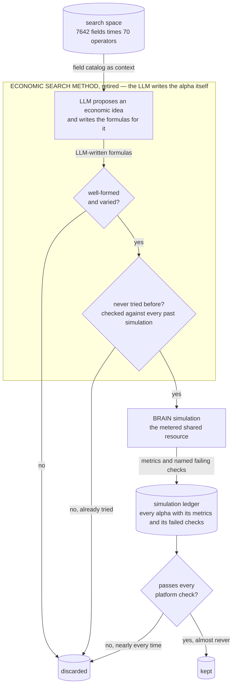

# Economic Search Method (retired) — let the LLM write the alpha

## The problem

The most direct attack on the search space, and the first one tried: **let the LLM do the whole
job.**

A model that has read the finance literature should be able to propose an economic idea *and*
write the formula that captures it. Since simulation is the scarce resource, every candidate is
checked against an index of everything simulated before, so nothing is ever paid for twice.

The reasoning was sound and the implementation was thorough — this is the largest of the retired
methods. It was also decisively wrong, and understanding why shaped everything built afterwards.

## How it discovers alpha

1. **The LLM proposes an economic idea and writes the formulas for it** (`cli.py`, subcommands
   `propose` and `generate`).
2. **Each formula is checked for being well-formed,** and each batch for variety, so the model
   cannot submit fifty versions of one idea (`expression_validation.py`).
3. **Each is checked against an index of every past simulation.** Anything too close to what has
   already been tried is dropped. To save cost, an LLM critic is consulted only for borderline
   cases; clear-cut ones are scored without a model call (`history_index.py`, `semantic_gate.py`).
4. **Survivors are simulated.**

The failure shows up at the very end: almost nothing passed the platform's checks. The formulas
were valid and genuinely new — the novelty check worked exactly as designed — and novelty turned
out to have almost nothing to do with whether an alpha makes money.



**How to read this graph:** the labelled box is what this retired method put inside the *alpha discovery module* of the [overall pipeline](../../../README.md#alpha-discovery-vs-alpha-enhancement). The search space, the simulation and the ledger are shared by every method and drawn the same way in each graph.

## The code

| File | LOC | What it does |
|---|---|---|
| `alpha_discovery/legacy/economic_search_method/tests/test_core.py` **(CLI)** | 1648 | CLI entry point |
| `alpha_discovery/legacy/economic_search_method/cli.py` **(CLI)** | 1497 | CLI for the plan-first LLM economic search workspace |
| `alpha_discovery/legacy/economic_search_method/history_index.py` | 728 | Read-only history scanner and novelty index builder |
| `alpha_discovery/legacy/economic_search_method/expression_validation.py` | 720 | Validation and diversity gates for LLM-generated FASTEXPR candidates |
| `alpha_discovery/legacy/economic_search_method/candidate_generation.py` | 686 | Deterministic candidate expansion from accepted economic theories |
| `alpha_discovery/legacy/economic_search_method/expression_generation.py` | 632 | LLM-first expression generation for accepted economic theories |
| `alpha_discovery/legacy/economic_search_method/llm_agents.py` | 626 | Optional LLM agents and deterministic mock outputs |
| `alpha_discovery/legacy/economic_search_method/semantic_gate.py` | 617 | Score-based semantic novelty gate for generated expressions |
| `alpha_discovery/legacy/economic_search_method/portfolio_context.py` | 413 | Submitted-alpha portfolio context for economic hypothesis search |
| `alpha_discovery/legacy/economic_search_method/continuous_runner.py` | 388 | State, ledger, and promotion-harvest helpers for continuous economic search |
| `alpha_discovery/legacy/economic_search_method/theory_store.py` | 264 | Filesystem-backed per-theory storage |
| `alpha_discovery/legacy/economic_search_method/field_catalogs.py` | 252 | Delay-aware field catalog helpers for economic search |
| `alpha_discovery/legacy/economic_search_method/critique.py` | 239 | Deterministic novelty checks and result interpretation |
| `alpha_discovery/legacy/economic_search_method/brain_submit.py` | 237 | Minimal Brain submission runner for economic theory candidate plans |

## Running it

```bash
cd alpha_discovery/legacy
python -m economic_search_method.cli sprint \
    --n 10 --max-candidates-per-theory 12 --simulate \
    --credentials ../../brain.txt \
    --sprint-focus "delay-0 price reversal under news"
```

Archived: this lane is not imported by active code and its artifacts are not shipped in this
repository. The credentials path is relative to the `legacy/` directory.

## Results

### Why it was retired

The expressions were well-formed, passed validation, and were certified novel by the index. They
were also empirically dead: across thousands of simulations, almost nothing passed every
platform check, and the median result was indistinguishable from noise. No theory branch ever
reached a promote decision.

The falsification is sharper than "the LLM wasn't good enough". It is that **novelty and signal
are close to independent**. The novelty index worked exactly as designed — it reliably found
expressions nobody had tried — and that turned out to be almost uncorrelated with whether they
made money. A novelty index cannot substitute for a quality predictor.

That insight is the direct ancestor of [`../../sim_slot_gate/`](../../sim_slot_gate/README.md),
which predicts *quality* rather than measuring *difference*.

