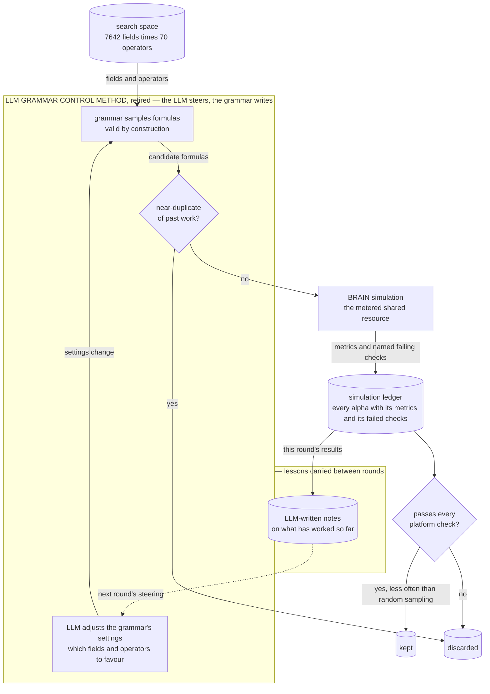

# LLM Grammar Control (retired) — let the LLM steer, not write

## The problem

The most elegant idea among the retired methods, and a genuinely good response to the previous
failure.

[`../economic_search_method/`](../economic_search_method/README.md) let the LLM write formulas,
and too many were malformed or incoherent; checking them afterwards was fighting the symptom. So
this method **never lets the LLM write a formula at all.** Instead it adjusts the grammar's
settings — which kinds of fields and operators to favour — and the grammar does the writing, so
everything produced is valid by construction.

A clean division of labour: the LLM supplies judgement about *where to look*, the grammar
supplies *correctness*.

## How it discovers alpha

Think of the LLM as the navigator and the grammar as the driver.

1. **The LLM adjusts the grammar's settings** — which fields and operators to favour this round —
   based on what has worked so far. It never writes a formula (`proposer.py`).
2. **The grammar samples formulas under those settings,** all valid by construction.
3. **Near-duplicates of past work are filtered out,** and the rest are simulated (`runner.py`).
4. **The LLM writes short notes on what it learned,** which carry into the next round's steering
   (`memory.py`).



**How to read this graph:** the labelled box is what this retired method put inside the *alpha discovery module* of the [overall pipeline](../../../README.md#alpha-discovery-vs-alpha-enhancement). The search space, the simulation and the ledger are shared by every method and drawn the same way in each graph.

## The code

| File | LOC | What it does |
|---|---|---|
| `alpha_discovery/legacy/llm_grammar_control_method/runner.py` **(CLI)** | 1379 | LLM exploration loop: propose → filter → submit → distill → repeat |
| `alpha_discovery/legacy/llm_grammar_control_method/proposer.py` | 664 | LLM-driven alpha candidate proposer |
| `alpha_discovery/legacy/llm_grammar_control_method/semantic_novelty.py` | 568 | Alpha-LLM semantic novelty gate |
| `alpha_discovery/legacy/llm_grammar_control_method/memory.py` | 449 | Exploration memory: structured facts distilled from batch simulation results |
| `alpha_discovery/legacy/llm_grammar_control_method/similarity.py` | 419 | Novelty filter for LLM-proposed alpha candidates |
| `alpha_discovery/legacy/llm_grammar_control_method/backfill_portfolio.py` **(CLI)** | 406 | Backfill portfolio admission scores for historical sim records |
| `alpha_discovery/legacy/llm_grammar_control_method/history_summarizer.py` | 363 | Startup analysis agents for the LLM exploration loop |
| `alpha_discovery/legacy/llm_grammar_control_method/__init__.py` | 31 | LLM-driven alpha exploration module |

## Running it

```bash
cd alpha_discovery/legacy
python -m llm_grammar_control_method.runner \
    --rounds 5 --batch-size 40 \
    --credentials ../../brain.txt --delay 1
```

Archived: not imported by active code, artifacts not shipped here.

## Results

Empirically worse than the plain grammar + Q-table lane it was meant to replace. The lane's own log (`alpha_discovery/legacy/llm_grammar_control_method/artifacts/llm_sim.jsonl`, 3368 rows / 3066 completed sims) contains only **19 records with zero FAIL checks - 0.62%**, against the grammar lane's ~5% submittable yield recorded in the project memory note `llm-generator-underperforms.md`. Of 1003 admission-scored alphas across 32 primary operators, **879 (87.6%) had contribution delta <= 0** (`portfolio_score_history.json`), i.e. they would have hurt the pool.

### Why it was retired

It lost to plain grammar sampling with Q-table and novelty pruning — the same grammar, without
the LLM steering it. Its clean-check rate was well under the grammar lane's, and the large
majority of its scored candidates had a *negative* marginal contribution to the portfolio.

So the LLM's judgement about which regions were promising was not merely unhelpful, it was
mildly harmful: it concentrated sampling in regions that sounded economically sensible and were
already crowded. Uniform sampling explored more of the space that actually mattered.

This is the result that produced the project's organising principle. Intelligence does not
belong in generation — not even in *steering* generation. It belongs in
**selection** ([`../../sim_slot_gate/`](../../sim_slot_gate/README.md)) and in **repair of
alphas that already have measured feedback**
([`../../../alpha_enhancement/`](../../../alpha_enhancement/README.md)).

