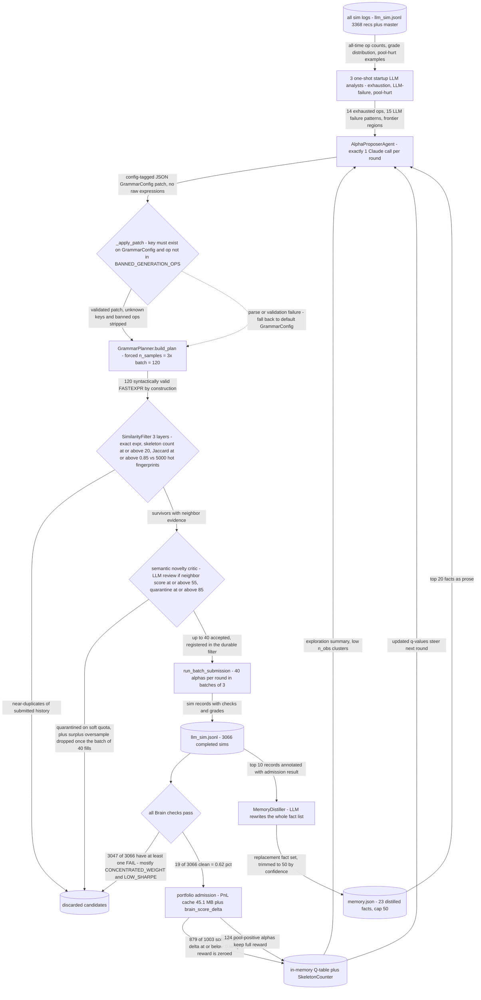

# LLM Grammar Control (retired) — let the LLM steer, not write

## The problem

The most elegant idea among the retired lanes, and a genuinely good response to the previous
failure.

The diagnosis of [`../economic_search_method/`](../economic_search_method/README.md) was that
LLM-authored expressions were often malformed or semantically incoherent, and that validating
them after the fact was fighting the symptom. So don't let the LLM write expressions at all.

Instead, have it emit a **`GrammarConfig` patch** — a modification to the sampling
distribution of the grammar. The grammar then guarantees every expression is well-formed by
construction, and the LLM's only job is to say *where in the space to look*. A clean separation
of concerns: the model supplies judgement about regions, the grammar supplies correctness.

## How it discovers alpha

A closed loop in `runner.py`: propose a config patch, sample the grammar under it, filter,
simulate, distill what was learned, repeat.

`proposer.py` is the heart of it — the LLM returns a structured patch to the grammar's sampling
weights rather than any expression text. `memory.py` is the other interesting piece: an
LLM-distilled store of persistent facts carried across simulation batches, so each round is
conditioned on a compressed summary of everything already observed rather than a raw log dump.
`semantic_novelty.py` and `similarity.py` guard against the loop converging on a single region.



## The code

| File | LOC | What it does |
|---|---|---|
| `alpha_discovery/legacy/llm_grammar_control_method/runner.py` **(CLI)** | 1379 | LLM exploration loop: propose → filter → submit → distill → repeat |
| `alpha_discovery/legacy/llm_grammar_control_method/proposer.py` | 664 | LLM-driven alpha candidate proposer |
| `alpha_discovery/legacy/llm_grammar_control_method/semantic_novelty.py` | 568 | Alpha-LLM semantic novelty gate |
| `alpha_discovery/legacy/llm_grammar_control_method/memory.py` | 449 | Exploration memory: structured facts distilled from batch simulation results |
| `alpha_discovery/legacy/llm_grammar_control_method/similarity.py` | 419 | Novelty filter for LLM-proposed alpha candidates |
| `alpha_discovery/legacy/llm_grammar_control_method/backfill_portfolio.py` **(CLI)** | 406 | Backfill portfolio admission scores for historical sim records |
| `alpha_discovery/legacy/llm_grammar_control_method/history_summarizer.py` | 363 | Startup analysis agents for the LLM exploration loop |
| `alpha_discovery/legacy/llm_grammar_control_method/__init__.py` | 31 | LLM-driven alpha exploration module |

## Running it

```bash
cd alpha_discovery/legacy
python -m llm_grammar_control_method.runner \
    --rounds 5 --batch-size 40 \
    --credentials ../../brain.txt --delay 1
```

Archived: not imported by active code, artifacts not shipped here.

## Results

Empirically worse than the plain grammar + Q-table lane it was meant to replace. The lane's own log (`alpha_discovery/legacy/llm_grammar_control_method/artifacts/llm_sim.jsonl`, 3368 rows / 3066 completed sims) contains only **19 records with zero FAIL checks - 0.62%**, against the grammar lane's ~5% submittable yield recorded in the project memory note `llm-generator-underperforms.md`. Of 1003 admission-scored alphas across 32 primary operators, **879 (87.6%) had contribution delta <= 0** (`portfolio_score_history.json`), i.e. they would have hurt the pool.

Why steering-by-LLM lost: (1) **resolution mismatch** - the LLM sees prose summaries (op counts, grade distributions, 20 fact bullets) and answers with a category-level prior over operators, while the Q-table it was replacing already carries per-(skeleton, cluster) counts at far finer granularity; a coarse prior laid over a fine one only loses information. (2) **bandwidth** - one patch per 40 sims means the LLM contributes a handful of decisions per round and the grammar's own sampler makes every remaining choice, so the measurable variance between rounds is sampler noise, not steering. (3) **the facts were already encoded deterministically** - the distilled memory and `llm_failure_analysis.json` converged on findings the pipeline already hard-coded, e.g. `if_else` on sparse analyst fields at 99% LOW_SHARPE / 208 fails, `group_mean` >90% flatline, and CONCENTRATED_WEIGHT as the dominant killer at ~50% of expressions - exactly the content of `BANNED_GENERATION_OPS` and the coverage thresholds, obtained for free. (4) **cost** - every round burned Claude calls for the patch, the semantic critic and the distiller, and the lane accreted 72MB of artifacts (45.1MB `pnl_cache.json` alone) for a lower hit rate. The semantic gate also shows the oversample was mostly waste: of 3232 scored candidates, 2082 were dropped purely as surplus once the batch of 40 filled.

### Why it was retired

It lost to plain grammar sampling with Q-table and novelty pruning — the same grammar, without
the LLM steering it. Its clean-check rate was well under the grammar lane's, and the large
majority of its scored candidates had a *negative* marginal contribution to the portfolio.

So the LLM's judgement about which regions were promising was not merely unhelpful, it was
mildly harmful: it concentrated sampling in regions that sounded economically sensible and were
already crowded. Uniform sampling explored more of the space that actually mattered.

This is the result that produced the project's organising principle. Intelligence does not
belong in generation — not even in *steering* generation. It belongs in
**selection** ([`../../sim_slot_gate/`](../../sim_slot_gate/README.md)) and in **repair of
alphas that already have measured feedback**
([`../../../alpha_enhancement/`](../../../alpha_enhancement/README.md)).

