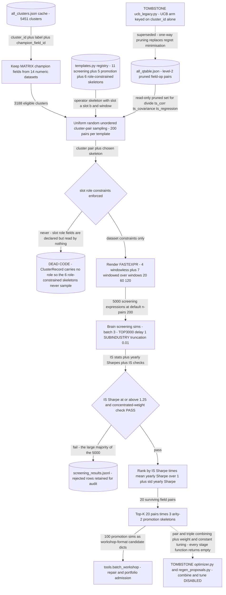

# Operator Skeleton Method (retired) — fix the shape, search the fields

## The problem

Invert grammar search.

Grammar search derives expression *shapes* and binds fields into whatever it derives. This
method does the opposite: fix the operator **skeleton** first, drawn from a registry of
hypotheses with role-constrained and dataset-constrained slots, then search which fields belong
in those slots.

The appeal is control. If you believe the useful shapes are a small known set, then constraining
slots by *role* — this slot wants a size proxy, that one wants a sentiment series — should
concentrate the search on economically coherent combinations instead of arbitrary ones.

## How it discovers alpha

`templates.py` holds the skeleton registry with declared slot roles. `field_sampler.py` selects
candidate fields, `screener.py` filters, `promoter.py` advances survivors, and `pipeline.py`
drives the loop.

The design is clear. What it actually did at runtime was not the same thing — see below.



## The code

| File | LOC | What it does |
|---|---|---|
| `alpha_discovery/legacy/operator_skeleton_method/screener.py` | 271 | Submit screening expressions to Brain and parse results |
| `alpha_discovery/legacy/operator_skeleton_method/templates.py` | 271 | Relationship template registry for operator-first alpha discovery |
| `alpha_discovery/legacy/operator_skeleton_method/field_sampler.py` | 236 | Field/cluster loading and pair sampling for operator-first alpha discovery |
| `alpha_discovery/legacy/operator_skeleton_method/pipeline.py` **(CLI)** | 221 | Operator-first alpha discovery pipeline |
| `alpha_discovery/legacy/operator_skeleton_method/promoter.py` | 172 | Promote top-scoring cluster pairs from screening to the full template suite |
| `alpha_discovery/legacy/operator_skeleton_method/roles.py` | 27 | Semantic role constants for field slot classification |
| `alpha_discovery/legacy/operator_skeleton_method/__init__.py` | 1 | Operator-first alpha discovery: templates → field pairs → Brain screening |

## Running it

```bash
cd alpha_discovery/legacy
python -m operator_skeleton_method.pipeline --dry-run
```

Archived: not imported by active code.

### Two deliberately disabled successors

Also archived, in [`../archived_shims/`](../archived_shims/), are two components that were
switched **off on purpose** and whose own docstrings explain why:

- `../archived_shims/wq_alpha/search/optimizer.py` — an alpha-combination optimizer, disabled
  because selecting combination weights on in-sample results is heavily exposed to selection
  bias. It would have produced beautiful backtests and no out-of-sample score.
- `../archived_shims/tools/regen_proposals.py` — disabled on the same grounds.

Both are left in place as working stubs that refuse to run, with the reasoning in the module
docstring, so the decision is documented where someone would look for the behaviour.

Also here: `../archived_shims/alpha_grammar/ucb_legacy.py`, a UCB bandit superseded by the
Q-table. A bandit was the wrong frame for this problem — the arms are not stationary, and the
reward cannot be observed without spending the very resource being allocated, so the usual
regret guarantees do not apply.

## Results

### Why it was retired

No alpha from this lane ever reached the ledger as a promoted candidate.

The more interesting failure is that **its distinguishing mechanism was never actually live**.
The slot *roles* are declared on every skeleton, but nothing in the execution path reads them —
the cluster records carry no role field to match against. So what ran was uniform random pairing
of clusters into a handful of fixed skeletons: all the constraint machinery that made the idea
attractive was inert, and the lane was quietly a worse version of template sweep.

It is kept partly as a reminder that a declared constraint which no code reads is not a
constraint, and that the way to find out is to check the execution path rather than the design
document.

