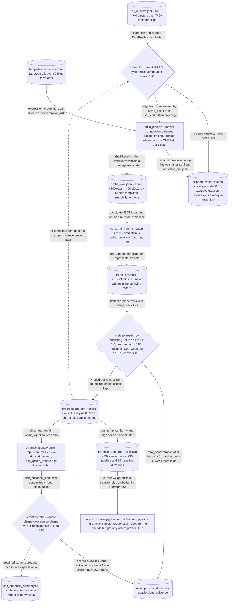

# Probe Method — map where signal lives before mining it

## The problem

Grammar search is productive but blind: it will happily spend hundreds of slots mining a field
cluster that carries no signal at all. The cost of finding that out the expensive way scales
with the *product* of fields and operators.

This method attacks a cheaper question first. Instead of searching fields × operators, pick one
representative field per field cluster and push it through a **fixed** operator pack. Cost then
scales with the number of clusters — roughly 5,451 rather than their product — and the output is
not alphas but a **prior over where to sample**, which the grammar lane then consumes.

The bet: signal is cluster-structured. If a representative field of a cluster shows nothing
under a standard battery of transforms, the rest of that cluster is probably not worth deep
mining either.

## How it discovers alpha

Three stages, each a separate CLI, and deliberately **no simulation of its own** — the plan is
handed to `core.brain.submit` so that slot accounting stays in one place.

`build_plan.py` turns the cluster catalog into a probe plan: choose representative fields per
cluster (`--representatives champion | champion_sleeper | all`), cross them with a declarative
`ProbeTemplate` pack from `templates.py` (`core`, `broad`, or `event`), and skip combinations
already tested.

`analyze_results.py` reads the resulting sim log and sorts outcomes into seed buckets against
explicit thresholds, with a concentration guard so a single-stock artefact cannot masquerade as
a weak-but-real signal.

`enhance_plan.py` then derives deterministic A-derived variants from seeds and ranks them by a
retention ratio — how much of the original edge survives perturbation.



## The code

| File | LOC | What it does |
|---|---|---|
| `alpha_discovery/probe_method/enhance_plan.py` **(CLI)** | 604 | Build deterministic A-derived enhancement and robustness plans |
| `alpha_discovery/probe_method/build_plan.py` **(CLI)** | 396 | Build a JSONL signal-probe plan from field clusters |
| `alpha_discovery/probe_method/analyze_results.py` **(CLI)** | 226 | Analyze probe simulation logs into seed and prior summaries |
| `alpha_discovery/probe_method/templates.py` | 214 | Probe templates for fast field-level signal discovery |
| `alpha_discovery/probe_method/__init__.py` | 5 | Field-level signal probing utilities |

## Running it

```bash
# 1. build the probe plan from the cluster catalog
python -m alpha_discovery.probe_method.build_plan \
    --clusters alpha_discovery/grammar_method/artifacts/all_clusters.json \
    --fields-csv all_fields.csv \
    --pack core --out artifacts/probe/probe_plan.jsonl

# 2. simulate it (slot accounting lives in core, not here)
python -m core.brain.submit --plan artifacts/probe/probe_plan.jsonl --credentials brain2.txt

# 3. bucket the results into seeds
python -m alpha_discovery.probe_method.analyze_results \
    --sim-log artifacts/probe/probe_sim.jsonl \
    --out-seeds artifacts/probe/probe_seeds.jsonl

# 4. derive enhancement variants from the seeds
python -m alpha_discovery.probe_method.enhance_plan build --max-alphas 50
```

Check the live thresholds with `--help`; `analyze_results` exposes
`--min-weak-abs-sharpe`, `--min-weak-abs-fitness` and `--min-near-fitness`.

## Results

Be straight about the limitation: the probe grid was **largely never spent**. The surviving
artifact is `artifacts/probe/grammar_prior_from_wiki.json` — 332 cluster priors — and the clue
is in the filename: those values are back-filled from the [wiki posterior](../../core/wiki/README.md)
over the full simulation history, not from a dedicated probe sweep. So the *prior mechanism*
is live and consumed by `alpha_discovery/grammar_method/probe_prior.py`, while the probe sweep
that was meant to populate it was overtaken by the fact that 91,969 simulations already existed
to aggregate. The method's shape is sound; its distinctive data collection step was made
redundant by accumulated history.

