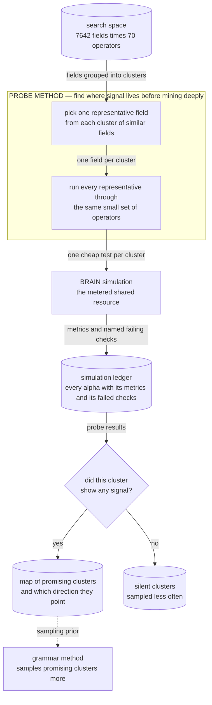

# Probe Method — map where signal lives before mining it

## The problem

The grammar method is productive but blind. It will happily spend simulation after simulation
in a group of fields that carries no signal at all, and finding that out the hard way costs one
simulation per field-and-operator combination tried.

The probe method asks a cheaper question first: *which groups of fields are worth mining at
all?* Similar fields are already grouped into clusters — several variants of the same analyst
estimate, for example — so it tests one representative per cluster with the same small, fixed
set of operators. The cost grows with the number of clusters instead of with fields times
operators.

The bet is that signal is cluster-shaped: if the representative of a cluster shows nothing under
a standard battery of transforms, its siblings probably won't either. The output is not alphas
but a **map of where to look**.

## How it discovers alpha

Think of it as test drilling: before mining the whole catalog, drill one cheap hole in each area
and see which ones show anything.

1. **Pick a representative.** One field stands in for each cluster of similar fields
   (`build_plan.py`).
2. **Run the same small battery on every representative.** A fixed pack of standard operators,
   identical for every cluster, so the results are comparable (`templates.py`).
3. **Read the results.** Each cluster is marked as showing signal — and in which direction — or
   as silent (`analyze_results.py`).
4. **Hand the map to the grammar method,** which then samples promising clusters more often and
   silent ones less (`alpha_discovery/grammar_method/probe_prior.py`).

The probe never tries to produce a competition alpha itself, and it hands simulation to the
shared submitter in `core/brain/` rather than running its own. Strong probe results can also be
turned into variants for the enhancement engine (`enhance_plan.py`), but that is a side output.



**How to read this graph:** the labelled box is what this method puts inside the *alpha discovery module* of the [overall pipeline](../../README.md#alpha-discovery-vs-alpha-enhancement). The search space, the simulation and the ledger are shared by every method and drawn the same way in each graph. In practice the map is now filled from the accumulated history rather than from a fresh probe sweep — see Results.

## The code

| File | LOC | What it does |
|---|---|---|
| `alpha_discovery/probe_method/enhance_plan.py` **(CLI)** | 604 | Build deterministic A-derived enhancement and robustness plans |
| `alpha_discovery/probe_method/build_plan.py` **(CLI)** | 396 | Build a JSONL signal-probe plan from field clusters |
| `alpha_discovery/probe_method/analyze_results.py` **(CLI)** | 226 | Analyze probe simulation logs into seed and prior summaries |
| `alpha_discovery/probe_method/templates.py` | 214 | Probe templates for fast field-level signal discovery |
| `alpha_discovery/probe_method/__init__.py` | 5 | Field-level signal probing utilities |

## Running it

```bash
# 1. build the probe plan from the cluster catalog
python -m alpha_discovery.probe_method.build_plan \
    --clusters alpha_discovery/grammar_method/artifacts/all_clusters.json \
    --fields-csv all_fields.csv \
    --pack core --out artifacts/probe/probe_plan.jsonl

# 2. simulate it (slot accounting lives in core, not here)
python -m core.brain.submit --plan artifacts/probe/probe_plan.jsonl --credentials brain2.txt

# 3. bucket the results into seeds
python -m alpha_discovery.probe_method.analyze_results \
    --sim-log artifacts/probe/probe_sim.jsonl \
    --out-seeds artifacts/probe/probe_seeds.jsonl

# 4. derive enhancement variants from the seeds
python -m alpha_discovery.probe_method.enhance_plan build --max-alphas 50
```

Check the live thresholds with `--help`; `analyze_results` exposes
`--min-weak-abs-sharpe`, `--min-weak-abs-fitness` and `--min-near-fitness`.

## Results

Be straight about the limitation: the probe grid was **largely never spent**. The surviving
artifact is `artifacts/probe/grammar_prior_from_wiki.json` — 332 cluster priors — and the clue
is in the filename: those values are back-filled from the [wiki posterior](../../core/wiki/README.md)
over the full simulation history, not from a dedicated probe sweep. So the *prior mechanism*
is live and consumed by `alpha_discovery/grammar_method/probe_prior.py`, while the probe sweep
that was meant to populate it was overtaken by the fact that 91,969 simulations already existed
to aggregate. The method's shape is sound; its distinctive data collection step was made
redundant by accumulated history.

