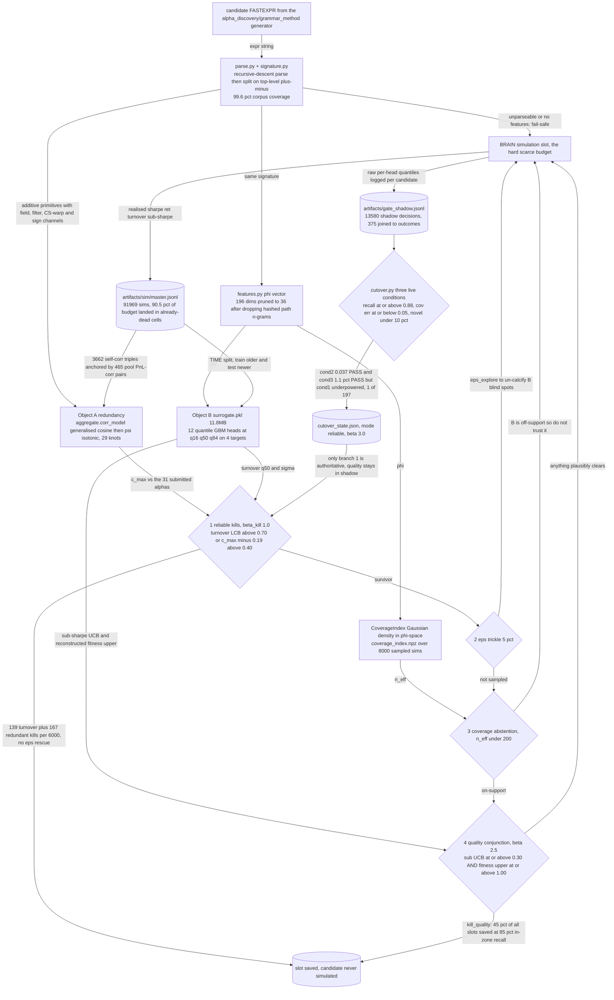

# Sim-Slot Gate — predict before spending a backtest

## The problem

Every other method here asks "what should I simulate next?". This one asks the question that
actually binds: **is this candidate worth a simulation slot at all?**

The platform allows 3 concurrent simulations per account and there is no cheap partial-sim
probe — a candidate yields nothing until it has had a full backtest. So simulation is the scarce
resource, and the highest-leverage intervention is not a better generator but a better *refusal*.

[`../../dedup.md`](../../dedup.md) measured how bad the waste was: across an 84,717-record slice,
**90.5% of simulation budget went into regions the existing history had already proved dead**,
and only 7.9% of (skeleton, field-set) cells ever recur. That second number is the important
one — it means identity-based dedup was solving the wrong problem. The waste was not
*duplication*, it was *predictable failure*.

So the gate is a predictor, and because a predictor that is confidently wrong is worse than no
predictor, it is built to know where it is ignorant.

## How it discovers alpha

Two objects answer two different questions, and a third decides whether to trust them.

**Object A — redundancy.** Is this candidate too close to something already simulated, or to the
portfolio? A generalised cosine over additive primitives, mapped through an isotonic `psi`
calibration, yields `c_max`.

**Object B — a quantile surrogate.** What outcome distribution should we expect? Twelve gradient-
boosted quantile heads predict q16/q50/q84 across four targets, from a pruned feature vector.

**Coverage — abstention.** A Gaussian density in feature space estimates `n_eff`. Where the
candidate is off-support, Object B's prediction is not trusted and the gate *abstains*, letting
the candidate through rather than killing it on an extrapolation.

The branches are ordered cheapest-and-surest first: reliable hard kills, a 5% epsilon trickle
that deliberately spends slots in Object B's blind spots to keep it from calcifying, coverage
abstention, then the quality conjunction.



## The code

| File | LOC | What it does |
|---|---|---|
| `alpha_discovery/sim_slot_gate/cutover.py` **(CLI)** | 326 | cutover.py — live shadow -> authoritative trigger (SHADOW_CUTOVER_TRIGGER.md) |
| `alpha_discovery/sim_slot_gate/parse.py` | 323 | parse.py — FastExpr string -> ExpressionNode AST, plus metric-level canonicalize |
| `alpha_discovery/sim_slot_gate/champion_challenger.py` **(CLI)** | 272 | champion_challenger.py — T2: new quality surrogate vs incumbent q-table, out-of-time |
| `alpha_discovery/sim_slot_gate/db_adapter.py` | 247 | db_adapter.py — load the historical sim store + calibration data |
| `alpha_discovery/sim_slot_gate/signature.py` | 225 | signature.py — AST -> Signature of additive behavioural primitives (§3.1-3.2) |
| `alpha_discovery/sim_slot_gate/features.py` | 213 | features.py — Signature/AST -> flat feature vector phi for the surrogate (§7.2) |
| `alpha_discovery/sim_slot_gate/backtest.py` | 202 | backtest.py — budget backtest (§9): slots saved vs good alphas killed |
| `alpha_discovery/sim_slot_gate/calibrate.py` | 199 | calibrate.py — Object A calibration: psi (corr_model -> realized corr) + sigma_corr |
| `alpha_discovery/sim_slot_gate/filters.py` | 192 | filters.py — temporal channel: operator(+window) -> magnitude response /H(omega)/ |
| `alpha_discovery/sim_slot_gate/verify.py` **(CLI)** | 183 | verify.py — reproducible verification harness for VERIFICATION_PLAN.md |
| `alpha_discovery/sim_slot_gate/fields.py` | 181 | fields.py — open-vocabulary field embedding for the field-similarity channel (§3.3) |
| `alpha_discovery/sim_slot_gate/surrogate.py` | 178 | surrogate.py — OBJECT B: submission-component surrogate (§7) |
| `alpha_discovery/sim_slot_gate/gate.py` | 168 | gate.py — should_simulate: the sim-slot decision (§8) |
| `alpha_discovery/sim_slot_gate/shadow.py` | 144 | shadow.py — log-only shadow gate for run_pipeline (non-invasive rollout) |
| `alpha_discovery/sim_slot_gate/channels.py` | 138 | channels.py — behavioural-similarity channels for the redundancy metric |
| `alpha_discovery/sim_slot_gate/tests/test_parse.py` **(CLI)** | 133 | Parser + canonicalisation tests (§9 — the parse/canonicalize portion) |
| `alpha_discovery/sim_slot_gate/redundancy.py` | 118 | redundancy.py — pool redundancy c_max and coverage density n_eff (§8) |
| `alpha_discovery/sim_slot_gate/tests/test_corr_model.py` **(CLI)** | 100 | corr_model unit tests (§9, Object A channel-level + aggregation) |

## Running it

```bash
# rebuild the time-split frontier and the calibration report inputs
python -m alpha_discovery.sim_slot_gate.verify all

# head-to-head against the incumbent Q-table pruner
python -m alpha_discovery.sim_slot_gate.champion_challenger

# read or advance the cutover state machine
python -m alpha_discovery.sim_slot_gate.cutover
```

The gate is invoked in-process by the grammar lane via `--gate-mode {shadow,reliable,full,auto}`;
`--shadow-gate` logs a decision per candidate without acting on it.

**Offline unit tests** — no account, no network:

```bash
python -m alpha_discovery.sim_slot_gate.tests.test_parse       # 13/13
python -m alpha_discovery.sim_slot_gate.tests.test_channels    #   9/9
python -m alpha_discovery.sim_slot_gate.tests.test_corr_model  # 11/11
python -m alpha_discovery.sim_slot_gate.tests.test_surrogate   # acceptance checks
```

## Results

Built and validated, partially live. Per CALIBRATION_REPORT.md (2026-06-19): structure does predict future quality — time-split rank-IC 0.296 on the median Sharpe head, 0.332 after pruning hashed phi features, with 4.77x top-decile lift over a 7.6% base rate, and it transfers across the biggest regime shift in the data. Held-out quantile coverage is within ~0.02-0.035 of nominal on all four heads (surrogate_coverage.json: 0.831/0.834/0.836/0.832 at the 0.84 level), which is the acceptance test the design actually chose over R-squared. Authoritative TIME-split budget backtest (test_results/G3_budget_backtest_timesplit.json, n=6000, base good 7.6%): beta=2.0 saves 71% of slots at 67% quality-zone recall; the shipped default beta=2.5 saves 45% at 85% in-zone recall (0.91 post-prune, G3_postprune.json); beta=3.0 saves 20% at 93%. NOTE a correction the lane made on itself: the widely-quoted "71% saved at 91% recall" pairing came from a RANDOM-split backtest and was retracted as temporal leakage — the default beta was raised 2.0 to 2.5 as a result. Robustness floor verified: with B's quality branch zeroed, good_killed_quality = 0 and reliable-kills-only still saves 5% at 79% recall, so it fails safe. Champion/challenger (test_results/champion_challenger.json, n=77,785 scored, base good 7.4%) found the incumbent q-table quality pruner effectively INERT — 9 of 8,987 level-1 buckets and 19 of 22,640 level-2 buckets prune, 0% slots saved at the production threshold, exactly the dedup.md failure mode — while the challenger reaches 38% saved at 92% recall and, on disagreement cells, skips 2,790 bad alphas vs the champion's 336 (McNemar chi-sq = 1816, p ~ 0). Live rollout is honest and incomplete: 13,580 shadow decisions logged to artifacts/gate_shadow.jsonl, 375 joined to realised outcomes; cond2 calibration 0.037 PASS and cond3 novelty 1.1% PASS, but cond1 quality-zone recall is underpowered (1 in-zone good observed against ~197 needed for h=0.04), so cutover_state.json still reads mode=reliable — the behavioural-dedup c_max and turnover hard-kills are authoritative, the quality surrogate is still shadow-only. It was never trusted on faith.

### Two findings that justify the whole subsystem

**1. It falsified the mechanism it was built to replace.** The incumbent two-level Q-table
pruner, measured on the real production artifact, prunes **9 of 8,987 level-1 buckets and 19 of
22,640 level-2 buckets** — 0.089%. It was saving ~0% of simulation slots while appearing to
learn. The challenger dominates it out-of-time (McNemar χ²=1816).

**2. It retracted its own earlier result.** An early backtest looked far better than the gate
really was, because it used a *random* train/test split — which leaks across time in an
append-only simulation log. Re-run on an honest time split the numbers fell materially, and the
kill threshold was made more conservative in response. Both the superseded and the corrected
figures are kept side by side in [`../../CALIBRATION_REPORT.md`](../../CALIBRATION_REPORT.md)
rather than the old one being quietly replaced.

### It is not cut over

Three cutover conditions were pre-declared *before* results came in. Two pass. The third — live
shadow confirmation — is still underpowered (~1 in-zone observation against ~197 needed). So
`cutover_state.json` reads `mode: reliable`, where only the redundancy and turnover hard-kills
are authoritative and the quality surrogate remains in shadow. The pre-registered condition was
not met, so the cutover did not happen.

