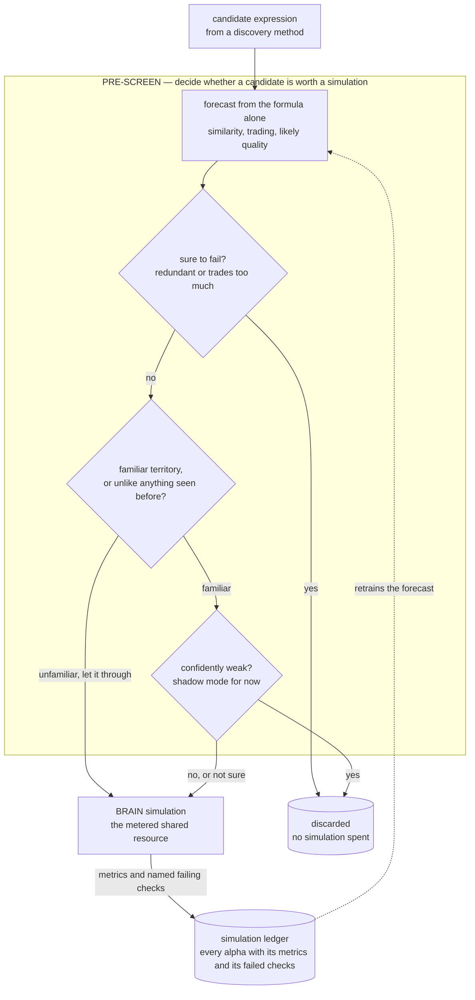

# Sim-Slot Gate — predict before spending a backtest

## The problem

The other methods generate candidates. This one generates nothing: it sits in front of the
simulator and answers a narrower question — **is this particular candidate worth a simulation?**

That question only exists because of a platform constraint. BRAIN allows three concurrent
simulations per account and has no cheap partial test, so a candidate tells you nothing until it
has had a full backtest. The constraint is arbitrary rather than fundamental, but while it holds,
candidates are cheap and measurements are not.

[`../../dedup.md`](../../dedup.md) found where the budget was actually going. Not to literal
duplicates — those were rare — but to candidates in regions the history had already shown to be
dead. The waste was *predictable failure*, not repetition. That makes this a forecasting problem,
and since a forecaster that is confidently wrong is worse than none, the gate is built to know
where it is guessing.

## How it screens candidates

Think of it as a bouncer in front of the simulator. It cannot know for sure who will turn out to
be good, but it can turn away the obvious cases and wave through anyone it does not recognise.

1. **Forecast from the formula alone.** Without simulating, estimate from the expression's
   structure how similar it is to alphas already simulated or submitted, how much it will trade,
   and roughly how good it is likely to be. The forecaster learns from the simulation ledger
   (`metric.py`, `surrogate.py`, `redundancy.py`).
2. **Turn away the sure failures.** Clearly redundant with existing work, or certain to trade too
   much — dropped. This is the part that runs live today.
3. **Know when the forecast is a guess.** If a candidate looks unlike anything in the history, the
   gate steps aside and lets it through rather than reject it on an extrapolation
   (`redundancy.py`, coverage index).
4. **Turn away the clearly weak.** In familiar territory, a candidate forecast to be confidently
   weak is dropped. This step still runs in **shadow mode**: it records what it would have done
   but does not act yet (`gate.py`, `shadow.py`).

A small random share of candidates is waved through regardless, so the forecaster keeps being
tested in its own blind spots.



**How to read this graph:** the labelled box opens up the *cheap pre-screen* diamond of the
[overall pipeline](../../README.md#alpha-discovery-vs-alpha-enhancement). It is wired into the
grammar method, which calls it on each candidate before spending a simulation (`--gate-mode`).

## The code

| File | LOC | What it does |
|---|---|---|
| `alpha_discovery/sim_slot_gate/cutover.py` **(CLI)** | 326 | cutover.py — live shadow -> authoritative trigger (SHADOW_CUTOVER_TRIGGER.md) |
| `alpha_discovery/sim_slot_gate/parse.py` | 323 | parse.py — FastExpr string -> ExpressionNode AST, plus metric-level canonicalize |
| `alpha_discovery/sim_slot_gate/champion_challenger.py` **(CLI)** | 272 | champion_challenger.py — T2: new quality surrogate vs incumbent q-table, out-of-time |
| `alpha_discovery/sim_slot_gate/db_adapter.py` | 247 | db_adapter.py — load the historical sim store + calibration data |
| `alpha_discovery/sim_slot_gate/signature.py` | 225 | signature.py — AST -> Signature of additive behavioural primitives (§3.1-3.2) |
| `alpha_discovery/sim_slot_gate/features.py` | 213 | features.py — Signature/AST -> flat feature vector phi for the surrogate (§7.2) |
| `alpha_discovery/sim_slot_gate/backtest.py` | 202 | backtest.py — budget backtest (§9): slots saved vs good alphas killed |
| `alpha_discovery/sim_slot_gate/calibrate.py` | 199 | calibrate.py — Object A calibration: psi (corr_model -> realized corr) + sigma_corr |
| `alpha_discovery/sim_slot_gate/filters.py` | 192 | filters.py — temporal channel: operator(+window) -> magnitude response /H(omega)/ |
| `alpha_discovery/sim_slot_gate/verify.py` **(CLI)** | 183 | verify.py — reproducible verification harness for VERIFICATION_PLAN.md |
| `alpha_discovery/sim_slot_gate/fields.py` | 181 | fields.py — open-vocabulary field embedding for the field-similarity channel (§3.3) |
| `alpha_discovery/sim_slot_gate/surrogate.py` | 178 | surrogate.py — OBJECT B: submission-component surrogate (§7) |
| `alpha_discovery/sim_slot_gate/gate.py` | 168 | gate.py — should_simulate: the sim-slot decision (§8) |
| `alpha_discovery/sim_slot_gate/shadow.py` | 144 | shadow.py — log-only shadow gate for run_pipeline (non-invasive rollout) |
| `alpha_discovery/sim_slot_gate/channels.py` | 138 | channels.py — behavioural-similarity channels for the redundancy metric |
| `alpha_discovery/sim_slot_gate/tests/test_parse.py` **(CLI)** | 133 | Parser + canonicalisation tests (§9 — the parse/canonicalize portion) |
| `alpha_discovery/sim_slot_gate/redundancy.py` | 118 | redundancy.py — pool redundancy c_max and coverage density n_eff (§8) |
| `alpha_discovery/sim_slot_gate/tests/test_corr_model.py` **(CLI)** | 100 | corr_model unit tests (§9, Object A channel-level + aggregation) |

## Running it

```bash
# rebuild the time-split frontier and the calibration report inputs
python -m alpha_discovery.sim_slot_gate.verify all

# head-to-head against the incumbent Q-table pruner
python -m alpha_discovery.sim_slot_gate.champion_challenger

# read or advance the cutover state machine
python -m alpha_discovery.sim_slot_gate.cutover
```

The gate is invoked in-process by the grammar lane via `--gate-mode {shadow,reliable,full,auto}`;
`--shadow-gate` logs a decision per candidate without acting on it.

**Offline unit tests** — no account, no network:

```bash
python -m alpha_discovery.sim_slot_gate.tests.test_parse       # 13/13
python -m alpha_discovery.sim_slot_gate.tests.test_channels    #   9/9
python -m alpha_discovery.sim_slot_gate.tests.test_corr_model  # 11/11
python -m alpha_discovery.sim_slot_gate.tests.test_surrogate   # acceptance checks
```

## Results

### What it measured

**1. It falsified the pruner it was built to replace.** The incumbent two-level Q-table
pruner, measured on the real production artifact, prunes **9 of 8,987 level-1 buckets and 19 of
22,640 level-2 buckets** — 0.089%. It was saving ~0% of simulation slots while appearing to
learn. The challenger dominates it out-of-time (McNemar χ²=1816).

**2. It retracted its own earlier result.** An early backtest looked far better than the gate
really was, because it used a *random* train/test split — which leaks across time in an
append-only simulation log. Re-run on an honest time split the numbers fell materially, and the
kill threshold was made more conservative in response. Both the superseded and the corrected
figures are kept side by side in [`../../CALIBRATION_REPORT.md`](../../CALIBRATION_REPORT.md)
rather than the old one being quietly replaced.

### It is not cut over

Three cutover conditions were pre-declared *before* results came in. Two pass. The third — live
shadow confirmation — is still underpowered (~1 in-zone observation against ~197 needed). So
`cutover_state.json` reads `mode: reliable`, where only the redundancy and turnover hard-kills
are authoritative and the quality surrogate remains in shadow. The pre-registered condition was
not met, so the cutover did not happen.

