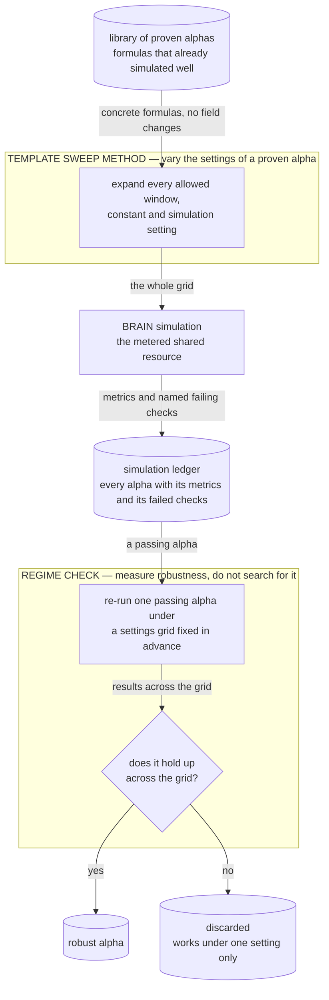

# Template Sweep Method — vary the settings of a proven alpha

## The problem

The cheapest place to look for a new alpha is right next to one that already works: the same
formula with a different window, or the same formula simulated under different platform settings.
That is this method's bet, and it is the oldest approach in the repository.

It is the opposite of the grammar method in a precise way. The grammar searches over *formula
shapes*; this method never changes the formula at all. It takes a small library of concrete,
already-verified alphas and varies only their numeric parameters and the simulation settings — no
fields or groups are ever substituted (`sweep.py`: *"No field or group sweeping."*).

That makes the search tiny and exhaustive. It also makes it dangerous, and the reason it was
demoted is the main lesson it left behind: **trying many settings and keeping the best one is
overfitting.** You are fitting the noise of one backtest, and the winning setting rarely holds up
out of sample.

## How it discovers alpha

1. **Start from a proven alpha.** Each template is a concrete formula that has already simulated
   well, with placeholders only for windows and constants (`templates.py`).
2. **Expand the grid.** Every allowed window, constant and simulation setting is combined into a
   plan (`sweep.py`).
3. **Simulate the plan** and log everything to the shared ledger (`pipeline.py`).

The part that survives is a reframing of the same idea, the **regime check**
(`regime_check.py`):

4. **Re-run one passing alpha under a settings grid fixed in advance** — universe,
   neutralization, truncation and decay — either one setting at a time or the full grid.
5. **Ask whether it holds up across the grid,** not which setting scored best. By default it has
   to pass in at least half of the settings; an alpha that only works under one is fragile, not
   good.

The difference between steps 2–3 and steps 4–5 is the difference between *searching* for
robustness and *measuring* it. The code says so directly: the regime check *"is a
robustness/regime diagnostic, not a greedy parameter optimizer"*.



**How to read this graph:** the labelled box is what this method puts inside the *alpha discovery module* of the [overall pipeline](../../README.md#alpha-discovery-vs-alpha-enhancement). The search space, the simulation and the ledger are shared by every method and drawn the same way in each graph. Unlike the other methods, this one does not start from the search space at all — it starts from alphas that are already known to work.

## The code

| File | LOC | What it does |
|---|---|---|
| `alpha_discovery/template_sweep_method/regime_check.py` | 368 | Predeclared regime checks for passing alpha expressions |
| `alpha_discovery/template_sweep_method/pipeline.py` **(CLI)** | 258 | Unified CLI entry point for the alpha-search pipeline |
| `alpha_discovery/template_sweep_method/templates.py` | 242 | Proven alpha template library for targeted window/settings sweeps |
| `alpha_discovery/template_sweep_method/consolidate_logs.py` **(CLI)** | 240 | Consolidate all sim logs and runner logs into alpha_search/artifacts/ |
| `alpha_discovery/template_sweep_method/feedback.py` **(CLI)** | 156 | Template performance tracker |
| `alpha_discovery/template_sweep_method/sweep.py` **(CLI)** | 105 | Generate a JSONL candidate plan from the proven alpha template library |
| `alpha_discovery/template_sweep_method/catalog.py` | 63 | Field catalog loaded from all_fields.csv |
| `alpha_discovery/template_sweep_method/__init__.py` | 2 | Template search and sweep helpers |

## Running it

```bash
# build a sweep plan from the template library (no simulation yet)
python -m alpha_discovery.template_sweep_method.pipeline build \
    --output artifacts/sweep/plan.jsonl

# simulate it
python -m alpha_discovery.template_sweep_method.pipeline submit \
    --plan artifacts/sweep/plan.jsonl --sim-log artifacts/sweep/sim.jsonl \
    --credentials brain2.txt
```

The regime check, which is the part worth using:

```bash
# one setting at a time, starting from each promoted workshop alpha
python -m tools.regime_check build \
    --input artifacts/workshop/workshop_submittable.jsonl --promote-only \
    --mode one-axis --output artifacts/regime_check/plan.jsonl

# simulate with the same submitter, then summarise
python -m alpha_discovery.template_sweep_method.pipeline submit \
    --plan artifacts/regime_check/plan.jsonl --sim-log artifacts/regime_check/sim.jsonl \
    --credentials brain2.txt
python -m tools.regime_check summary --sim-log artifacts/regime_check/sim.jsonl
```

Use `--mode grid` for the full cross-product instead of one setting at a time.

## Results

The sweep's historical runs were folded into the shared simulation ledger by its own one-time
`consolidate_logs.py` migration, where they form the second-largest lane after grammar. The
template library itself is tiny — two proven alphas and one placeholder example — which says
something about how quickly the approach was outgrown.

Its durable contribution is the **regime check** and the lesson behind it. The check remains
available as a standalone tool you run on promoted alphas (`tools/regime_check.py` reads the
enhancement engine's submittable list), and its simulations are tagged and deliberately kept out
of both the Q-table and the workshop's candidate pool — so a robustness diagnostic is never fed
back into search as if it were evidence. The lesson is the one in the problem statement: sweeping
settings and reporting the best is overfitting with extra steps.
