# Theory Method — pre-register a mechanism, then enumerate it

## The problem

If the space is too large to enumerate, perhaps an economic hypothesis can point at the right
subspace. That is the premise here, and the reason this lane exists is to test it properly
rather than assert it.

The obvious version — ask an LLM for alpha expressions — is the one that had already failed
twice in this repository (see [`../legacy/`](../legacy/README.md): 0.06% and 0.62% clean rates).
The diagnosis was that LLM-authored expressions are fluent but empirically dead, and that
free-form generation makes the result unfalsifiable: when one of fifty expressions works, you
have learned nothing about the mechanism.

So this lane imposes **pre-registration**. The LLM states a falsifiable mechanism *card* up
front. A deterministic enumerator — not the LLM — renders a bounded family of expressions from
that card. The verdict is then issued at the level of the **family**, not the individual alpha,
which is what makes a negative result mean something.

## How it discovers alpha

The LLM never writes FASTEXPR. It produces a structured hypothesis card: a mechanism, the
fields it should act on, a direction, and a horizon. `enumerate_.py` renders that card into a
designed family using the shared grammar vocabulary, so every member is valid by construction
and the family spans the card's stated degrees of freedom rather than an LLM's stylistic
preferences.

After simulation, `family.py` updates a Beta posterior per family and issues `VALIDATED`,
`FALSIFIED` or `INCONCLUSIVE`. `dedup.py` guards against re-proposing a mechanism already
settled, using embedding similarity with an LLM adjudicator invoked only on genuine overlaps.
`coverage.py` reads the Q-table to avoid proposing into regions already known dead.

The prompts are the clearest statement of the method and are kept as data in
[`../../core/prompts/`](../../core/prompts/): `theory_propose.md`, `theory_decompose.md`,
`theory_adjudicate.md`, `theory_refine.md`.

```mermaid
flowchart TD
    CTX[("Context assembly: cluster catalog with crowding stats, wiki posterior pages, mechanism index, falsified graveyard, Q-table saturation map")]
    PROP["economist.py plus theory_propose.md<br/>10 pre-registered mechanism cards per round<br/>the LLM writes NO expressions"]
    DEDUP{"dedup.py: embed card, cosine vs 872 registered mechanisms<br/>below 0.60 is NEW with no LLM call, otherwise the adjudicator rules SAME or VARIANT or NEW"}
    THOMP["Thompson sample each card Beta posterior<br/>only the top 3 cards get sim budget this round"]
    ENUM["enumerate_.py deterministic slot expansion<br/>slots field, field2 to field4, w, d, group<br/>cap 400 variants per skeleton, distinct-field constraint, VECTOR fields auto-wrapped in vec_avg"]
    COV{"coverage.py dead-region prune<br/>has the grammar already proved this field and operator pair dead?<br/>8 or more tries with mean reward under 0.10"}
    FAM["Designed family of 5 to 20 members<br/>stratified so every skeleton and every declared field appears at least once"]
    CACHE[("artifacts/sim/master.jsonl, 91969 sims<br/>75.8k distinct skeleton and field-set cells, 92.3 pct of them weak<br/>also the source of the 517 dead Q-table regions")]
    SIM["BRAIN simulation on the brain2 discovery pool<br/>first wave of 5 then the rest, 3 concurrent sims max per account"]
    VERD{"family.py family-level verdict<br/>a member supports when oriented sharpe exceeds 0.5, minimum 5 members<br/>thresholds pre-registered, never tuned after seeing results"}
    GRAVE[("mechanisms.jsonl registry: 872 cards, Beta posteriors, 197 FALSIFIED<br/>plus first-class wiki what-failed sections")]
    REFINE["theory_refine.md, exactly ONE refine round<br/>narrow, shift the horizon or swap operators; widening to chase the best member is banned"]
    PROMO["Promote 3 MEDIAN-robustness submittable supporters<br/>never the max-sharpe spike, which is treated as a multiple-testing artifact"]
    DROP["Discarded with zero sim slots spent"]
    BRAIN["tools/promote_to_brain.py: re-sim 88 queued winners on the competition account with self-correlation and score-addition gates active"]
    OUTCOME["EMPIRICAL VERDICT, lane retired<br/>49 of 327 families validated, a flat 15 pct that never improved as the registry grew<br/>winners redundant: theory_0268 self-corr 0.67 and brain score delta -161<br/>decompose-expand sibling scored 0 of 100 submittable vs grammar 5 pct"]

    CTX -->|"candidate clusters, prior evidence, dead operator families"| PROP
    PROP -->|"card: hypothesis, why_it_exists, cluster_ids, direction, horizon band, motif skeletons with typed slots"| DEDUP
    DEDUP -->|"SAME as an already FALSIFIED card: rejected, a dead theory cannot re-enter under new wording"| DROP
    DEDUP -->|"NEW, or VARIANT with a named untested dimension inheriting 50 pct of the parent Beta pseudo-counts"| THOMP
    THOMP -->|"3 cards; the rest wait for a later round"| ENUM
    ENUM -->|"rendered FASTEXPR variants, degenerate forms like subtract of x with x already dropped"| COV
    CACHE -->|"Q-table learned over 76k sims"| COV
    COV -->|"variant sits in a region the history proved dead, roughly 90 pct of historical budget bled here"| DROP
    COV -->|"surviving variants, ordered by novelty and strength"| FAM
    CACHE -->|"exact expression match: the logged result is reused as zero-cost family evidence"| FAM
    FAM -->|"uncached members only"| SIM
    SIM -->|"0 supporters in the first 5: early stop, remaining members never simulated"| DROP
    SIM -->|"per-member sharpe, fitness, turnover, yearly stats"| VERD
    VERD -->|"support rate 0.30 or below: FALSIFIED, 223 of 327 families"| GRAVE
    VERD -->|"support rate between 0.30 and 0.60: INCONCLUSIVE, 55 of 327"| REFINE
    VERD -->|"support rate 0.60 or above: VALIDATED, 49 of 327"| PROMO
    VERD -->|"posterior update: alpha plus supporters, beta plus non-supporters; retro cards capped at 3 pseudo-counts"| GRAVE
    REFINE -->|"one revised card, same mechanism, narrower scope"| ENUM
    REFINE -->|"abandonment plus a one-sentence falsification lesson"| GRAVE
    GRAVE -->|"mechanism index and graveyard fed back into the next round prompt"| CTX
    PROMO -->|"88 submittable robust winners queued"| BRAIN
    BRAIN -->|"self-correlation and score-addition results"| OUTCOME
```



## The code

| File | LOC | What it does |
|---|---|---|
| `alpha_discovery/theory_method/runner.py` | 406 | Theory-lane orchestration |
| `alpha_discovery/theory_method/enumerate_.py` | 358 | Theory card -> FASTEXPR family rendering |
| `alpha_discovery/theory_method/dedup.py` | 297 | Embedding-only mechanism dedup with LLM adjudication (no taxonomy) |
| `alpha_discovery/theory_method/economist.py` | 194 | TheoryEconomistAgent: pre-registered hypothesis cards from the LLM |
| `alpha_discovery/theory_method/family.py` | 194 | Family-level verdicts and the mechanism Beta posterior |
| `alpha_discovery/theory_method/context.py` | 153 | Catalogs and context assembly for the theory lane |
| `alpha_discovery/theory_method/coverage.py` | 88 | Grammar-coverage awareness for the theory enumerator |
| `alpha_discovery/theory_method/__init__.py` | 20 | Theory-first hypothesis lane |

## Running it

```bash
# dry run first — prints the proposed cards and the enumerated families, no sims
python tools/theory_lane.py --rounds 1 --n-theories 10 --dry-run

# live: --rounds 0 runs until interrupted
python tools/theory_lane.py \
    --rounds 0 --n-theories 10 --family-size 8 \
    --max-simulated 3 --batch-size 3 \
    --credentials brain2.txt
```

There is no `__main__` inside `alpha_discovery/theory_method/` itself — the lane is driven
entirely through `tools/theory_lane.py`.

## Results

### What the negative result actually says

The mechanism registry grew to 872 cards, of which 197 are falsified, and the family validation
rate stayed **flat at ~15% as the registry grew**. A flat rate under growth is the informative
part: it means the LLM was not learning which mechanisms work, it was sampling from a fixed
distribution of plausible-sounding economics.

More decisive: of the 88 candidates this lane queued into
`artifacts/theory/promote_to_brain.jsonl` — all of them submittable, robust and locally
de-correlated — only **12 raised the portfolio score**. The failure was not that the alphas were
bad. It was that they were *redundant* with what the grammar lane had already found. Economic
reasoning and structural search converged on the same crowded regions.

The lane last ran 2026-06-18; the grammar lane ran through 06-27. The lesson carried forward
into [`../sim_slot_gate/`](../sim_slot_gate/README.md): put the intelligence in **selection**,
not generation.

