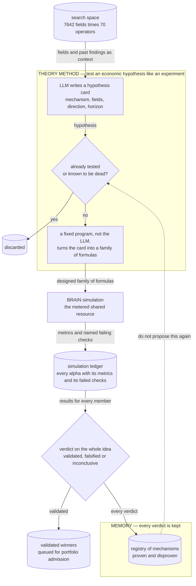

# Theory Method — pre-register a mechanism, then enumerate it

## The problem

If the space is too large to search blindly, perhaps economic reasoning can point at the right
part of it. This method exists to test that idea properly rather than assume it.

The obvious version — just ask an LLM for alpha formulas — had already failed twice in this
repository (see [`../legacy/`](../legacy/README.md)): the formulas were fluent and plausible and
almost never worked. Worse, free-form generation teaches you nothing. If one formula in fifty
works, you cannot tell whether the economic idea behind it was right or you got lucky.

So this method works like a scientist rather than a brainstormer: **state the hypothesis first,
run an experiment designed to test it, then accept the verdict.** The LLM supplies the
hypothesis. It never writes a formula.

## How it discovers alpha

1. **The LLM writes a hypothesis card, not an alpha** — an economic mechanism, the fields it
   should show up in, the expected direction and the time horizon (`economist.py`).
2. **Check it hasn't already been settled.** Ideas that were already tested, or that point into
   regions the history shows are dead, are dropped before they cost anything (`dedup.py`,
   `coverage.py`).
3. **A fixed program turns the card into a family of formulas.** Because the LLM never writes
   them, the family is a fair, systematic test of the idea rather than whatever the model happened
   to produce (`enumerate_.py`).
4. **Judge the idea, not the individual alphas.** After the family is simulated, the hypothesis
   as a whole is marked validated, falsified or inconclusive. One lucky member does not validate
   an idea (`family.py`).
5. **Remember the verdict.** A registry of every mechanism tried, and what happened to it, stops
   the LLM from proposing a disproven idea again.

The loop is driven by `tools/theory_lane.py`. The prompts behind each LLM step are kept as plain
text in [`../../core/prompts/`](../../core/prompts/); `theory_propose.md` is the best single file
to read for the method's intent.



**How to read this graph:** the labelled box is what this method puts inside the *alpha discovery module* of the [overall pipeline](../../README.md#alpha-discovery-vs-alpha-enhancement). The search space, the simulation and the ledger are shared by every method and drawn the same way in each graph.

## The code

| File | LOC | What it does |
|---|---|---|
| `alpha_discovery/theory_method/runner.py` | 406 | Theory-lane orchestration |
| `alpha_discovery/theory_method/enumerate_.py` | 358 | Theory card -> FASTEXPR family rendering |
| `alpha_discovery/theory_method/dedup.py` | 297 | Embedding-only mechanism dedup with LLM adjudication (no taxonomy) |
| `alpha_discovery/theory_method/economist.py` | 194 | TheoryEconomistAgent: pre-registered hypothesis cards from the LLM |
| `alpha_discovery/theory_method/family.py` | 194 | Family-level verdicts and the mechanism Beta posterior |
| `alpha_discovery/theory_method/context.py` | 153 | Catalogs and context assembly for the theory lane |
| `alpha_discovery/theory_method/coverage.py` | 88 | Grammar-coverage awareness for the theory enumerator |
| `alpha_discovery/theory_method/__init__.py` | 20 | Theory-first hypothesis lane |

## Running it

```bash
# dry run first — prints the proposed cards and the enumerated families, no sims
python tools/theory_lane.py --rounds 1 --n-theories 10 --dry-run

# live: --rounds 0 runs until interrupted
python tools/theory_lane.py \
    --rounds 0 --n-theories 10 --family-size 8 \
    --max-simulated 3 --batch-size 3 \
    --credentials brain2.txt
```

There is no `__main__` inside `alpha_discovery/theory_method/` itself — the lane is driven
entirely through `tools/theory_lane.py`.

## Results

### What the negative result actually says

The mechanism registry grew to 872 cards, of which 197 are falsified, and the family validation
rate stayed **flat at ~15% as the registry grew**. A flat rate under growth is the informative
part: it means the LLM was not learning which mechanisms work, it was sampling from a fixed
distribution of plausible-sounding economics.

More decisive: of the 88 candidates this lane queued into
`artifacts/theory/promote_to_brain.jsonl` — all of them submittable, robust and locally
de-correlated — only **12 raised the portfolio score**. The failure was not that the alphas were
bad. It was that they were *redundant* with what the grammar lane had already found. Economic
reasoning and structural search converged on the same crowded regions.

The lane last ran 2026-06-18; the grammar lane ran through 06-27. The lesson carried forward
into [`../sim_slot_gate/`](../sim_slot_gate/README.md): put the intelligence in **selection**,
not generation.

