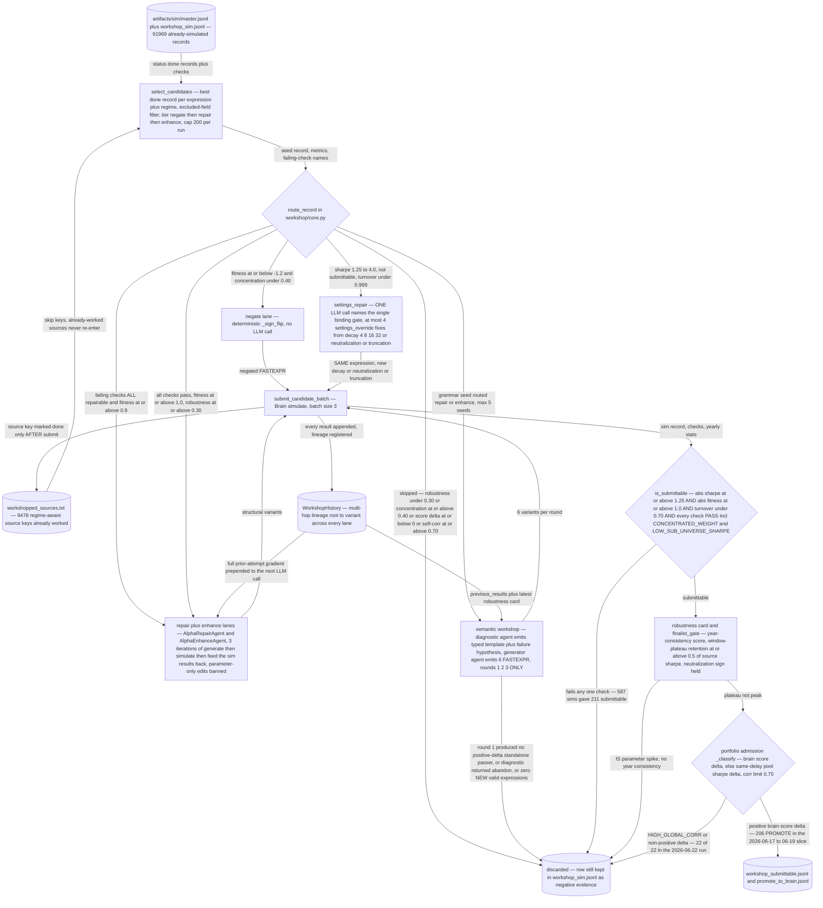

# The AI Alpha Enhancement Engine

## The problem

This is the second of the project's two pillars, and it exists because of a negative result.

Three separate attempts to make an LLM *generate* alphas all failed badly — see
[`../alpha_discovery/legacy/`](../alpha_discovery/legacy/README.md). LLM-authored expressions
were fluent, novel by every similarity measure, and empirically dead. Plain random sampling from
a grammar beat all of them.

But the diagnosis pointed at something specific. The LLM was being asked to do the one thing it
had no evidence for: predict, from the text of an expression alone, whether it would make money.
It had no feedback. Change that one condition — hand it an alpha that **already has a measured
backtest and a specific named failing check** — and the task becomes something an LLM is
genuinely good at: a constrained, diagnosable repair with a stated objective.

That is the whole thesis of this engine. **It never invents from nothing.** Its input is always
a simulated record with known metrics and known failures, and its job is to fix or extend it.

## How it enhances alpha

### Selection into the engine is hand-picked

This is deliberate and worth being explicit about, because it is the step a reader would
otherwise assume is automated. There is **no automatic promotion** from discovery into
enhancement. The researcher inspects the simulation ledger and the workshop audit, decides
which measured alphas are worth spending LLM and simulation budget on, and feeds that curated
list in — either as `--expr-file` (one expression per line) or `--from-audit <txt>`.

Only *after* that human selection does `route_record()` in `workshop/core.py` dispatch each
record automatically to one of three lanes.

### The three lanes

**negate** — the alpha has real structure but the wrong sign. The cheapest possible fix: flip
it and re-simulate. No LLM involved.

**repair** — the alpha fails a *named* check, and the repair is targeted at that check. This
splits in two. **Settings repair** changes neutralization, decay, truncation or universe while
leaving the expression untouched — often the right move for a concentration or turnover
failure, and it needs no LLM at all. **Expression repair** asks an LLM to rewrite the formula,
always with the failing check and the measured metrics in the prompt — see the next section for
the two different ways this is done.

**enhance** — the alpha already passes. The question is whether it can be made stronger without
becoming fragile, which is why robustness scoring rather than raw fitness is the acceptance
criterion.

A fourth component, `semantic_templates/`, abstracts families that were *already promoted* into
typed-slot templates and binds new fields into those slots — exploiting what worked rather than
repairing what failed.

### Two workshops: repairing an alpha vs. abstracting a template

The engine contains two components both called "workshop". They share more than the name:
**both** take a measured alpha, **both** run roughly three rounds of generate → simulate →
feed the results back (`workshop/batch.py` runs *"N rounds of (LLM generate → simulate →
feedback) for one alpha"*; the semantic runner loops `for round_index in (1, 2, 3)`), and
**both** forbid parameter chasing. That last rule is engine-wide policy, not a feature of
either one — `agents/repair.py` states *"Parameter-only variants are invalid, even if they
might improve the backtest"*, `agents/enhance.py` and the semantic generator repeat it, and
the semantic generator lists *"No parameter-only variants"* under Hard rules.

The real difference is **what each one produces**.

**The workshop** (`workshop/batch.py`, `workshop/alpha.py`, `workshop/targeted.py`, driven by
`agents/repair.py` and `agents/enhance.py`) produces **better variants of that one alpha**. The
repair agent is handed a near-miss plus its failing checks, few-shot examples of similar passing
alphas from the same dataset, and previously successful repair pairs, and it *"suggests FASTEXPR
repair expressions by wrapping the original expression with appropriate operators."* The output
stays bound to the original expression. Nothing is abstracted; when the run ends you have a
repaired alpha and nothing reusable.

**The semantic workshop** (`workshop/semantic.py`, `agents/semantic_workshop.py`) produces a
**typed semantic template** — a reusable specification of the *kind* of signal the alpha
represents. Its diagnostic agent does not emit FASTEXPR at all (*"You do NOT generate FASTEXPR
expressions"*); it returns a JSON object naming the signal and its slots:

```json
{
  "signal_identity":      "short label",
  "semantic_template":    "typed template family",
  "field_roles": {
    "main_signal":        "role and field(s)",
    "secondary_fields":   "compatible secondary field types",
    "gate_fields":        "compatible trade_when/gating fields",
    "neutralizer_fields": "compatible neutralizer/control fields"
  },
  "valid_mutation_axes":  ["axis", "..."],
  "invalid_mutations":    ["mutation to avoid", "..."],
  "failure_diagnosis":    "diagnosis based on metrics and robustness",
  "overfit_risk":         "low|medium|high",
  "recommendation":       "generate|repair|abandon"
}
```

That is the artifact the lane exists to produce. The generator agent is then *constrained by*
it — it receives the diagnostic object and must keep new fields *"semantically compatible with
the diagnostic template"* — and on success `semantic_templates/handoff.py` passes the template
into the template pipeline, where architect, field-selector and router agents **bind those slots
to new fields** and build candidates for signals the original alpha never touched.

So the two lanes sit at different levels of abstraction. The workshop asks how to fix this
expression. The semantic workshop asks what kind of signal this is, which field types can fill
each of its roles, and along which axes it may be varied — and answers in a form that
generalises past the alpha it started from. The split is visible in the code: the identifiers
`semantic_template`, `signal_identity`, `field_roles` and `mutation_axes` appear **nowhere** in
the plain workshop or its agents, and 41 times across the semantic path.

| | the workshop | the semantic workshop |
|---|---|---|
| **Produces** | repaired/enhanced variants of one alpha | a typed template: signal identity, four field-role slots, valid and invalid mutation axes |
| Unit of work | a population, triaged from the sim history | one seed, worked up in depth |
| Repairs by | wrapping the original expression | reframing the signal, within declared mutation axes |
| LLM structure | one repair/enhance agent | diagnostic agent (no FASTEXPR) + generator agent constrained by its template |
| Reusable after? | no — output is tied to that expression | yes — handed to `semantic_templates/` to bind to new fields |
| Shared with the other | 3 feedback rounds, parameter-only edits banned, measured input only | same |



## The code

| File | LOC | What it does |
|---|---|---|
| `alpha_enhancement/workshop/batch.py` **(CLI)** | 2494 | Batch auto-workshop over entire simulation history |
| `alpha_enhancement/semantic_templates/core.py` | 1623 | Deterministic helpers for semantic templates and template routing |
| `alpha_enhancement/workshop/semantic.py` **(CLI)** | 1249 | Post-grammar semantic LLM workshop runner |
| `alpha_enhancement/agents/repair.py` | 955 | LLM-based alpha repair agent using the OpenAI-backed LLM wrapper |
| `alpha_enhancement/agents/semantic_workshop.py` | 707 | Two-agent LLM helpers for post-grammar semantic workshop |
| `alpha_enhancement/workshop/alpha.py` **(CLI)** | 684 | Unified alpha fix/enhancement workshop |
| `alpha_enhancement/workshop/targeted.py` **(CLI)** | 595 | Targeted workshop runner for specific alphas |
| `alpha_enhancement/workshop/robustness_card.py` | 585 | Robustness-card helpers for semantic workshop |
| `alpha_enhancement/workshop/core.py` | 555 | Auto-workshop: route sim records to negate/repair/enhance and generate candidates |
| `alpha_enhancement/workshop/seed_resim.py` | 434 | Seed resimulation helpers for score-missing semantic/workshop sources |
| `alpha_enhancement/workshop/repair.py` **(CLI)** | 428 | Near-miss repair: scan simulation logs for high-Sharpe failing alphas and |
| `alpha_enhancement/semantic_templates/pipeline.py` **(CLI)** | 421 | Semantic template architect/router CLI |
| `alpha_enhancement/agents/enhance.py` | 408 | LLM-based alpha enhancement agents using the OpenAI-backed LLM wrapper |
| `alpha_enhancement/semantic_templates/handoff.py` | 406 | Semantic-workshop handoff into the semantic-template pipeline |
| `alpha_enhancement/workshop/semantic_context.py` | 371 | Auditable context packets for semantic workshop LLM prompts |
| `alpha_enhancement/agents/semantic_templates.py` | 360 | LLM agents for semantic template creation, field selection, and routing |
| `alpha_enhancement/workshop/scoring.py` | 306 | Shared workshop seed scoring and admission-context helpers |
| `alpha_enhancement/workshop/simulation.py` | 290 | Shared workshop candidate simulation helpers |
| `alpha_enhancement/workshop/history.py` | 197 | WorkshopHistory — shared trial history across all workshop lanes and iterations |
| `alpha_enhancement/workshop/probe_cards.py` | 186 | Compact probe-card helpers for semantic workshop diagnostics |

The submittable predicate (`is_passing`, `resolve_checks`, `failing_checks`) and the JSON parsing helpers live in the shared layer at `core/quality.py` and `core/json_utils.py`, so that discovery lanes can use them without importing the enhancement engine. Prompts are in `core/prompts/`.

## Running it

```bash
# dry run: show what would be routed where, no sims, no LLM calls
python tools/batch_workshop.py --dry-run

# hand-picked input, explicit lanes, capped LLM rounds
python -m alpha_enhancement.workshop.batch \
    --from-audit artifacts/workshop/workshop_audit.txt \
    --lane negate repair enhance \
    --workshop-iterations 3 \
    --credentials brain2.txt

# a single curated expression list
python -m alpha_enhancement.workshop.alpha \
    --expr-file my_picks.txt --credentials brain2.txt
```

The semantic workshop is a separate entry point, because it works one seed at a time:

```bash
# dry run: show the diagnostic and the round-1 plan without simulating
python tools/semantic_workshop.py --dry-run

# three rounds on one named seed
python -m alpha_enhancement.workshop.semantic \
    --seed-expr "group_rank(ts_mean(ts_zscore(returns, 20), 10), subindustry)" \
    --credentials brain2.txt \
    --diagnostics-jsonl artifacts/workshop/semantic_diagnostics.jsonl \
    --summary-txt artifacts/workshop/semantic_summary.txt

# or let it pick seeds out of a sim log
python -m alpha_enhancement.workshop.semantic \
    --sim-log artifacts/sim/master.jsonl --max-seeds 5 \
    --credentials brain2.txt
```

`--diagnostics-jsonl` is worth passing: it records each round's failure hypothesis, which is the
artifact that makes the lane auditable after the fact. Add `--no-semantic-template-auto` to stop
it handing successful seeds on to `semantic_templates/`.

## Results

### What is and is not evidenced

The workshop is the only lane in the project whose LLM calls clearly pay for themselves — its
submittable rate on hand-picked input is an order of magnitude above every generation lane.
That asymmetry is the project's central empirical finding.

`semantic_templates/` is the honest exception. It is wired, default-on inside the semantic
workshop runner, and has produced **no surviving output** — `artifacts/semantic_templates/`
does not exist. It is built, not yet evidenced, and is described that way rather than counted
as a working component.

