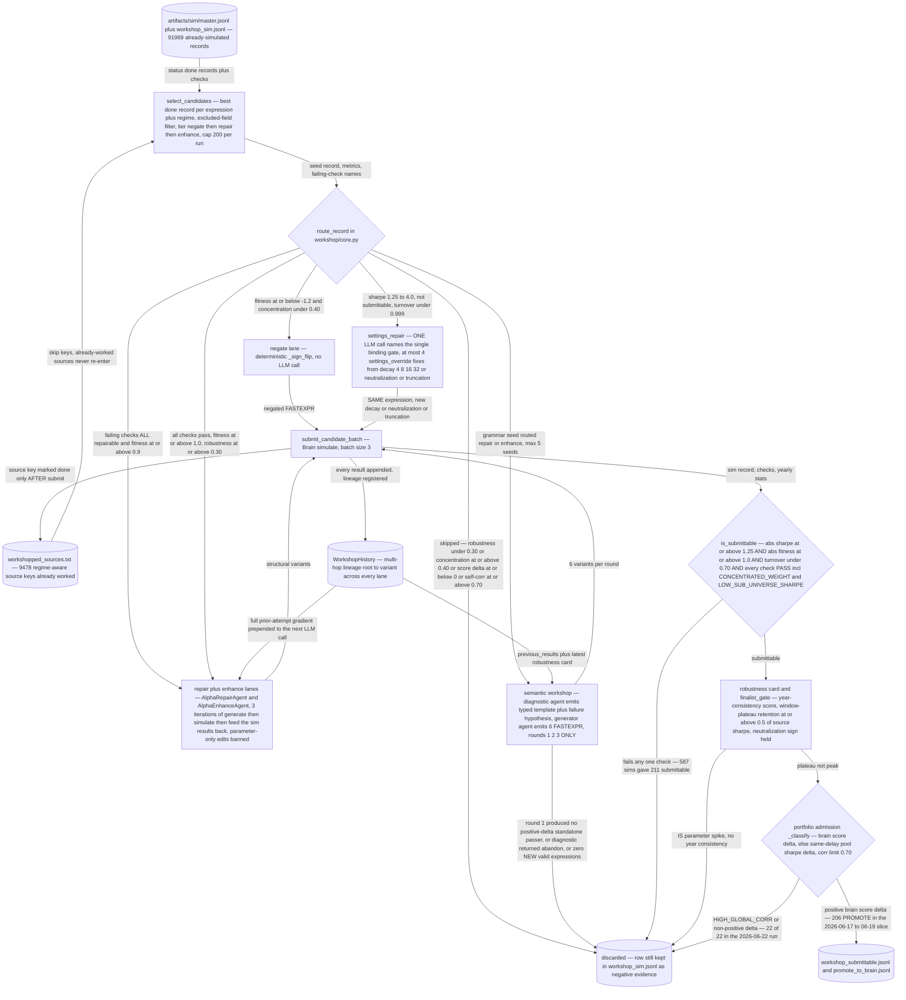

# The AI Alpha Enhancement Engine

## The problem

This is the second of the project's two pillars, and it exists because of a negative result.

Three separate attempts to make an LLM *generate* alphas all failed badly — see
[`../alpha_discovery/legacy/`](../alpha_discovery/legacy/README.md). LLM-authored expressions
were fluent, novel by every similarity measure, and empirically dead. Plain random sampling from
a grammar beat all of them.

But the diagnosis pointed at something specific. The LLM was being asked to do the one thing it
had no evidence for: predict, from the text of an expression alone, whether it would make money.
It had no feedback. Change that one condition — hand it an alpha that **already has a measured
backtest and a specific named failing check** — and the task becomes something an LLM is
genuinely good at: a constrained, diagnosable repair with a stated objective.

That is the whole thesis of this engine. **It never invents from nothing.** Its input is always
a simulated record with known metrics and known failures, and its job is to fix or extend it.

## How it enhances alpha

### Selection into the engine is hand-picked

This is deliberate and worth being explicit about, because it is the step a reader would
otherwise assume is automated. There is **no automatic promotion** from discovery into
enhancement. The researcher inspects the simulation ledger and the workshop audit, decides
which measured alphas are worth spending LLM and simulation budget on, and feeds that curated
list in — either as `--expr-file` (one expression per line) or `--from-audit <txt>`.

Only *after* that human selection does `route_record()` in `workshop/core.py` dispatch each
record automatically to one of three lanes.

### The three lanes

**negate** — the alpha has real structure but the wrong sign. The cheapest possible fix: flip
it and re-simulate. No LLM involved.

**repair** — the alpha fails a *named* check, and the repair is targeted at that check. This
splits in two. **Settings repair** changes neutralization, decay, truncation or universe while
leaving the expression untouched — often the right move for a concentration or turnover
failure, and it needs no LLM at all. **Expression repair** asks an LLM to rewrite the formula,
always with the failing check and the measured metrics in the prompt — see the next section for
the two different ways this is done.

**enhance** — the alpha already passes. The question is whether it can be made stronger without
becoming fragile, which is why robustness scoring rather than raw fitness is the acceptance
criterion.

A fourth component, `semantic_templates/`, abstracts families that were *already promoted* into
typed-slot templates and binds new fields into those slots — exploiting what worked rather than
repairing what failed.

### Two workshops: triage and identity-preserving repair

The engine contains two different things both called "workshop", and the difference matters
more than the shared name suggests. They answer different questions and they fail in different
ways.

**The workshop** (`workshop/batch.py`, `workshop/alpha.py`, `workshop/targeted.py`) is
**breadth**. It scans the whole simulation history, keeps the best representative per field,
and triages each record on its *metrics*: fitness below a floor routes to negate, a repairable
failing check with acceptable concentration routes to repair, a fully passing alpha routes to
enhance. Each record then gets one pass through its lane. The repair agent
(`agents/repair.py`) takes a near-miss and suggests fixes by **wrapping the original expression
with operators** chosen to address the named failing check.

That is the right tool for processing a population, and it has an obvious failure mode: wrapping
an expression until a check goes green can satisfy the check while destroying the reason the
alpha worked. You end up with something that passes and means nothing.

**The semantic workshop** (`workshop/semantic.py`, `agents/semantic_workshop.py`) is **depth**,
and it exists to avoid exactly that. It takes a *single* seed and runs three rounds:

```
seed → diagnostic → generator → simulate → robustness card
     → diagnostic update → generator → simulate → robustness card
     → diagnostic update → generator → simulate → final summary
```

Two things make it different from the plain repair lane.

**The division of labour between two agents is enforced.** The diagnostic agent's system prompt
opens with *"You do NOT generate FASTEXPR expressions. Your job is to turn a grammar or workshop
seed into a semantic template and a failure/repair hypothesis."* The generator agent writes
expressions but does no diagnosis, and the runner submits only its `expression` field, ignoring
its rationale. So the component that reasons about *why* the alpha failed cannot shortcut its
way to an answer by emitting a formula, and the component that writes formulas never gets to
decide what the problem was. This is the same separation the
[theory method](../alpha_discovery/theory_method/README.md) applies on the generation side.

**It is explicitly forbidden from parameter chasing.** The diagnostic agent is instructed:
*"Do not recommend parameter chasing. Valid repairs must preserve or explicitly reframe the
semantic signal identity."* It is also told *"Do not optimize exact robustness rows; use
robustness only to diagnose whether signal identity is stable"*. And on the trap of optimising
the wrong objective: *"If score addition improves while standalone quality deteriorates,
diagnose that as a watchlist/fragile outcome, not a solved alpha."*

That is what "semantic" means here. The unit being repaired is not the expression string and
not the failing metric — it is the **signal identity**, the economic claim the alpha is making.
A repair is only valid if that claim survives, or if the diagnosis says plainly that it has been
reframed into a different one.

The round structure is what lets this work: the robustness card from each simulation goes back
to the diagnostic agent, so round 2 is conditioned on measured evidence about whether the
identity held, not on the LLM's own guess. The card is deliberately diagnostic only — it
excludes delay perturbations and `sign(A)` checks — so it cannot be optimised against. Three
rounds is a hard cap, which is what stops a failing repair from looping on the simulation budget.

Once a seed has been worked up this way, `semantic_templates/` takes over (on by default) and
abstracts the result into a typed template for reuse.

| | the workshop | the semantic workshop |
|---|---|---|
| Unit of work | a population, from the sim history | one seed |
| Decides by | metric thresholds | a stated failure hypothesis |
| Shape | one pass per record | 3 rounds, feedback between them |
| Agents | one repair/enhance agent | diagnostic + generator, separated |
| Repairs by | wrapping the expression | preserving or reframing signal identity |
| Guards against | wasted LLM calls on hopeless records | passing a check while losing the signal |



## The code

| File | LOC | What it does |
|---|---|---|
| `alpha_enhancement/workshop/batch.py` **(CLI)** | 2494 | Batch auto-workshop over entire simulation history |
| `alpha_enhancement/semantic_templates/core.py` | 1623 | Deterministic helpers for semantic templates and template routing |
| `alpha_enhancement/workshop/semantic.py` **(CLI)** | 1249 | Post-grammar semantic LLM workshop runner |
| `alpha_enhancement/agents/repair.py` | 955 | LLM-based alpha repair agent using the OpenAI-backed LLM wrapper |
| `alpha_enhancement/agents/semantic_workshop.py` | 707 | Two-agent LLM helpers for post-grammar semantic workshop |
| `alpha_enhancement/workshop/alpha.py` **(CLI)** | 684 | Unified alpha fix/enhancement workshop |
| `alpha_enhancement/workshop/targeted.py` **(CLI)** | 595 | Targeted workshop runner for specific alphas |
| `alpha_enhancement/workshop/robustness_card.py` | 585 | Robustness-card helpers for semantic workshop |
| `alpha_enhancement/workshop/core.py` | 555 | Auto-workshop: route sim records to negate/repair/enhance and generate candidates |
| `alpha_enhancement/workshop/seed_resim.py` | 434 | Seed resimulation helpers for score-missing semantic/workshop sources |
| `alpha_enhancement/workshop/repair.py` **(CLI)** | 428 | Near-miss repair: scan simulation logs for high-Sharpe failing alphas and |
| `alpha_enhancement/semantic_templates/pipeline.py` **(CLI)** | 421 | Semantic template architect/router CLI |
| `alpha_enhancement/agents/enhance.py` | 408 | LLM-based alpha enhancement agents using the OpenAI-backed LLM wrapper |
| `alpha_enhancement/semantic_templates/handoff.py` | 406 | Semantic-workshop handoff into the semantic-template pipeline |
| `alpha_enhancement/workshop/semantic_context.py` | 371 | Auditable context packets for semantic workshop LLM prompts |
| `alpha_enhancement/agents/semantic_templates.py` | 360 | LLM agents for semantic template creation, field selection, and routing |
| `alpha_enhancement/workshop/scoring.py` | 306 | Shared workshop seed scoring and admission-context helpers |
| `alpha_enhancement/workshop/simulation.py` | 290 | Shared workshop candidate simulation helpers |
| `alpha_enhancement/workshop/history.py` | 197 | WorkshopHistory — shared trial history across all workshop lanes and iterations |
| `alpha_enhancement/workshop/probe_cards.py` | 186 | Compact probe-card helpers for semantic workshop diagnostics |

The submittable predicate (`is_passing`, `resolve_checks`, `failing_checks`) and the JSON parsing helpers live in the shared layer at `core/quality.py` and `core/json_utils.py`, so that discovery lanes can use them without importing the enhancement engine. Prompts are in `core/prompts/`.

## Running it

```bash
# dry run: show what would be routed where, no sims, no LLM calls
python tools/batch_workshop.py --dry-run

# hand-picked input, explicit lanes, capped LLM rounds
python -m alpha_enhancement.workshop.batch \
    --from-audit artifacts/workshop/workshop_audit.txt \
    --lane negate repair enhance \
    --workshop-iterations 3 \
    --credentials brain2.txt

# a single curated expression list
python -m alpha_enhancement.workshop.alpha \
    --expr-file my_picks.txt --credentials brain2.txt
```

The semantic workshop is a separate entry point, because it works one seed at a time:

```bash
# dry run: show the diagnostic and the round-1 plan without simulating
python tools/semantic_workshop.py --dry-run

# three rounds on one named seed
python -m alpha_enhancement.workshop.semantic \
    --seed-expr "group_rank(ts_mean(ts_zscore(returns, 20), 10), subindustry)" \
    --credentials brain2.txt \
    --diagnostics-jsonl artifacts/workshop/semantic_diagnostics.jsonl \
    --summary-txt artifacts/workshop/semantic_summary.txt

# or let it pick seeds out of a sim log
python -m alpha_enhancement.workshop.semantic \
    --sim-log artifacts/sim/master.jsonl --max-seeds 5 \
    --credentials brain2.txt
```

`--diagnostics-jsonl` is worth passing: it records each round's failure hypothesis, which is the
artifact that makes the lane auditable after the fact. Add `--no-semantic-template-auto` to stop
it handing successful seeds on to `semantic_templates/`.

## Results

### What is and is not evidenced

The workshop is the only lane in the project whose LLM calls clearly pay for themselves — its
submittable rate on hand-picked input is an order of magnitude above every generation lane.
That asymmetry is the project's central empirical finding.

`semantic_templates/` is the honest exception. It is wired, default-on inside the semantic
workshop runner, and has produced **no surviving output** — `artifacts/semantic_templates/`
does not exist. It is built, not yet evidenced, and is described that way rather than counted
as a working component.

