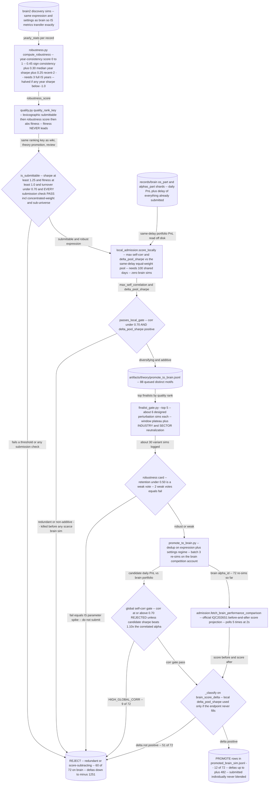

# Portfolio Admission — does total score actually go up?

## The problem

Competition points accrue to the **portfolio**, not to the alpha. This single fact invalidates
the obvious objective function.

A candidate can pass every platform check — good Sharpe, acceptable turnover, clean
concentration, solid sub-universe behaviour — and still be worth exactly nothing, because its
PnL is a repaint of something already submitted. The portfolio's score does not move. All the
simulation budget spent proving it was a good alpha was spent proving the wrong thing.

So the real admission question is marginal, not absolute: **does total score increase once this
alpha joins what is already there?** That is a different and much harder test than "is this
alpha good", and it is the last gate before submission.

## How it decides

Two paths to the same question, at different cost.

`admission.py` asks the platform directly: fetch the official before/after competition score
projection for the portfolio with and without the candidate, and pair it with a
self-correlation check against existing submissions. Authoritative, but it needs a live account
and consumes API budget.

`local_admission.py` estimates the same thing offline from cached PnL vectors alone. Less
precise, but it needs no account at all — which makes it the one part of this component a
reader can actually exercise.

The ordering rule the whole repository enforces lives next door in `../quality.py`:
**submittable > score > fitness, never fitness-led.** An alpha is first required to pass every
check, then ranked by marginal score, and fitness is only a tiebreaker. `../robustness.py`
supplies the year-consistency score used as the selection criterion, so that a candidate which
owes its edge to one lucky year is not promoted over a steadier one.



## The code

| File | LOC | What it does |
|---|---|---|
| `core/portfolio/admission.py` **(CLI)** | 671 | Portfolio-aware admission scoring for workshop candidates |
| `core/portfolio/local_admission.py` | 147 | Local (no-brain-account) score-addition estimate |
| `core/portfolio/__init__.py` | 2 | Portfolio admission helpers |

## Running it

```bash
# dry run — print the promotion queue, no sims, no auth
./run_promote_brain.sh

# re-simulate the queue on the competition account and compute official score deltas
./run_promote_brain.sh go

# perturbation cards for finalists
python tools/finalist_gate.py --help
```

Promotion to the competition account triggers interactive biometric authentication, so this
stage cannot run headless.

## Results

The gate is where "good alphas" go to die, and that is the point. Of 72 brain re-simulations of candidates that were ALL already submittable, robust and locally de-correlated, only 12 actually raised the competition score (POSITIVE_BRAIN_SCORE_DELTA, best +482); 51 were rejected for a non-positive delta (worst -1251) and 9 for HIGH_GLOBAL_CORR -- a ~17% score-add hit rate among alphas every sim-level filter had already blessed (artifacts/theory/promote_run.log, 72 [admit] rows). A standalone re-rank of the top 50 workshop candidates returned 50/50 REJECT HIGH_GLOBAL_CORR (artifacts/portfolio_admission/ranked.txt), which is the empirical argument for the lane's existence: structural novelty in the expression does not imply PnL novelty in the portfolio. PIPELINE.md "Two Pools" and "Stage 2.7" sections state the rule that only a brain re-sim confirms score-add; dedup.md records the same failure mode (the anl4_adjusted_netincome cluster, theory_0268's -161 delta).

This gate is where good alphas go to die, and that is the point. Of a batch of candidates that
were **all** already submittable, robust and locally de-correlated, only about one in six
actually raised the portfolio score; the rest were rejected for a non-positive delta or for high
global correlation. A separate ranked batch was rejected unanimously for correlation.

That is the strongest evidence in the repository for the claim that **redundancy, not quality,
is the binding constraint** — and it is the reason the
[sim-slot gate](../../alpha_discovery/sim_slot_gate/README.md) treats redundancy as a
first-class object rather than an afterthought.

