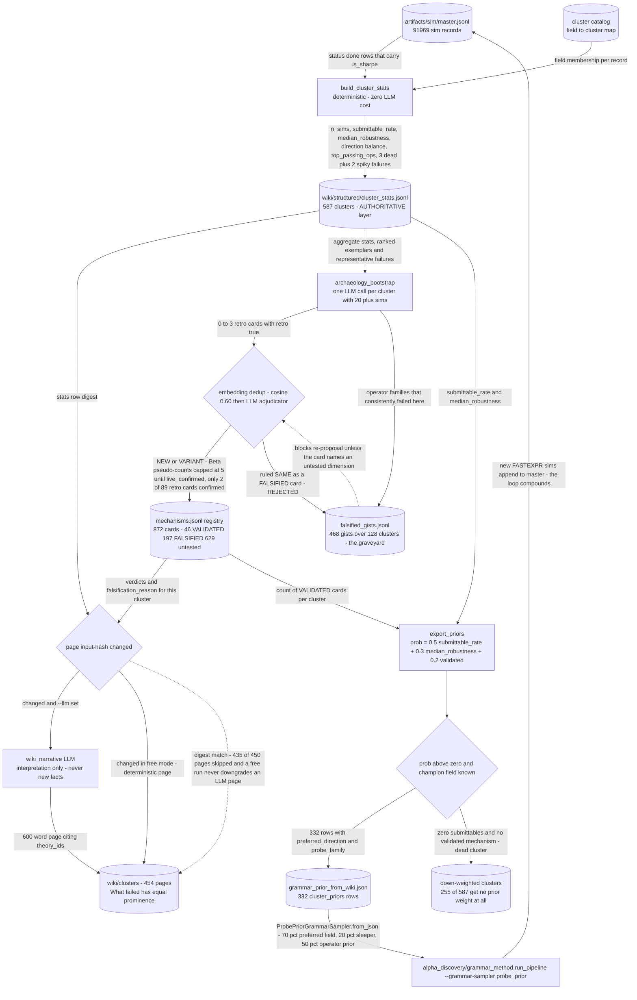

# Wiki Posterior — the component that closes the loop

## The problem

A search that does not remember re-pays for the same dead ends forever.

Each discovery lane, run in isolation, starts from the same uninformed prior over where signal
might live. The grammar lane samples a cluster, finds nothing, and — absent some persistent
memory — is just as likely to sample it again next session. Across tens of thousands of
simulations that is an enormous amount of re-purchased knowledge.

This component's job is to make the search **compound**. Every simulation, win *or* failure, is
aggregated into a per-cluster posterior, and that posterior is exported back as the grammar
lane's sampling prior. A region repeatedly proven dead gets down-weighted in future derivation.
It is the one edge in the system that feeds results back into generation.

## How it discovers alpha

`generate.py` reads the full simulation ledger and aggregates it per field cluster into
structured statistics, then has an LLM write a short narrative page per cluster so the evidence
is readable rather than just tabulated. The prompts are data, in `../prompts/wiki_narrative.md`
and `../prompts/archaeology_cluster.md`.

The important output is not the prose. `--export-priors` writes a compact prior keyed by cluster
— a field, a probe family, a preferred direction and a score — which
`alpha_discovery/grammar_method/probe_prior.py` consumes as a sampling distribution. Clusters
whose evidence is too thin to support a direction are dropped rather than given a weak prior.

One governing rule from the project's docs is worth repeating here, because it is the difference
between a prior and a lie: a retrospective result is treated as a **prior over where to look
next**, never as evidence of live performance.



## The code

| File | LOC | What it does |
|---|---|---|
| `core/wiki/generate.py` | 484 | Wiki generation: structured aggregation, narrative pages, prior export |
| `core/wiki/__init__.py` | 13 | Research wiki: the persistent posterior store of the theory loop |

## Running it

```bash
# aggregate the ledger, write narrative pages, and export the grammar prior
python tools/build_wiki.py --llm --export-priors --min-sims 10

# backfill cluster evidence from historical simulations
python tools/archaeology_bootstrap.py --min-sims 20
```

`wiki/` is gitignored because it is regenerable; a few committed example pages live in
[`../../samples/wiki/`](../../samples/wiki/).

## Results

Empirically the lane is a falsification engine first and a generator second. From 91,969 master sim records it produced 587 clusters with evidence and 454 narrative pages (wiki/index.md header: "mechanisms: 872 (46 validated, 197 falsified), clusters with evidence: 587"), i.e. falsified mechanisms outnumber validated ones 4.3 to 1 and 468 falsified gists over 128 clusters now sit in the graveyard blocking re-proposal. The posterior separates clusters sharply: model16 earnings-sustainability got 740 sims for 0 submittables while analyst4 revision clusters hit 0.30-0.36 submittable rates with median robustness 0.455-1.0, and export_priors turns that into 332 prior rows (probability 0.0135 to 0.689) while 255 of 587 clusters are dropped to zero grammar weight entirely. Archaeology confirms the governing retro-as-prior rule rather than contradicting it: of 89 retro cards registered, only 2 ever earned live_confirmed, which is why PIPELINE.md states "Retro (archaeology) theories are PRIOR, not posterior: they need a live confirmation family before VALIDATED" and why family.py caps retro Beta pseudo-counts at 5. Note the honest caveat recorded in the grammar lane's own argparse help: the cluster catalog covers only about 7 percent of the live field universe, so the default sampler is uniform and the wiki prior is opt-in via --grammar-sampler probe_prior.

The striking thing about the posterior is its shape: **falsified mechanisms outnumber validated
ones by more than four to one**, and roughly half the clusters with any evidence have too
little of it to support a directional prior and are dropped.

So in practice this is a falsification engine first and a generator second. Its main product is
a map of where *not* to spend the next simulation — which, given that the binding constraint is
the simulation slot, is worth more than another list of candidates.

