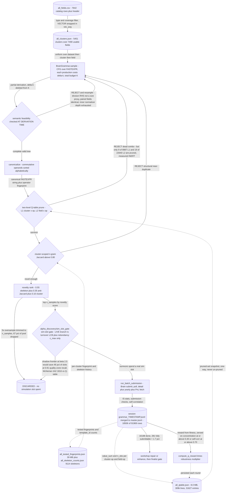

# Grammar Search: CFG-Generated FASTEXPR Discovery

**A context-free grammar over FASTEXPR with a Δk depth budget, semantic constraints enforced at derivation time, and three stacked prune datastores guarding every simulation slot.**

[&larr; back to the pipeline overview](../../README.md)

The bet is that alpha discovery is a *search* problem, not a *generation* problem: a cheap stochastic sampler over a well-specified expression grammar covers structure space faster than any LLM can propose it, so the intelligence belongs in SELECTION — what you refuse to simulate — not in authoring. Hence the shape: an extremely productive generator (a CFG whose productions each cost Δk, bounded by a total budget K) bolted to an increasingly expensive stack of pre-sim filters, because the binding constraint is the Brain simulation slot, not candidate supply. Every gate writes its evidence to a persistent datastore so the next round starts from the accumulated 92k-sim history rather than from scratch.

## Pipeline



## Stages

| Stage | Implementation | What it does |
|---|---|---|
| 1. Field catalog to clusters | `alpha_discovery/grammar_method/fields.py` | 7643 CSV rows filtered by type and coverage, clustered into 5451 cached clusters over 7490 usable fields |
| 2. CFG derivation under Δk budget | `alpha_discovery/grammar_method/grammar.py` | Alpha and Expr productions each debit Δk from budget K; K bounds reachable expression shapes |
| 3. Derivation-time semantic constraints | `alpha_discovery/grammar_method/grammar.py feasible_*_productions` | Division RHS must be a size proxy, paired fields distinct, inner-normalizer depth capped at 1. Not a post-filter |
| 4. Commutative canonicalization | `alpha_discovery/grammar_method/grammar.py canonicalize` | Sorts commutative operands so add of a and b equals add of b and a; halves the paired-operator space |
| 5. Two-level Q-table prune | `alpha_discovery/grammar_method/qtable.py` | One-way prune of cluster-op and field-op pairs. MIN_OBS 8 and 12, mean_q below 0.05. Measured near-inert |
| 6. Structural novelty veto and rank | `alpha_discovery/grammar_method/novelty.py plus planner.py` | Cluster-scoped n-gram Jaccard above 0.80 vetoed; 3x oversampled pool ranked by novelty, trimmed to n_samples |
| 7. Sim-slot gate and submit | `alpha_discovery/grammar_method/run_pipeline.py run_batch_submission` | alpha_discovery/sim_slot_gate surrogate kills 46 pct of slots, then survivors are threaded to Brain and polled to completion |
| 8. Reward, persist, merge | `alpha_discovery/grammar_method/run_pipeline.py main` | Fitness times robustness reward with concentration and self-correlation vetoes; Q-table, fingerprints, master.jsonl all updated per round |

## Running it

```bash
python -m alpha_discovery/grammar_method.run_pipeline --fields-csv all_fields.csv --credentials brain2.txt --delay 1 --exclude-dataset analyst4 --rounds 0 --budget 6 --n-samples 300 --batch-size 3 --max-candidates 300 --gate-mode reliable
```

## Outcome

Measured on artifacts/sim/master.jsonl (2026-06): 18,506 grammar-lane records of 91,969 total, 16,188 completed, 482 at IS Sharpe >= 1.25 (3.0%), and 281 passing every submission gate including concentrated-weight and sub-universe (1.7% hit rate). That is the repo's best generator — the decompose-expand variant scored 0/100 submittable (memory note llm-generator-underperforms), which is why PIPELINE.md keeps grammar running as the background evidence collector. Two honest negatives sit inside the lane. (1) dedup.md's measurement over 84,717 records: only 7.9% of (skeleton, field-set) cells ever recur, 92.3% of cells top out below Sharpe 1.25, and 90.5% of sim budget is spent in cells history already proved dead — so identity dedup was solving the wrong problem. (2) The lane's own Q-table pruner is effectively inert: I verified 9 of 8987 L1 and 19 of 22640 L2 entries pruned (<0.15%), matching CALIBRATION_REPORT.md line 112 and ASSUMPTIONS.md G3, where the alpha_discovery/sim_slot_gate surrogate challenger dominates it (46% slots saved at 0.91 quality-zone recall, McNemar chi2 = 1816). The real pre-sim cull today is the 3x novelty oversample-and-trim plus that gate, not the Q-table.

