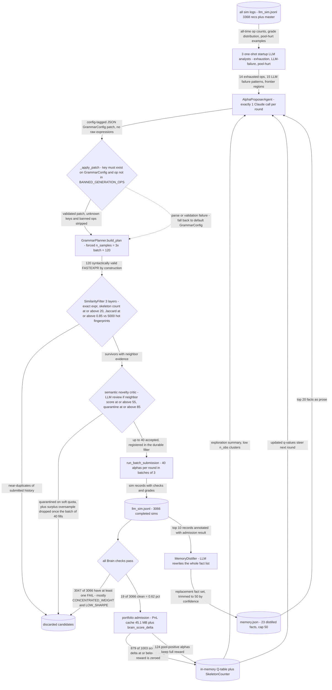

# LLM-as-Grammar-Controller (retired)

*The LLM never writes an expression - it emits a GrammarConfig patch, so the grammar guarantees validity and the LLM only steers the search distribution.*

[&larr; back to the pipeline overview](../../README.md)

Bet: an LLM is a bad expression generator but might be a good *search-distribution controller*. So `proposer.py` makes exactly one Claude call per round that returns a JSON **patch** onto the dataclass `GrammarConfig` - which operator categories are allowed, budget K, groups, min_coverage, nesting probabilities - and `GrammarPlanner` then samples the actual FASTEXPR. Syntactic validity and operator bans are structurally guaranteed by the sampler, never by prompt compliance, and the LLM's whole output surface is ~10 numbers. A second bet rides on top: `memory.py` keeps an LLM-distilled fact base (max 50 facts) plus three one-shot startup analysts, so what the search learns from 85k historical sims is carried across rounds as prose rather than only as Q-values.

## Pipeline



## Stages

| Stage | Implementation | What it does |
|---|---|---|
| Startup analysis (once per session) | `legacy/alpha_discovery/legacy.llm_grammar_control_method/history_summarizer.py` | Three single-purpose LLM agents mine all sim logs for exhausted op regions, repeated LLM failure modes, pool-hurt patterns |
| Config-patch proposal | `legacy/alpha_discovery/legacy.llm_grammar_control_method/proposer.py` | One Claude call emits a GrammarConfig patch; validator keeps only real dataclass fields and non-banned operators |
| Grammar sampling | `legacy/alpha_discovery/legacy.llm_grammar_control_method/proposer.py:_sample_candidates` | GrammarPlanner samples 3x batch valid FASTEXPR from the patched config, tagged search_lane llm_grammar |
| Deterministic novelty filter | `legacy/alpha_discovery/legacy.llm_grammar_control_method/similarity.py` | Exact-string, skeleton count cap 20, then Jaccard 0.85 against a 5000-record hot fingerprint ring |
| Semantic novelty critic | `legacy/alpha_discovery/legacy.llm_grammar_control_method/semantic_novelty.py` | LLM critic scores only candidates with neighbor score >= 55; quarantines at >= 85 with tagged reasons |
| Brain submission | `legacy/alpha_discovery/legacy.llm_grammar_control_method/runner.py:run_one_round` | 40 accepted candidates per round submitted in batches of 3, appended to llm_sim.jsonl, merged to master on exit |
| Portfolio admission and Q-update | `legacy/alpha_discovery/legacy.llm_grammar_control_method/runner.py:_score_batch_admission` | Clean alphas get PnL plus brain_score_delta; non-positive contribution zeroes the Q-table reward |
| Memory distillation | `legacy/alpha_discovery/legacy.llm_grammar_control_method/memory.py` | LLM rewrites the whole fact base from batch results, persisted to memory.json and replayed next round |

## Running it

```bash
cd legacy && python -m alpha_discovery/legacy.llm_grammar_control_method.runner --rounds 5 --batch-size 40 --credentials ../brain.txt --delay 1 --semantic-review-threshold 55 --semantic-quarantine-threshold 85    # there is no top-level alpha_discovery/legacy.llm_grammar_control_method/ package; it lives only under legacy/. All six flags DO exist in legacy/alpha_discovery/legacy.llm_grammar_control_method/runner.py.
```

## Outcome

Empirically worse than the plain grammar + Q-table lane it was meant to replace. The lane's own log (`legacy/alpha_discovery/legacy.llm_grammar_control_method/artifacts/llm_sim.jsonl`, 3368 rows / 3066 completed sims) contains only **19 records with zero FAIL checks - 0.62%**, against the grammar lane's 1.74% submittable yield recorded in the project memory note `llm-generator-underperforms.md`. Of 1003 admission-scored alphas across 32 primary operators, **879 (87.6%) had contribution delta <= 0** (`portfolio_score_history.json`), i.e. they would have hurt the pool.

Why steering-by-LLM lost: (1) **resolution mismatch** - the LLM sees prose summaries (op counts, grade distributions, 20 fact bullets) and answers with a category-level prior over operators, while the Q-table it was replacing already carries per-(skeleton, cluster) counts at far finer granularity; a coarse prior laid over a fine one only loses information. (2) **bandwidth** - one patch per 40 sims means the LLM contributes a handful of decisions per round and the grammar's own sampler makes every remaining choice, so the measurable variance between rounds is sampler noise, not steering. (3) **the facts were already encoded deterministically** - the distilled memory and `llm_failure_analysis.json` converged on findings the pipeline already hard-coded, e.g. `if_else` on sparse analyst fields at 99% LOW_SHARPE / 208 fails, `group_mean` >90% flatline, and CONCENTRATED_WEIGHT as the dominant killer at ~50% of expressions - exactly the content of `BANNED_GENERATION_OPS` and the coverage thresholds, obtained for free. (4) **cost** - every round burned Claude calls for the patch, the semantic critic and the distiller, and the lane accreted 72MB of artifacts (45.1MB `pnl_cache.json` alone) for a lower hit rate. The semantic gate also shows the oversample was mostly waste: of 3232 scored candidates, 2082 were dropped purely as surplus once the batch of 40 filled.

## Retired because

Falsified on its own terms: giving the LLM control of the search *distribution* (rather than the expressions) still failed to beat random/Q-table grammar sampling - 0.62% clean-check rate vs ~5% for the grammar lane, with 87.6% of its scored alphas pool-negative. The conclusion recorded in `llm-generator-underperforms.md` is that an alpha's edge is a specific field x structure interaction that lives in simulation history, not in anything an LLM can summarise as prose, so intelligence belongs in SELECTION not generation. The lane's descendants kept the selection half and dropped the LLM controller: the kNN dead-zone prune (`dedup.md`) and the `alpha_discovery/sim_slot_gate/` sim-slot gate (beta=2.0, 71% of slots saved at 91% recall). Archived under `legacy/` with a no-import policy; `alpha_discovery/grammar_method/` + `alpha_enhancement/workshop/` are the active path.

