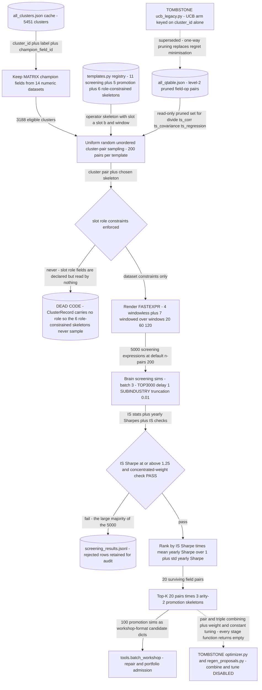

# Operator-First Template Search and Its Tombstones

*Fix the operator skeleton first and search fields into it - the inverse of grammar search - plus three deliberately disabled successors.*

[&larr; back to the pipeline overview](../../README.md)

Grammar search derives expression shapes from a production grammar and then discovers which shapes work. This lane bets the opposite way: that the economically meaningful object is a small hand-written registry of operator SKELETONS - 22 of them in templates.py, each one "one economic hypothesis via a fixed operator skeleton" - and that the only thing worth searching is which field pair drops into the slots. Slots carry declared dataset and semantic-role constraints so that, for example, a fundamental-yield skeleton can only take an income-statement numerator over a market-size denominator. Two of the three archived pieces here are tombstones that record why the obvious next moves - a UCB bandit over field clusters, and a combiner/tuner over winning alphas - were rejected rather than shipped.

## Pipeline



## Stages

| Stage | Implementation | What it does |
|---|---|---|
| 1. Skeleton registry (a) | `legacy/alpha_discovery/legacy.operator_skeleton_method/templates.py` | 22 frozen RelationshipTemplate skeletons - 11 screening, 5 promotion, 6 role-constrained - each with slot and window constraints. |
| 2. Cluster pool and Q-prune (a) | `legacy/alpha_discovery/legacy.operator_skeleton_method/field_sampler.py` | 5451 cached clusters filtered to 3188 MATRIX champions in 14 numeric datasets, minus Q-table level-2 pruned field-op pairs. |
| 3. Pair sampling and render (a) | `legacy/alpha_discovery/legacy.operator_skeleton_method/promoter.py` | Uniform random unordered cluster pairs, 200 per skeleton, rendered across the window grid into 5000 FASTEXPR strings. |
| 4. Brain screen and score (a) | `legacy/alpha_discovery/legacy.operator_skeleton_method/screener.py` | Threaded sim submission reusing grammar retry and re-auth, then IS Sharpe times mean-over-one-plus-std yearly consistency. |
| 5. Promotion (a) | `legacy/alpha_discovery/legacy.operator_skeleton_method/promoter.py` | Top-20 pairs above Sharpe 1.25 with concentrated-weight PASS re-enter 3 arity-2 skeletons, giving 100 promotion sims. |
| 6. Tombstone - UCB bandit (b) | `legacy/alpha_discovery/grammar_method/ucb_legacy.py` | 130-line bandit, one arm per cluster, c equals 1.4, coverage prior. Replaced by two-level one-way Q pruning. |
| 7. Tombstone - combo optimizer (c) | `legacy/wq_alpha/search/optimizer.py` | 299 lines kept as a compatibility shell: eight stage functions return empty, render_expression and to_candidate raise RuntimeError. |
| 8. Tombstone - proposal CLI (c) | `legacy/tools/regen_proposals.py` | 19-line entrypoint that prints the refusal and redirects reviewers to ranked.jsonl or workshop_submittable.jsonl for individual review. |

## Running it

```bash
cd legacy && python -m alpha_discovery/legacy.operator_skeleton_method.pipeline --dry-run --n-pairs 20    # real run: python -m alpha_discovery/legacy.operator_skeleton_method.pipeline --n-pairs 200 --seed 42 --top-k 20 --sharpe-threshold 1.25
```

## Outcome

No empirical yield survives, and that is the finding. Git history shows only the seven .py files were ever tracked under alpha_discovery/legacy.operator_skeleton_method - the lane's own artifacts/screening_results.jsonl and artifacts/promoted_candidates.jsonl were never committed, and grepping all 1664 .jsonl files in the repo returns zero rows carrying search_lane "alpha_discovery/legacy.operator_skeleton_method", so no promoted alpha from this lane ever reached artifacts/sim/master.jsonl. legacy/README.md files it as "Historical operator/relationship search experiments" under a policy of "Do not import legacy modules from active code," and nothing outside legacy/ imports it. Two structural reasons it was abandoned are visible in the code itself. First, the headline idea never ran: slot_a_roles and slot_b_roles are declared on RelationshipTemplate and populated for all 6 role-constrained skeletons, but no code reads them and ClusterRecord has no role attribute at all, so pipeline.main uses only SCREENING_TEMPLATES and filters slots by dataset. What actually executed was uniform random pairing - field_sampler's own docstring admits "No coverage filter. No co-occurrence weighting. Pure uniform random over the cluster pool" - which costs 5000 sims per sweep with no within-lane learning, since the Q-table is read-only here and never written back. Second, the two disabled stubs state the research position explicitly. optimizer.py: "Pair/triple expression combining, serial settings tuning, weight tuning, and constant tuning are intentionally disabled because they are highly exposed to in-sample selection bias." regen_proposals.py: "The active pipeline reviews and submits PROMOTE candidates individually rather than combining multiple alphas into one expression." The UCB tombstone fails for a frame mismatch rather than a bias one: its arm key is cluster_id alone, so it cannot represent that a field is dead under ts_corr yet alive under divide, and its log-exploration bonus guarantees perpetual re-pulling of arms already known to be dead. The successor alpha_discovery/grammar_method/qtable.py instead keys on (cluster, op) and (field, op), prunes at mean_q below threshold after MIN_OBS_L1 8 and MIN_OBS_L2 12 observations, and states "Pruning is one-way: entries are never un-pruned" - the objective is permanent elimination of dead search space under a fixed sim budget, not cumulative-regret minimisation over a stationary reward.

## Retired because

Retired on three independent falsifications. (1) The distinguishing mechanism was never live: slot_a_roles and slot_b_roles are declared on every role-constrained skeleton but read by no code, and ClusterRecord has no role field, so what executed was uniform random cluster pairing into 11 fixed skeletons - a 5000-sim random sweep, strictly dominated by the grammar lane which derives shapes AND writes its Q-table feedback back. (2) The hand-written registry is a hard ceiling: 22 skeletons cannot be extended without a human editing templates.py, whereas the grammar lane enumerates skeletons mechanically. (3) No promoted alpha was ever logged - zero rows with search_lane "alpha_discovery/legacy.operator_skeleton_method" across all 1664 .jsonl files - so the lane produced no evidence it beat the lane it was meant to complement. The UCB bandit was separately retired for a frame mismatch: arms keyed on cluster_id alone cannot express operator-conditional deadness, and UCB's exploration bonus mandates re-pulling known-dead arms, while the real objective under a fixed sim budget is permanent one-way pruning of dead (cluster, op) and (field, op) regions. The optimizer and proposal-regen tools were disabled on principle rather than on evidence - combining, weight tuning, and constant tuning are "highly exposed to in-sample selection bias" - and are kept as executable tombstones so the refusal is documented in code, not just in prose.

