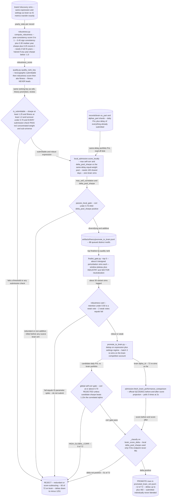

# Portfolio Admission: Does Adding This Alpha Add Score?

**Passing a simulation is not the bar. The bar is whether the competition score goes UP once this alpha joins what is already submitted.**

[&larr; back to the pipeline overview](../../README.md)

A submittable alpha is worthless if it is a repaint of something already in the portfolio: the IQC score is a property of the submitted *pool*, not of a single backtest. This lane therefore refuses to treat sim metrics as admission, and instead asks Brain for the official before/after competition-score projection plus a global self-correlation check, with an account-free PnL-only estimate used to kill redundant candidates before any scarce brain simulation is spent. It also owns the repo-wide ordering rule that every other lane imports: submittable, then year-consistency robustness score, then fitness as a mere tiebreaker -- never fitness-led.

## Pipeline



## Stages

| Stage | Implementation | What it does |
|---|---|---|
| Quality ordering (repo-wide) | `wq_alpha/quality.py` | Lexicographic key: submittable, then year-consistency robustness score, then abs fitness as tiebreaker only. |
| Robustness score | `wq_alpha/robustness.py` | Turns yearly_stats into 0-1 consistency score; 3-year minimum, bad-year haircut, Q-table reward multiplier. |
| Local score-add proxy (no account) | `wq_alpha/portfolio/local_admission.py` | Self-corr plus same-delay pool-Sharpe delta against brain portfolio read from records shards on disk. |
| Finalist perturbation gate | `tools/finalist_gate.py` | About 6 window-plateau and neutralization sims per finalist; emits robust/weak/fail cards. |
| Brain re-simulation | `tools/promote_to_brain.py` | Re-sims brain2 winners on the competition account with portfolio gates active; dedups by expression plus regime. |
| Official before/after projection | `wq_alpha/portfolio/admission.py` | Polls the portal competition endpoint for score before and after; brain_score_delta is the primary signal. |
| Self-corr gate and classify | `wq_alpha/portfolio/admission.py` | Corr 0.70 rejects unless sharpe beats 1.10x the matched alpha; then PROMOTE/WATCH/REJECT on score delta. |
| Ranked review output | `wq_alpha/portfolio/admission.py` | Sorts by decision, then score delta, then robustness; writes ranked.jsonl plus human-readable ranked.txt. |

## Running it

```bash
./run_promote_brain.sh                      # DRY-RUN: print the promotion queue, no sims, no auth
./run_promote_brain.sh go                   # re-sim on brain.txt, fetch the OFFICIAL score delta
python tools/finalist_gate.py --top 5       # ~6 perturbation sims per finalist -> finalist_cards.jsonl
python -m wq_alpha.portfolio.admission --credentials brain.txt --competition-id IQC2026S1 \
    --candidates artifacts/workshop/workshop_admission.jsonl --top 200
```

## Outcome

The gate is where "good alphas" go to die, and that is the point. Of 72 brain re-simulations of candidates that were ALL already submittable, robust and locally de-correlated, only 12 actually raised the competition score (POSITIVE_BRAIN_SCORE_DELTA, best +482); 51 were rejected for a non-positive delta (worst -1251) and 9 for HIGH_GLOBAL_CORR -- a ~17% score-add hit rate among alphas every sim-level filter had already blessed (artifacts/theory/promote_run.log, 72 [admit] rows). A standalone re-rank of the top 50 workshop candidates returned 50/50 REJECT HIGH_GLOBAL_CORR (artifacts/portfolio_admission/ranked.txt), which is the empirical argument for the lane's existence: structural novelty in the expression does not imply PnL novelty in the portfolio. PIPELINE.md "Two Pools" and "Stage 2.7" sections state the rule that only a brain re-sim confirms score-add; dedup.md records the same failure mode (the anl4_adjusted_netincome cluster, theory_0268's -161 delta).

