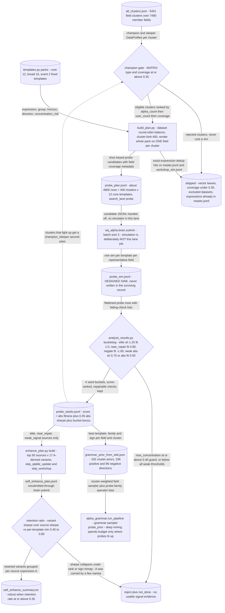

# Probe -> Seed -> A-Derived Enhance

*One fixed operator pack per field cluster - map where signal lives before spending grammar or LLM mining budget.*

[&larr; back to the pipeline overview](../../README.md)

The bet is that sim slots, not ideas, are the scarce resource, so breadth-first mapping beats depth-first mining. Rather than letting the grammar sample 5451 field clusters uniformly, this lane spends one representative field per cluster against a frozen 12-template operator pack covering level, direction, horizon and normalization, then converts the resulting Sharpe/fitness pattern into a soft prior over fields, probe families and signs that biases - never hard-prunes - downstream grammar sampling. Its second half applies the same logic to a single discovered alpha A: wrap A in rank, sign and power remaps and keep A only if its Sharpe survives as a ratio of the original, which separates genuine signal enhancement from raw mining and from parameter fiddling.

## Pipeline



## Stages

| Stage | Implementation | What it does |
|---|---|---|
| Cluster to representative | `alpha_probe/build_plan.py:_representatives` | champion gives one field per cluster, maximizing breadth per sim; champion_sleeper is the second pass |
| Eligibility and balance | `alpha_probe/build_plan.py:build_plan` | MATRIX only, coverage >= 0.35, dataset round-robin so no single dataset eats the 400-cluster limit |
| Fixed operator pack | `alpha_probe/templates.py` | 12 declarative core templates rendered on each leaf; broad adds 4 repair/stability, event adds 2 high-concentration probes |
| Pre-sim dedup | `alpha_probe/build_plan.py:_known_expressions` | exact expression dropped if already present in master.jsonl or workshop_sim.jsonl; no sim slot re-spent |
| Simulation handoff | `wq_alpha/brain/submit.py` | lane owns no simulator and no artifacts dir by design; plans go to the shared Brain submitter |
| Seed bucketing | `alpha_probe/analyze_results.py:_classify` | elite / near_repair / negate_seed / weak_signal, with a max_concentration >= 0.40 guard zeroing the score |
| A-derived enhancement | `alpha_probe/enhance_plan.py:build_candidates` | 5 robustness remaps plus 12 self-enhance variants wrapped around a single signal A, expression-only |
| Retention ranking | `alpha_probe/enhance_plan.py:summarize_records` | ranks sources by retention ratio against source sharpe, not by standalone optimization of the variant |

## Running it

```bash
python -m alpha_probe.build_plan --clusters alpha_grammar/artifacts/all_clusters.json --out artifacts/probe/probe_plan.jsonl --pack core --representatives champion --cluster-limit 400
```

## Outcome

Built, wired, and labelled "Active prior-building lane" in PIPELINE.md:82; its empirical output is a prior, not alphas. The one surviving artifact is artifacts/probe/grammar_prior_from_wiki.json - 332 cluster_priors rows with field, probe_family, preferred_direction (236 positive, 96 negative) and prior_score, generated 2026-06-13 - consumed by alpha_grammar.probe_prior.ProbePriorGrammarSampler via `run_pipeline --grammar-sampler probe_prior` and by wq_alpha/workshop/probe_cards.py for semantic-workshop probe gating. Honest caveat: the probe grid itself was never spent in the surviving record. There is no artifacts/probe/probe_sim.jsonl and no artifacts/enhance/ directory at all, and grepping for the lane's tags returns zero hits across artifacts/sim/master.jsonl (223 MB), master.jsonl.bak (164 MB) and every other JSONL in the repo - no `"probe:` template_id rows and no `a_derived_variant` params rows. The prior is currently back-filled from the wiki posterior instead, which PIPELINE.md:150 describes as "grammar prior export (revives the probe-prior lane)", i.e. the probe-shaped prior survived the June 2026 disk failure but the probe simulations did not. Thresholds are therefore design-time choices (analyze_results.py defaults 0.70 abs sharpe / 0.50 abs fitness / 0.80 near-fitness / 0.40 concentration; enhance min retention rate 0.35), not calibrated hit rates.

