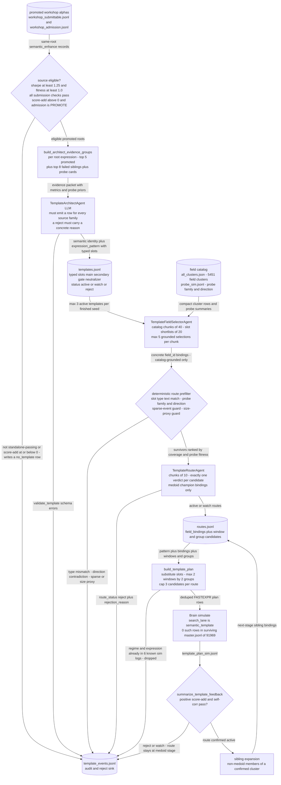

# Semantic Templates - typed reuse of promoted alphas

**Abstract alphas that already passed into typed-slot templates, then let an architect/selector/router trio bind new fields into the slots.**

[&larr; back to the pipeline overview](../../README.md)

This is the exploit half of the explore/exploit split: grammar discovery searches structure at random, this lane takes only families that already cleared the submission and admission bars and asks what is reusable about them. The bet is that the transferable asset is a *semantic identity plus typed field roles* - "ranked revision momentum, neutralized within a peer group" - not the literal FASTEXPR string, so the LLM is confined to writing templates and binding fields and is never allowed to emit a final candidate. Every expansion is deliberately bounded (medoid field first, 2 windows, 2 groups, 3 candidates per route) so that reuse cannot degenerate into the parameter sweep the repo bans elsewhere.

## Pipeline



## Stages

| Stage | Implementation | What it does |
|---|---|---|
| 1. Source eligibility | `alpha_enhancement/semantic_templates/handoff.py` | Only same-root alphas that are standalone-passing, score-additive and admitted PROMOTE become template sources. |
| 2. Evidence packing | `alpha_enhancement/semantic_templates/core.py` | Groups records by root expression: top 5 promoted, top 8 failed siblings, probe cards per field. |
| 3. Architect | `alpha_enhancement/agents/semantic_templates.py` | LLM writes semantic identity plus expression_pattern with typed slots, invalid mutations, overfit risk. |
| 4. Field selection | `alpha_enhancement/semantic_templates/core.py` | Selector LLM binds concrete field ids from chunked catalog of 5451 clusters plus slot shortlists. |
| 5. Route gating | `alpha_enhancement/semantic_templates/core.py` | Deterministic prefilter rejects on slot type, probe direction, sparsity, size proxy; router LLM confirms. |
| 6. Plan render | `alpha_enhancement/semantic_templates/core.py` | Substitutes slots into FASTEXPR, caps 2 windows by 2 groups by 3 candidates, dedups vs 6 sim logs. |
| 7. Simulate | `core/brain/submit.py` | Plan rows go to Brain tagged search_lane semantic_template; results land in template_plan_sim.jsonl. |
| 8. Feedback | `alpha_enhancement/semantic_templates/core.py` | Per route verdict active, watch or reject; only active medoid routes unlock sibling-field expansion. |

## Running it

```bash
Command is valid (tools/ resolves as a PEP-420 namespace package; verified `--help` works and all of --max-roots/--candidate-limit/--chunk-size/--max-windows/--max-groups/--max-candidates-per-route exist). But it contradicts the lane's own stage 6 text, which says the caps are '2 windows by 2 groups by 3 candidates' -- those are the argparse DEFAULTS. Either run with defaults or change stage 6 to say 1x1x1.
```

## Outcome

Built and wired, but empirically unevidenced. PIPELINE.md and README.md both file it as "Optional: Semantic Template Expansion" / "Active template lane", and it is default-on inside the semantic workshop runner (`alpha_enhancement/workshop/semantic.py` sets `semantic_template_auto=True`, handing off after every finished seed). Yet no output survives: `artifacts/semantic_templates/` does not exist, `artifacts/semantic_workshop/` does not exist, and `grep -c '"semantic_template"'` over the restored 223MB / 91969-record `artifacts/sim/master.jsonl` returns 0 - the only lane tags present are grammar (17.3k of a 20k-line sample), sweep, screen, repair, core, enhance, bottomup, negate, manual. Its pilot harness `tools/test_semantic_template_loop.py` points at `artifacts/probe_semantic_ab/20260512T200632Z/summary.jsonl`, which was lost in the June 2026 disk failure, so the one recorded pilot is unreproducible. Also note its two upstream seed files on disk are 0 bytes (`workshop_submittable.jsonl`, `new_templates.jsonl`); only the `_recent` copies hold rows. Separately: `shared/discovered_templates.json` (836KB, 27348 lines) is an ORPHAN, not this lane's input - every producer lives in `legacy/` (`legacy/tools/mine_sim_templates.py`, `legacy/tools/generate_field_probes.py`, `legacy/alpha_discovery/grammar_method/template_extractor.py`), no active module reads the path, and PIPELINE.md:463 states "Mechanical template extraction into shared/discovered_templates.json has been removed."

