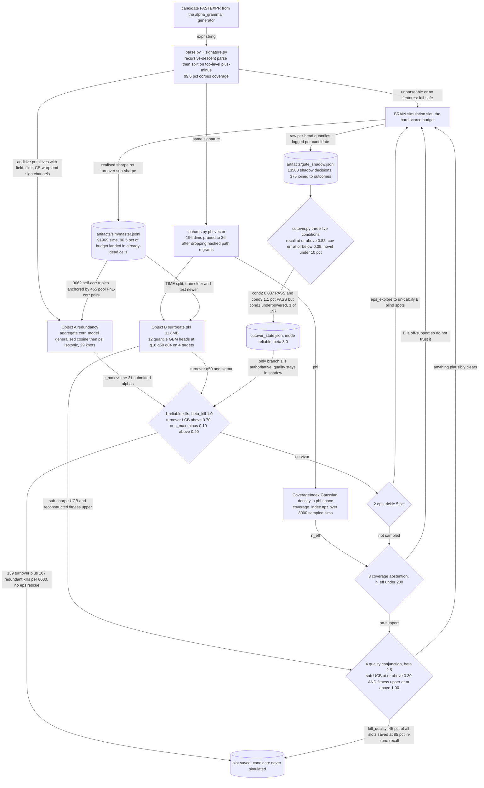

# Sim-slot gate: predict before spending a backtest

*Sim-free pre-screen that decides simulate-or-skip per candidate, validated out-of-time against the incumbent pruner before any cutover.*

[&larr; back to the pipeline overview](../../README.md)

A BRAIN simulation slot is the hard scarce resource and there is no cheaper partial-sim probe, so the only lever is predicting, sim-free, whether a candidate deserves a slot. A measurement over 84,717 historical sims (dedup.md) showed the waste is not duplication at all — only 7.9% of (skeleton, field-set) cells ever recur, but 90.5% of the budget goes to cells history already proved dead — so the fix is a predictive prune, not a stricter blocklist. The lane therefore builds two independent objects, an analytic redundancy distance and a calibrated quantile surrogate, and gates on their *intervals* so that hardness widens the interval and routes the candidate to simulate: skipping a good alpha is the expensive error, wasting a slot is cheap.

## Pipeline



## Stages

| Stage | Implementation | What it does |
|---|---|---|
| Parse and decompose | `alpha_metric/parse.py + alpha_metric/signature.py` | Hand-written recursive-descent FastExpr parser; split under top-level plus-minus into additive primitives. 99.6% corpus coverage. |
| Behavioural channels | `alpha_metric/fields.py + filters.py + channels.py` | Open-vocab 48-dim field embedding, TS-operator magnitude response, CS-warp monotonicity, sign orientation per primitive. |
| Object A redundancy | `alpha_metric/aggregate.py + calibrate.py + redundancy.py` | Generalised cosine corr_model, then isotonic psi mapped to realised PnL-corr, giving c_max against the 31-alpha book. |
| Object B surrogate | `alpha_metric/features.py + surrogate.py` | 36-dim phi into 12 quantile GBM heads on subsharpe, sharpe, ret, turnover; fitness reconstructed not regressed. |
| Coverage density | `alpha_metric/redundancy.py CoverageIndex` | Gaussian kernel density of phi over the sim index; n_eff below 200 means B extrapolates, so simulate. |
| The gate | `alpha_metric/gate.py` | Four ordered branches: reliable kills, eps trickle, coverage abstention, quality conjunction. Every default is simulate. |
| Offline validation | `alpha_metric/verify.py + backtest.py` | Time-split assumption tests and the budget frontier swept over beta, plus the robustness floor with B disabled. |
| Rollout and guard | `alpha_metric/champion_challenger.py + shadow.py + cutover.py` | Race the incumbent q-table out-of-time, log-only shadow in the live pipeline, three-condition cutover with auto-rollback. |

## Running it

```bash
python -m alpha_metric.verify all                       # rebuild the time-split frontier into test_results/
python -m alpha_metric.champion_challenger              # q-table vs surrogate, out-of-time
python -m alpha_grammar.run_pipeline --fields-csv all_fields.csv --rounds 4 --n-samples 390 --budget 10 --batch-size 3 --credentials brain2.txt --gate-mode auto
python -m alpha_metric.cutover --beta 3.0               # live 3-condition status; --apply to flip to full; `rollback` for the kill-switch
```

## Outcome

Built and validated, partially live. Per CALIBRATION_REPORT.md (2026-06-19): structure does predict future quality — time-split rank-IC 0.296 on the median Sharpe head, 0.332 after pruning hashed phi features, with 4.77x top-decile lift over a 7.6% base rate, and it transfers across the biggest regime shift in the data. Held-out quantile coverage is within ~0.02-0.035 of nominal on all four heads (surrogate_coverage.json: 0.831/0.834/0.836/0.832 at the 0.84 level), which is the acceptance test the design actually chose over R-squared. Authoritative TIME-split budget backtest (test_results/G3_budget_backtest_timesplit.json, n=6000, base good 7.6%): beta=2.0 saves 71% of slots at 67% quality-zone recall; the shipped default beta=2.5 saves 45% at 85% in-zone recall (0.91 post-prune, G3_postprune.json); beta=3.0 saves 20% at 93%. NOTE a correction the lane made on itself: the widely-quoted "71% saved at 91% recall" pairing came from a RANDOM-split backtest and was retracted as temporal leakage — the default beta was raised 2.0 to 2.5 as a result. Robustness floor verified: with B's quality branch zeroed, good_killed_quality = 0 and reliable-kills-only still saves 5% at 79% recall, so it fails safe. Champion/challenger (test_results/champion_challenger.json, n=77,785 scored, base good 7.4%) found the incumbent q-table quality pruner effectively INERT — 9 of 8987 L1 buckets and 19 of 22640 L2 buckets prune, 0% slots saved at the production threshold, exactly the dedup.md failure mode — while the challenger reaches 38% saved at 92% recall and, on disagreement cells, skips 2,790 bad alphas vs the champion's 336 (McNemar chi-sq = 1816, p ~ 0). Live rollout is honest and incomplete: 13,580 shadow decisions logged to artifacts/gate_shadow.jsonl, 375 joined to realised outcomes; cond2 calibration 0.037 PASS and cond3 novelty 1.1% PASS, but cond1 quality-zone recall is underpowered (1 in-zone good observed against ~197 needed for h=0.04), so cutover_state.json still reads mode=reliable — the behavioural-dedup c_max and turnover hard-kills are authoritative, the quality surrogate is still shadow-only. It was never trusted on faith.

