# Theory-First Lane: Pre-Registered Mechanism Cards

*An LLM pre-registers a mechanism card, a deterministic enumerator renders the designed family, a Beta posterior issues the verdict. Rigorous — and it lost.*

[&larr; back to the pipeline overview](../../README.md)

The bet: alpha discovery fails because of multiple testing, so borrow clinical-trial discipline. An LLM "economist" proposes a falsifiable mechanism card — counterparty, friction, horizon band, operator families, slotted motif skeletons — before seeing any result, and crucially never writes an expression; a deterministic enumerator renders a bounded, coverage-stratified family from the grammar vocabulary, so the family is a designed experiment rather than an LLM-cherry-picked sample. Evidence is then scored at the family level with a Beta posterior per mechanism, and promotion takes the MEDIAN-robustness member, which structurally forbids the max-sharpe spike that makes most alpha research irreproducible.

## Pipeline

```mermaid
flowchart TD
    CTX[("Context assembly: cluster catalog with crowding stats, wiki posterior pages, mechanism index, falsified graveyard, Q-table saturation map")]
    PROP["economist.py plus theory_propose.md<br/>10 pre-registered mechanism cards per round<br/>the LLM writes NO expressions"]
    DEDUP{"dedup.py: embed card, cosine vs 872 registered mechanisms<br/>below 0.60 is NEW with no LLM call, otherwise the adjudicator rules SAME or VARIANT or NEW"}
    THOMP["Thompson sample each card Beta posterior<br/>only the top 3 cards get sim budget this round"]
    ENUM["enumerate_.py deterministic slot expansion<br/>slots field, field2 to field4, w, d, group<br/>cap 400 variants per skeleton, distinct-field constraint, VECTOR fields auto-wrapped in vec_avg"]
    COV{"coverage.py dead-region prune<br/>has the grammar already proved this field and operator pair dead?<br/>8 or more tries with mean reward under 0.10"}
    FAM["Designed family of 5 to 20 members<br/>stratified so every skeleton and every declared field appears at least once"]
    CACHE[("artifacts/sim/master.jsonl, 91969 sims<br/>75.8k distinct skeleton and field-set cells, 92.3 pct of them weak<br/>also the source of the dead Q-table regions")]
    SIM["BRAIN simulation on the brain2 discovery pool<br/>first wave of 5 then the rest, 3 concurrent sims max per account"]
    VERD{"family.py family-level verdict<br/>a member supports when oriented sharpe exceeds 0.5, minimum 5 members<br/>thresholds pre-registered, never tuned after seeing results"}
    GRAVE[("mechanisms.jsonl registry: 872 cards, Beta posteriors, 197 FALSIFIED<br/>plus first-class wiki what-failed sections")]
    REFINE["theory_refine.md, exactly ONE refine round<br/>narrow, shift the horizon or swap operators; widening to chase the best member is banned"]
    PROMO["Promote 3 MEDIAN-robustness submittable supporters<br/>never the max-sharpe spike, which is treated as a multiple-testing artifact"]
    DROP["Discarded with zero sim slots spent"]
    BRAIN["tools/promote_to_brain.py: re-sim 88 queued winners on the competition account with self-correlation and score-addition gates active"]
    OUTCOME["EMPIRICAL VERDICT, lane retired<br/>49 of 327 families validated, a flat 15 pct that never improved as the registry grew<br/>winners redundant: theory_0268 self-corr 0.67 and brain score delta -161<br/>decompose-expand sibling scored 0 of 100 submittable vs grammar 5 pct"]

    CTX -->|"candidate clusters, prior evidence, dead operator families"| PROP
    PROP -->|"card: hypothesis, why_it_exists, cluster_ids, direction, horizon band, motif skeletons with typed slots"| DEDUP
    DEDUP -->|"SAME as an already FALSIFIED card: rejected, a dead theory cannot re-enter under new wording"| DROP
    DEDUP -->|"NEW, or VARIANT with a named untested dimension inheriting 50 pct of the parent Beta pseudo-counts"| THOMP
    THOMP -->|"3 cards; the rest wait for a later round"| ENUM
    ENUM -->|"rendered FASTEXPR variants, degenerate forms like subtract of x with x already dropped"| COV
    CACHE -->|"Q-table learned over 76k sims"| COV
    COV -->|"variant sits in a region the history proved dead, roughly 90 pct of historical budget bled here"| DROP
    COV -->|"surviving variants, ordered by novelty and strength"| FAM
    CACHE -->|"exact expression match: the logged result is reused as zero-cost family evidence"| FAM
    FAM -->|"uncached members only"| SIM
    SIM -->|"0 supporters in the first 5: early stop, remaining members never simulated"| DROP
    SIM -->|"per-member sharpe, fitness, turnover, yearly stats"| VERD
    VERD -->|"support rate 0.30 or below: FALSIFIED, 223 of 327 families"| GRAVE
    VERD -->|"support rate between 0.30 and 0.60: INCONCLUSIVE, 55 of 327"| REFINE
    VERD -->|"support rate 0.60 or above: VALIDATED, 49 of 327"| PROMO
    VERD -->|"posterior update: alpha plus supporters, beta plus non-supporters; retro cards capped at 3 pseudo-counts"| GRAVE
    REFINE -->|"one revised card, same mechanism, narrower scope"| ENUM
    REFINE -->|"abandonment plus a one-sentence falsification lesson"| GRAVE
    GRAVE -->|"mechanism index and graveyard fed back into the next round prompt"| CTX
    PROMO -->|"88 submittable robust winners queued"| BRAIN
    BRAIN -->|"self-correlation and score-addition results"| OUTCOME
```



## Stages

| Stage | Implementation | What it does |
|---|---|---|
| 1. Context assembly | `alpha_discovery/theory_method/context.py` | Renders candidate cluster catalog with userCount crowding, wiki evidence, mechanism index, graveyard and saturated-operator map into the prompt |
| 2. Pre-registered proposal | `alpha_discovery/theory_method/economist.py + core/prompts/theory_propose.md` | LLM emits hypothesis cards: mechanism, counterparty, direction, horizon band, operator families, slotted motif skeletons. Never an expression |
| 3. Mechanism dedup | `alpha_discovery/theory_method/dedup.py + core/prompts/theory_adjudicate.md` | Top-5 embedding cosine, then LLM ruling. SAME on a falsified card is rejected; VARIANT inherits half the parent Beta |
| 4. Budget allocation | `alpha_discovery/theory_method/runner.py` | Thompson sampling over card Beta posteriors picks the 3 cards of 10 that get simulation budget this round |
| 5. Designed family enumeration | `alpha_discovery/theory_method/enumerate_.py` | Deterministic slot expansion renders 5 to 20 expressions, stratified so every skeleton and declared field is covered at least once |
| 6. Dead-region prune | `alpha_discovery/theory_method/coverage.py` | Drops variants whose field-operator pair the grammar Q-table proved dead over 76k sims, the Q-table's pruned regions |
| 7. Simulate and family verdict | `alpha_discovery/theory_method/family.py` | Wave of 5 with early stop on zero support, then VALIDATED, FALSIFIED or INCONCLUSIVE plus Beta posterior update |
| 8. Median promotion and brain re-sim | `alpha_discovery/theory_method/family.py + tools/promote_to_brain.py` | Three median-robustness submittable members queue to the competition account for self-correlation and score-addition re-simulation |

## Running it

```bash
python tools/theory_lane.py --rounds 0 --n-theories 10 --max-simulated 3 --batch-size 3 --credentials brain2.txt   # dry-run first: python tools/theory_lane.py --dry-run --n-theories 5
```

## Outcome

Negative result, documented honestly. `artifacts/theory/theories.jsonl` holds 327 family verdicts: 49 VALIDATED, 223 FALSIFIED, 55 INCONCLUSIVE — a 15 pct family-validation rate that stayed flat as the mechanism registry grew to 872 cards (197 of them falsified). The grammar lane's 1.74 pct submittable yield beat it, and the few theory winners were portfolio-redundant rather than additive: theory_0268 came back at self-correlation 0.67 with brain_score_delta -161 (cited in dedup.md, Stage 2 section). The decompose-and-expand variant of the same idea — LLM reads a proven robust alpha and re-routes the edge through other fields (`core/prompts/theory_decompose.md`, `tools/decompose_test.py`) — scored 0 of 100 submittable on brain, median sharpe 0.12 against seeds at ~2.2, with 71 pct pure noise. The measurement in dedup.md explains why: 92.3 pct of the 75.8k (skeleton, field-set) cells in the 84717-record measured slice are weak and only 5.8 pct contain a submittable winner, so a card scoring "100 pct novel" is by construction 100 pct inside the dead mass. Novelty and signal are in direct tension. Lesson recorded: an alpha's edge is a specific field-by-structure interaction, not a portable abstract mechanism, so put the intelligence in SELECTION, not GENERATION.

## Retired because

LLM-as-generator was falsified empirically on real BRAIN sims (June 2026). The a-priori card lane validated a flat 15 pct of families (49/327) and the decompose-expand variant went 0/100 submittable, both losing to grammar search's ~5 pct submittable yield; its winners were also correlated with the existing portfolio (theory_0268: self-corr 0.67, brain_score_delta -161). Root cause measured in dedup.md: 92.3 pct of structure-by-field cells in the 84717-record measured slice are dead, so a narrative-driven "novel" proposal lands in the dead mass almost by definition. The machinery that survived into the active lanes is the selection half — coverage.py dead-region pruning, the mechanism graveyard, and family-level rather than member-level verdicts — which became the kNN dead-zone prune and the alpha_discovery/sim_slot_gate sim-slot gate.

