# Theory-First Economic Search (retired)

*LLM proposes a falsifiable economic mechanism and writes the FASTEXPR itself; a SQLite novelty index rations sim slots. 2531 sims, 1 passer.*

[&larr; back to the pipeline overview](../../README.md)

The bet: the scarce resource in alpha discovery is economic imagination, not search throughput. If an LLM pre-registers a hypothesis card - mechanism, expected sign, horizon, kill and expand criteria - and then writes the FASTEXPR for it, each simulation slot buys a falsifiable experiment instead of a lottery ticket. Everything in the lane is shaped to protect that premise: a read-only SQLite index over 23891 prior sims so novelty is proven before slots are spent, a submitted-portfolio context so proposals avoid incentives the account already owns, deterministic validation so the LLM's syntax never reaches Brain, and a cost-controlled semantic critic that scores candidates in one batched call per theory while deterministic code - never the LLM - makes the simulate-or-quarantine decision. The LLM is the generator; the code is the referee.

## Pipeline

```mermaid
flowchart TD
    LOGS[("Brain sim history<br/>master.jsonl + workshop_sim + llm_sim + ranked")]
    IDX["history_index.py<br/>read-only scanner"]
    SQL[("history_index.sqlite 22MB<br/>23891 records - 1542 standalone passers")]
    CTX["portfolio_context.py + field_catalogs.py<br/>submitted alphas + delay-aware field catalog"]
    PROP["TheoryProposerAgent<br/>claude-opus-4-7 max_tokens 12000"]
    CRIT{"NoveltyCriticAgent + deterministic jaccard critic"}
    STORE[("artifacts/theories<br/>217 theory dirs + memory_delay.md")]
    GEN["LLMExpressionGenerator<br/>the LLM WRITES the FASTEXPR"]
    VAL{"ExpressionValidator<br/>banned ops - dup vs history - skeleton quota"}
    SEM["semantic_gate.py<br/>top-12 kNN from SQLite then ONE batched LLM scorecard call per theory"]
    ROUTE{"deterministic routing on similarity 0-100"}
    PLAN[("candidate_plans<br/>38 plan jsonl files")]
    SIM["brain_submit.py<br/>2531 Brain simulations"]
    CHK{"Brain checks<br/>sharpe 1.25 - fitness 1.0 - turnover - sub-universe - weight"}
    ADJ{"DeterministicResultInterpreter<br/>best sharpe under 0.8 means KILL"}
    DEAD[("dead ends<br/>76 KILLED branches - 18 quarantined - 0 PROMOTED")]

    LOGS -->|"raw sim rows from 4 lanes"| IDX
    IDX -->|"fields - skeletons - failed checks per row"| SQL
    SQL -->|"history_summary + hot fingerprints"| PROP
    CTX -->|"owned operators and datasets to avoid"| PROP
    PROP -->|"217 hypothesis cards - mechanism - expected sign - kill criteria"| CRIT
    CRIT -->|"REJECT 36 and REVISE 39 - re-propose"| PROP
    CRIT -->|"ACCEPTED 132"| STORE
    STORE -->|"theory card + prior results + branch decision"| GEN
    GEN -->|"up to 60 raw FASTEXPR strings per theory"| VAL
    VAL -->|"53 of 2994 rejected - 28 missing required dataset - 22 unknown field<br/>one repair re-prompt with the validation report"| GEN
    VAL -->|"2941 accepted - minimum 4 distinct operator skeletons"| SEM
    SEM -->|"similarity scorecards - median 38 of 100"| ROUTE
    ROUTE -->|"score under 65 - 2832 accepted outright"| PLAN
    ROUTE -->|"score 65 to 85 - 15 percent soft quota - 14 kept"| PLAN
    ROUTE -->|"score over 85 or quota exhausted - 18 quarantined"| DEAD
    PLAN -->|"expression + settings_override.delay"| SIM
    SIM -->|"1611 completed sims matched back by expression and delay<br/>1 passed ALL checks - median sharpe 0.08 - 60 percent under 0.5"| CHK
    CHK -->|"per-theory metrics and standalone passers"| ADJ
    ADJ -->|"ITERATE 26 or EXPAND 5 - next generation round"| GEN
    ADJ -->|"KILL 76 - PROMOTE 0"| DEAD
```



## Stages

| Stage | Implementation | What it does |
|---|---|---|
| 1. Index history | `legacy/alpha_discovery/legacy.economic_search_method/history_index.py` | Read-only scan of 4 sim logs into a SQLite novelty index: 23891 records, fields, skeletons, failed-check counters. |
| 2. Build context | `legacy/alpha_discovery/legacy.economic_search_method/portfolio_context.py` | Fetch submitted alphas and a delay-aware field catalog so proposals avoid economic incentives the account already owns. |
| 3. Propose theories | `legacy/alpha_discovery/legacy.economic_search_method/llm_agents.py` | Opus writes hypothesis cards: mechanism, data roles, expected sign, horizon, kill and expand criteria. 217 proposed. |
| 4. Critique for novelty | `legacy/alpha_discovery/legacy.economic_search_method/critique.py` | Deterministic jaccard risk report plus LLM verdict. 132 ACCEPT, 39 REVISE, 36 REJECT; rejects loop back to propose. |
| 5. Write expressions | `legacy/alpha_discovery/legacy.economic_search_method/expression_generation.py` | LLM emits concrete FASTEXPR per theory in probe, iterate or expand mode, with one repair re-prompt allowed. |
| 6. Validate deterministically | `legacy/alpha_discovery/legacy.economic_search_method/expression_validation.py` | Banned and unknown operators, dup vs history, window-only variants, skeleton quota. Only 53 of 2994 rejected. |
| 7. Semantic novelty gate | `legacy/alpha_discovery/legacy.economic_search_method/semantic_gate.py` | Top-12 kNN from SQLite, one batched LLM scorecard call per theory, code routes at 65 and 85 with 15 percent soft quota. |
| 8. Simulate and adjudicate | `legacy/alpha_discovery/legacy.economic_search_method/brain_submit.py` | 2531 Brain sims; results ingested per theory branch; fixed stopping rules emit PROMOTE, EXPAND, ITERATE or KILL. |

## Running it

```bash
cd legacy && python -m alpha_discovery/legacy.economic_search_method.cli sprint --delay 0 --n 10 --max-candidates-per-theory 12 --simulate --credentials ../brain.txt --sprint-focus "..."    # no top-level alpha_discovery/legacy.economic_search_method/ package. The `sprint` subparser (cli.py:1325) and every flag listed DO exist, so this is purely a missing cd.
```

## Outcome

Ran 2531 Brain simulations across 107 theory branches (artifacts/continuous/*_sim.jsonl plus economic_delay0/1_probe_sim.jsonl). Of the 1611 that completed, exactly 1 passed every Brain check (0.06 percent); median IS Sharpe was 0.08, 60 percent of sims were pure noise with absolute Sharpe under 0.5, and only 5.2 percent cleared the Sharpe 1.25 bar even ignoring the other checks. Branch adjudication across the 217 dirs in artifacts/theories (decision_delay*.json) was 76 KILL, 26 ITERATE, 5 EXPAND, 0 PROMOTE - no theory ever produced a standalone passer with positive marginal portfolio contribution. The decisive finding is that the gates were not the bottleneck: the deterministic validator rejected only 53 of 2994 LLM-written expressions (1.8 percent) and the semantic gate quarantined 18 of 2941 (0.6 percent, median similarity 38 of 100), so roughly 98 percent of what the LLM wrote was well-formed AND certified novel AND still carried no signal. Grammar search over the same account yields 1.74 percent submittable, so this lane underperformed the dumb generator by two orders of magnitude. PIPELINE.md records the architectural correction (lines 192-194): in the successor alpha_discovery/theory_method/ the LLM declares clusters, operators, horizons and skeletons but never final expressions.

## Retired because

LLM-written expressions were well-formed and certified novel but empirically dead: 1 of 1611 completed sims passed all Brain checks, and 0 of 107 adjudicated theory branches reached PROMOTE while 76 were KILLed on the best-Sharpe-under-0.8 rule. The falsification is that novelty and signal are in direct tension - roughly 92 percent of skeleton-by-field-set cells in the sim history are dead, so a high novelty score mostly certifies that a candidate sits in the dead mass. An alpha's edge is a specific field-by-structure interaction, not a portable abstract mechanism, so the LLM's economic story is a plausible post-hoc narrative and routing it into fresh fields keeps the story while dropping the thing that worked. The successor alpha_discovery/theory_method/ keeps the pre-registered hypothesis card and the mechanism registry but removes the LLM from expression writing: it declares clusters, operators, horizons and skeletons and the grammar enumerator builds the FASTEXPR, with the intelligence moved from generation into selection.

