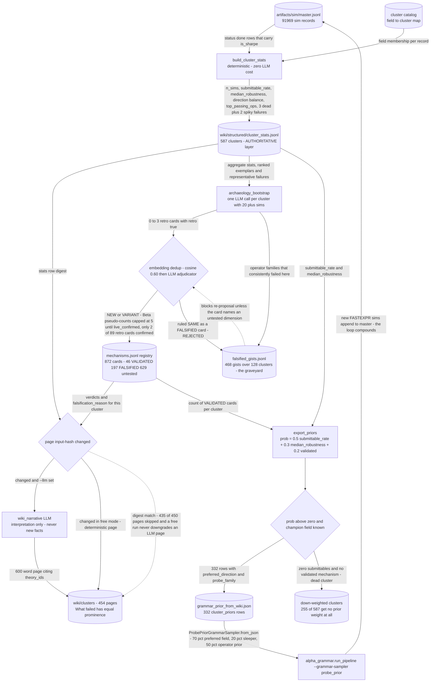

# Wiki Posterior and the Compounding Grammar Prior

*Every simulation, win or failure, folds into a per-cluster posterior that is exported back as the grammar lane's sampling prior.*

[&larr; back to the pipeline overview](../../README.md)

Search budget is the scarce resource, so the system is built to never pay twice for the same negative result. Every finished simulation is aggregated into a per-field-cluster evidence row, falsified mechanisms are stored with equal prominence to validated ones, and the resulting posterior is re-exported as a numeric prior that re-weights field and operator sampling in the grammar lane. A cluster that has been proven dead therefore loses grammar weight automatically, which is what makes the loop compound rather than repeat itself.

## Pipeline



## Stages

| Stage | Implementation | What it does |
|---|---|---|
| 1. Aggregate (free) | `wq_alpha/wiki/generate.py:77 build_cluster_stats` | Folds every done sim record into one evidence row per field cluster: rates, robustness, direction balance, exemplars. |
| 2. Keep failures first-class | `wq_alpha/wiki/generate.py:145 failure_examples` | Each row carries 3 dead signals plus 2 spiky check-failers as explicit falsification evidence. |
| 3. Incremental narrative gate | `wq_alpha/wiki/generate.py:328 generate_wiki, wiki/.state.json` | Input-hash digest skips unchanged pages; a free run never overwrites an existing LLM page. |
| 4. Narrate one cluster | `wq_alpha/prompts/wiki_narrative.md` | LLM reads only the structured row and registry entries; What failed section is mandatory, no new facts allowed. |
| 5. Archaeology induction | `tools/archaeology_bootstrap.py, prompts/archaeology_cluster.md` | One call per high-evidence cluster induces 0-3 retro mechanism cards plus falsified gists; zero cards is acceptable. |
| 6. Graveyard and dedup | `wq_alpha/theory/dedup.py:212 adjudicate` | Cosine 0.60 then adjudicator; a card ruled SAME as a FALSIFIED mechanism is rejected, not re-tested. |
| 7. Retro stays a prior | `wq_alpha/theory/family.py:137 update_beta` | Retro cards keep total Beta pseudo-counts capped at 5 until a live family validates them. |
| 8. Export prior to grammar | `wq_alpha/wiki/generate.py:438 export_priors, alpha_grammar/probe_prior.py` | Blends quality rate, robustness and validated count into one cluster probability that reweights grammar field and operator sampling. |

## Running it

```bash
python tools/build_wiki.py --llm --export-priors --min-sims 10
python tools/archaeology_bootstrap.py --min-sims 20
```

## Outcome

Empirically the lane is a falsification engine first and a generator second. From 91,969 master sim records it produced 587 clusters with evidence and 454 narrative pages (wiki/index.md header: "mechanisms: 872 (46 validated, 197 falsified), clusters with evidence: 587"), i.e. falsified mechanisms outnumber validated ones 4.3 to 1 and 468 falsified gists over 128 clusters now sit in the graveyard blocking re-proposal. The posterior separates clusters sharply: model16 earnings-sustainability got 740 sims for 0 submittables while analyst4 revision clusters hit 0.30-0.36 submittable rates with median robustness 0.455-1.0, and export_priors turns that into 332 prior rows (probability 0.0135 to 0.689) while 255 of 587 clusters are dropped to zero grammar weight entirely. Archaeology confirms the governing retro-as-prior rule rather than contradicting it: of 89 retro cards registered, only 2 ever earned live_confirmed, which is why PIPELINE.md states "Retro (archaeology) theories are PRIOR, not posterior: they need a live confirmation family before VALIDATED" and why family.py caps retro Beta pseudo-counts at 5. Note the honest caveat recorded in the grammar lane's own argparse help: the cluster catalog covers only about 7 percent of the live field universe, so the default sampler is uniform and the wiki prior is opt-in via --grammar-sampler probe_prior.

