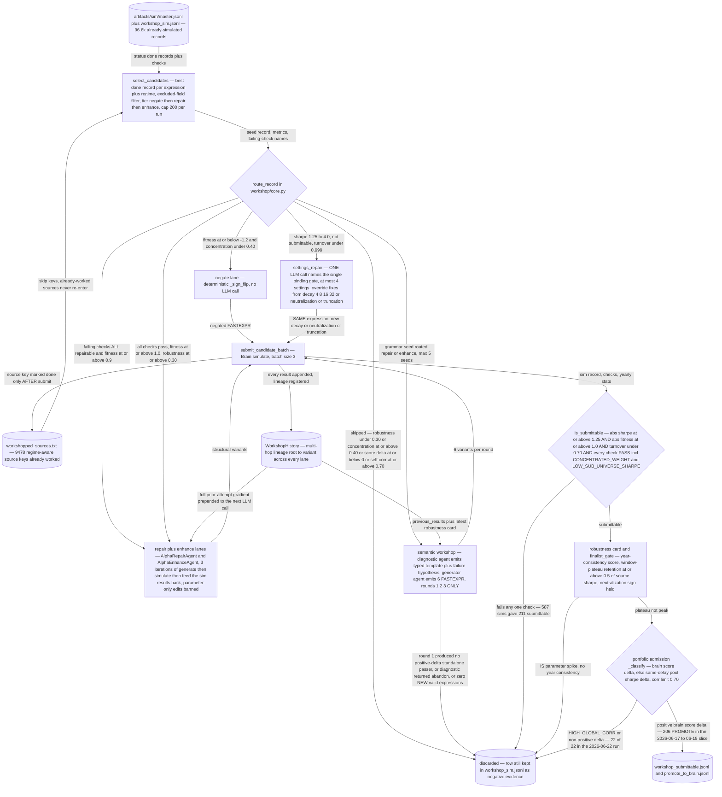

# Workshop: Negate, Repair, Enhance a Measured Alpha

*The LLM never invents from scratch here. It repairs an alpha that already has a measured backtest and a named failing check.*

[&larr; back to the pipeline overview](../../README.md)

Discovery lanes produce alphas with a *diagnosis attached* — a Sharpe, a turnover, and a specific failing submission check. The bet of this lane is that an LLM handed that evidence is a good repair engine even though it is a bad generator: 587 workshop sims produced 211 submittable (36%), while the same model proposing mechanisms from scratch produced 0/100. So the lane is shaped as a router, not a generator — `core.py:route_record` reads the metrics and sends each already-simulated record to the cheapest remedy that fits its defect (deterministic sign flip, settings-only fix, or structural LLM rewrite), and every proposal must re-clear the full submittable gate by re-simulation, never by argument.

## Pipeline



## Stages

| Stage | Implementation | What it does |
|---|---|---|
| 1. Select sources | `alpha_enhancement/workshop/batch.py:select_candidates` | Keep highest-|Sharpe| done record per expression+regime, drop 9478 already-worked keys and excluded fields, cap 200. |
| 2. Route by defect | `alpha_enhancement/workshop/core.py:route_record` | fitness<=-1.2 to negate; repairable failing checks + fitness>=0.9 to repair; all-pass + fitness>=1.0 + robustness>=0.30 to enhance. |
| 3a. Negate | `alpha_enhancement/workshop/repair.py:_sign_flip` | Deterministic sign flip of a strongly-negative alpha. No LLM, no cost. Blocked when concentration >= 0.40. |
| 3b. Settings repair | `tools/settings_repair.py + core/prompts/settings_repair.md` | One LLM call diagnoses the binding gate, returns <=4 settings_override fixes. Expression untouched, so execution-neutral. |
| 3c. Structural repair/enhance | `alpha_enhancement/agents/repair.py, alpha_enhancement/agents/enhance.py` | 3 rounds of generate then simulate then feed the sim verdict back. Parameter-only and settings-only variants rejected. |
| 3d. Semantic workshop | `alpha_enhancement/workshop/semantic.py + alpha_enhancement/agents/semantic_workshop.py` | Diagnostic agent types the signal and hypothesises the failure; generator agent emits 6 FASTEXPR. Hard 3-round cap. |
| 4. Submittable gate | `core/quality.py:is_submittable + workshop/core.py:is_passing` | Sharpe 1.25, fitness 1.0, turnover 0.70 AND every submission check PASS. Only SELF_CORRELATION and UNITS are warnings. |
| 5. Robustness then admission | `alpha_enhancement/workshop/robustness_card.py, core/portfolio/admission.py:_classify` | Perturbation retention kills IS spikes; then PROMOTE/WATCH/REJECT on brain score delta with a 0.70 global-corr veto. |

## Running it

```bash
python tools/batch_workshop.py --from-audit artifacts/workshop/workshop_audit.txt --workshop-iterations 3 --lane negate repair enhance --credentials brain.txt
```

## Outcome

This is the lane that empirically works, and the only one whose LLM calls pay for themselves. `artifacts/workshop/workshop_summary_20260620.txt` records the 2026-06-17 to 06-19 slice: 587 sims (enhance 327, repair 230, negate 30) -> 211 submittable (36%) -> 206 PROMOTE / 219 REJECT, 309 with positive score delta; the standouts were repair-lane fnd6_itci composites at Sharpe 2.1-2.3, fitness 2+. Contrast with the memory note `llm-generator-underperforms.md`: the same model proposing mechanisms from scratch went 0/100 submittable. Settings-repair is the cheapest sub-lane: 446 sims in `settings_repair_sim.jsonl` yielded 112 submittable rows in `settings_repair_submittable.jsonl` (~25%) by changing decay/neutralization alone. The honest failure mode is also on record - `artifacts/workshop/workshop_summary.txt` (2026-06-22) reads "56 simulated -> 22 standalone-passing -> 0 admission-promoted, REJECT=22", 18 of them HIGH_GLOBAL_CORR: once the workshop has mined a signal family hard, its own variants become near-duplicates of each other and the portfolio corr gate, not the alpha gate, becomes binding.

